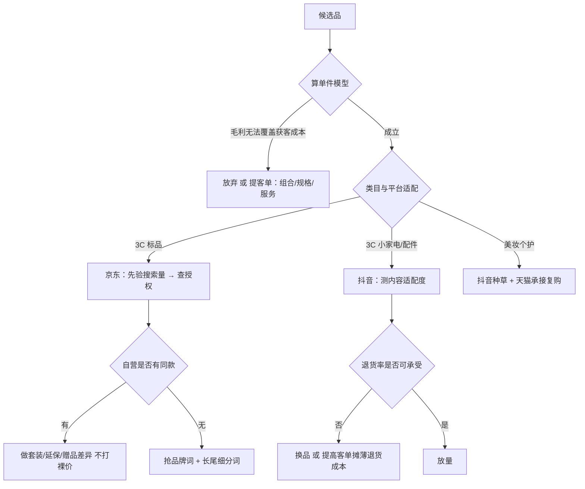
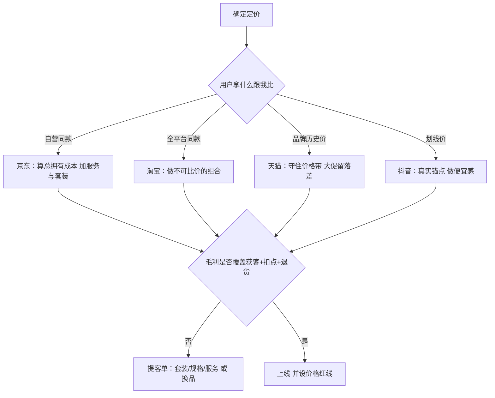
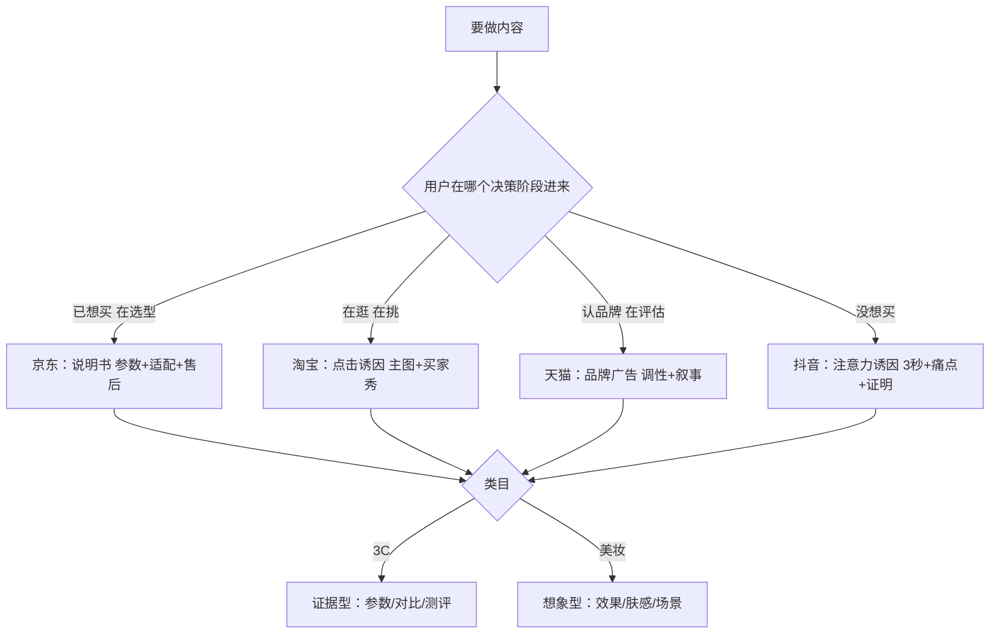
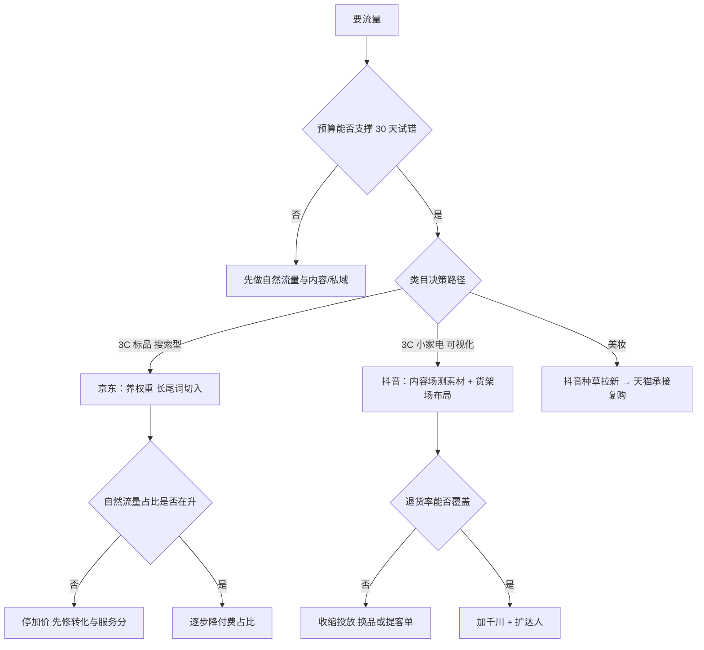
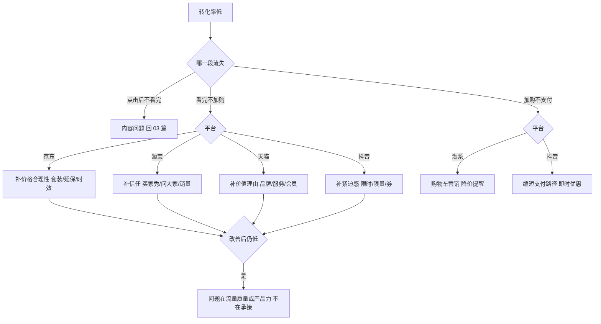
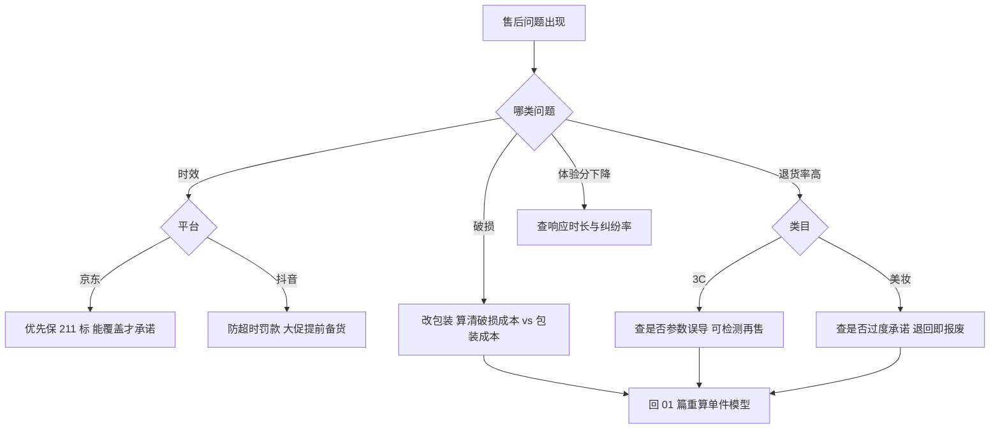
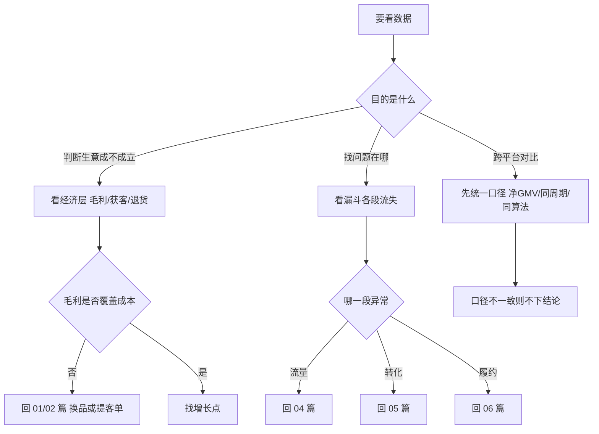
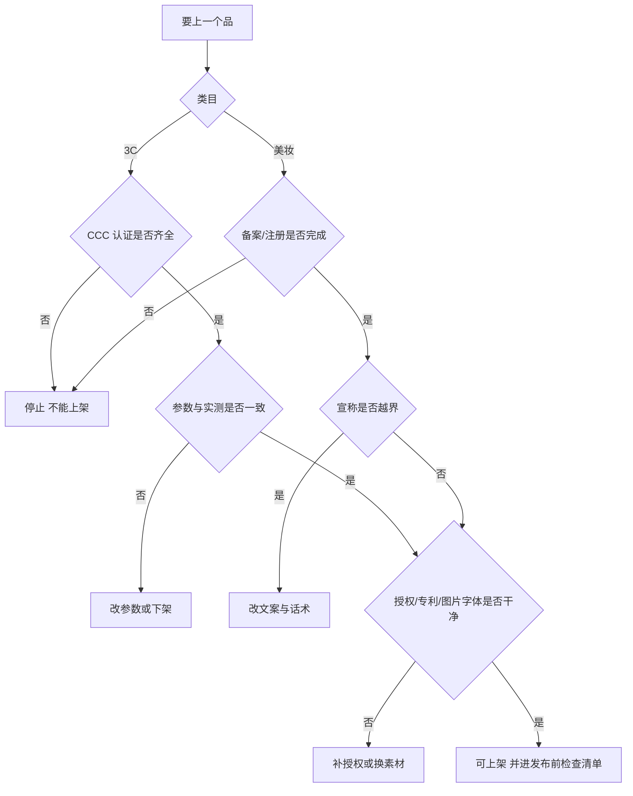
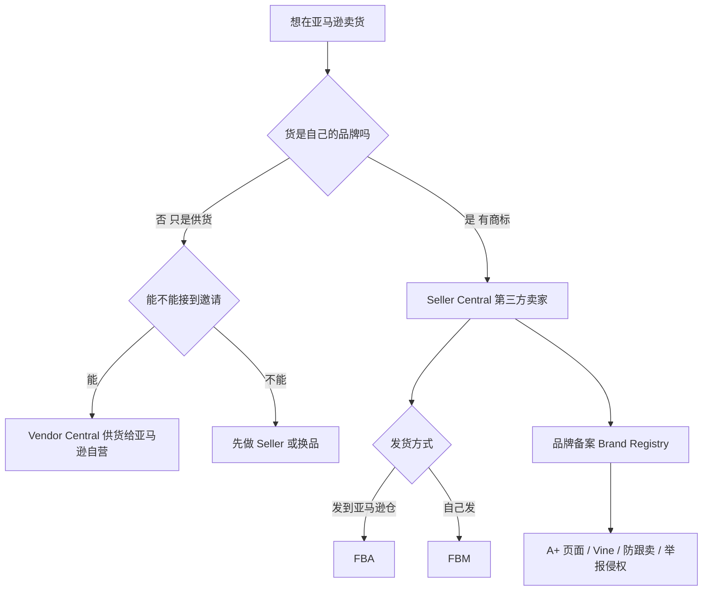

# 电商运营实操手册 · 抖音 / 淘宝 / 天猫 / 京东

> 同一门生意，四个平台四种做法。
> 这里不搬运平台规则，只记录规则之上的取舍。

---

## 这是什么

一份按**业务链路模块**组织、横向对比四个平台的运营笔记。锚定两个类目做实例：**3C 家电** 与 **美妆个护**。

主读者是我自己：换平台、换类目、换阶段时能直接查、直接套。

## 这不是什么

- **不是平台规则手册。** 官方学习中心的细则永远比我新，我从商家后台首页进学习中心，不在别处二手转述。
- **不是玩法清单。** 只列"能做什么"的文档没有决策价值，因为它不告诉你"该放弃什么"。
- **不是截图集。** 后台截图涉密、易失效、且改版即废。所有图示都是重绘的流程图、决策树与对比矩阵。

## 一个模块长什么样

每篇覆盖一个业务模块，横向切四个平台。每格固定填七个字段：

| 字段 | 说明 |
|---|---|
| 适用类目 | 3C / 美妆 / 通用 |
| 适用阶段 | 起盘期（验证模型）/ 放量期（放大）/ 规模化期（守份额） |
| 最低预算 | 跑通这件事的下限 |
| 见效周期 | 从投钱到能判断成败的时间 |
| 核心指标 | 只看一个数就能判断好坏的那个数 |
| 主要风险 | 最容易翻车的地方 |
| **停止条件** | 什么信号出现就该停手换路 |

最后一栏是这份文档和教程的分水岭。没有它，写的就是许愿池。

## 四平台底层差异

先记住机制，再记操作。操作会变，机制变得慢。

| 维度 | 抖音 | 淘宝 | 天猫 | 京东 |
|---|---|---|---|---|
| 流量主体 | 推荐分发 | 搜索 + 推荐 | 搜索 + 活动 | 搜索 + 自营推荐 |
| 用户路径 | 内容激发 → 冲动下单 | 搜索比价 → 加购 | 品牌认知 → 复购 | 参数对比 → 信任履约 |
| 核心资产 | 内容产能、达人网络 | 店铺权重、爆款群 | 品牌资产、会员 | 供应链、服务分 |
| 起量速度 | 快，但波动大 | 中 | 慢，需前置投入 | 中慢，靠积累 |
| 最大风险 | 内容合规、退货率 | 同质化价格战 | 活动依赖、毛利被摊薄 | 账期、自营同台竞争 |
| 类目适配（本文档） | 美妆强、3C 中 | 两者皆可 | 美妆强、3C 中 | **3C 强**、美妆弱 |

> 淘宝与天猫在组织上已并入淘天集团，后台工具逐步统一；但在运营逻辑上，C 店与品牌旗舰店仍是两套打法，故本文档分列。

## 目录

- 00 · 总纲：四个平台，四种流量所有权
- 01 · 选品与测款
- 02 · 货品与定价
- 03 · 内容与素材
- 04 · 流量获取
- 05 · 转化承接
- 06 · 履约与售后
- 07 · 数据与复盘
- 08 · 合规与风控
- 09 · 规则变动日志
- 10 · 亚马逊（延伸对照）

---

## 00 · 总纲：四个平台，四种流量所有权

> **一句话结论**：这四个平台不是四个渠道，而是四种流量所有权结构。你在这四个平台上的角色根本不同——京东是供应商，淘天是广告主，抖音是内容生产者。用错角色，投多少钱都白费。

---

### 一、先分清你在扮演谁

| | 京东 | 淘宝 | 天猫 | 抖音 |
|---|---|---|---|---|
| 流量归谁 | 平台（搜索 + 采销） | 平台，可竞价购买 | 平台，可竞价购买 | 算法，按内容表现分配 |
| 怎么拿到 | 供货资格 + 搜索排名 | 竞价 + 转化率换自然流量 | 竞价 + 品牌资产 | 生产内容"赚" + 千川"买" |
| 你的角色 | 供应商 | 广告主 | 品牌方 / 广告主 | 内容生产者 |
| 平台对你的考核 | 履约与服务分 | 转化率、动销 | 品牌力、活动参与 | 内容质量、完播与互动 |

这张表是整份文档的地基。后面每一篇的"为什么这么做"，都要回到这一行。

### 二、平台靠什么赚钱，就决定它要你做什么

这一节比任何操作技巧都重要。平台的收入结构，决定它把流量给谁、把规则往哪调。

**京东**：自营赚进销差价，POP 收佣金与广告。但京东的护城河是履约体验，不是广告收入。所以平台真正在意的是**时效、破损率、售后响应**——这些直接进服务分，服务分直接挂钩流量。
→ 你的重心在供应链和售后。投流技巧在这里的杠杆很小。

**淘天**：客户管理收入（广告 + 佣金）是主体。平台的利益是让你**持续买流量、持续上新**。所以自然流量越来越贵、付费占比越来越高，是结构性的，不是暂时的。
→ 你的重心在投产比测算和转化率。会算账的人才能活。

**抖音**：广告（千川）+ 佣金。平台的利益是让内容不断制造新的注意力——内容死了，广告库存就没了。
→ 你的重心在**内容产能与素材迭代速度**。这不是"顺便做做内容"，是入场券。

一句话记住：**京东拼供应链，淘天拼转化与投放效率，抖音拼内容产能。**

### 三、两段门槛：入驻门槛 ≠ 经营门槛

这是最容易混淆的一点，也是我修正得最多的一点。

| 平台 | 入驻门槛 | 真正的经营门槛 |
|---|---|---|
| 京东自营 | 极高：要成为供应商，过采销审核 | 高：供货价、产能稳定性、返点谈判 |
| 京东 POP | **低**：营业执照 + 品牌授权 + 保证金 | **高**：品牌词搜索量、账期占用、与自营同台竞争 |
| 淘宝 C 店 | 极低，可近乎零成本启动 | 中：无品牌则流量几乎全靠买 |
| 天猫 | 中高：资质审核、保证金、年费 | 高：活动资源、品牌投入、扣点摊薄毛利 |
| 抖音小店 | 低 | **高**：内容产能是硬门槛，不会做内容就没有自然流量 |

> 年费、保证金、扣点各年度政策有调整（部分类目年费已减免），一律以招商页面当期为准，本文档不写死数字。

**所以"京东要厚资本背书"这句话需要拆开看**：京东 POP 的**入驻**门槛其实不高，卡人的是**经营**门槛——京东用户品牌词搜索占比高，白牌拿不到自然搜索，只能靠付费买；再加上账期占资金、自营在旁边同台比价，小商家很难撑住。你观察到的"先在别的平台打出名气再迁到京东"，本质是**用外部品牌资产去换京东的搜索流量**，这个判断是对的。

**另外"加盟京东商标"这个说法要拆成三件事**，它们完全不同：

1. **成为自营供应商**——货挂"京东自营"标，但店铺不由你运营，运营权在采销，你负责供货和履约；
2. **京东京造**——京东自有品牌的 OEM 代工，你只是制造商；
3. **线下加盟店**（京东之家、京东专卖店等）——线下门店授权，和线上运营是两套体系。

三者门槛、权责、赚钱方式都不一样，后续写 01 选品时再展开。

### 四、人群与决策路径

| | 京东 | 淘宝 | 天猫 | 抖音 |
|---|---|---|---|---|
| 典型画像 | 目的性强、男性占比高、看重参数与售后 | 全人群、逛与比价并存 | 品牌认知型、女性占比高 | 年轻、内容驱动、冲动型 |
| 决策链 | 明确需求 → 比参数 → 认服务 | 模糊需求 → 搜索 → 比价 → 加购 | 认品牌 → 找官方 → 复购 | 刷到 → 被激发 → 下单 |
| 价格敏感 | 中（愿为时效与服务付费） | 高 | 中低 | 中，但对"便宜感"极敏感 |
| 复购驱动 | 服务与习惯 | 店铺与价格 | 会员与品牌 | 内容持续触达 |

> 具体人群数据以各平台官方数据产品为准（生意参谋、京麦商智、抖音电商罗盘），此处只写稳定的结构性判断。

### 五、反向定义：每个平台最不适合做什么

正向清单谁都会写，反向的更值钱。

- **京东**：不适合低价白牌；不适合需要内容种草才能理解的新品类（用户不逛，只搜）。
- **淘宝**：不适合无品牌的高客单（用户会比价到死）；不适合需要信任背书才能成交的品类。
- **天猫**：不适合没有品牌预算的新品牌（活动门槛、视觉与调性投入都是硬支出）。
- **抖音**：不适合高退货率且低毛利的结构（冲动下单 = 冲动退货）；不适合需要长决策链的复杂 3C，除非你有很强的测评类内容能力。

### 六、对两个类目的直接含义

**3C 家电**：京东是主场——参数决策、售后信任、时效承诺都是它的强项。天猫做承接与人群补充。抖音只做**单品爆破**（测评、场景演示、价格锚点），不做全店经营。

**美妆个护**：抖音做种草与拉新（内容是天然入口，但退货率高，毛利必须扛得住）。天猫做复购与品牌沉淀。京东做礼盒、套装、送礼场景的机会性补充——**不要把它当主战场**。

这也解释了为什么"京东第一"的排序，隐含的重心其实压在 3C 上。

### 七、规则怎么核实

平台不会公开全部细节，但这几条都能自己验证出来。**与其等一个权威答案，不如自己设一个对照实验。**

| 疑问 | 为什么重要 | 怎么自己验证 |
|---|---|---|
| 天猫年费与扣点到底是多少 | 直接决定单件毛利算不算得对 | 从后台费率说明看年费档位，再用一个月的结算单反算平均扣点。不要用第三方汇总的行业数字 |
| 抖音货架场是否已过半 | 决定"抖音只能做内容"这个判断要不要改 | 在抖音电商罗盘看流量来源里商城 + 搜索的 GMV 占比，**连续看三个月**。单看一个月会被大促严重干扰 |
| 京东 POP 的保证金与账期 | 决定启动资金与现金流 | 招商页给的是区间，实际值在入驻审核后由类目确认。账期看结算单的实际打款日，不是合同上的 T+N |
| 商城价低于直播间价，谁让利 | 决定这部分成本归谁承担 | 同一商品同时挂两个价，对比自己的结算金额。结算一致说明平台补；商城结算更低说明商家让利 |

> 最后核实 2026-11 ｜ 适用类目 3C / 美妆 ｜ 适用阶段 全阶段

---

## 01 · 选品与测款

> **一句话结论**：选品不是找一个"卖得好的东西"，而是判断这个品在某个平台的流量结构下**能不能被看见、赚不赚钱、退不退货**。同一款货在四个平台的成败，往往在选品那一刻就定了。

---

### 一、选品逻辑

新手选品问"什么好卖"，操盘手选品主要聚焦于以下三个问题。这三问构成一切选品动作的底层筛子：

**1. 可被发现性**——这个品在该平台，靠什么路径被用户找到？  
京东靠搜索，抖音靠内容，淘宝靠搜索加推荐，天猫靠品牌加活动。**同一个品，可被发现性在四个平台完全不同。** 一个在淘宝靠长尾词活得很好的品，放到抖音可能一条素材都跑不出来，因为没有人会"搜"它，也没有内容切口能激发它。

**2. 经济性**——毛利能不能覆盖这个平台的获客成本？  
这是最常被跳过的一步。抖音的获客成本包含内容生产和投流两项，淘系主要是投流，京东是授权加保证金加推广。**同一个品，毛利不变，平台成本变了，成立与否就变了。**

**3. 履约性**——退货与售后会不会吃掉利润？  
抖音的冲动下单对应冲动退货，美妆类目尤其明显；3C 的售后成本在京东和淘宝是两套量级（京东服务分是硬约束，淘宝相对宽松）。**毛利算得再漂亮，退货率一高全归零。**

三问里任何一问不过，这个品在这个平台就不成立。不是"再优化一下"能救的。

### 二、阶段与立项门槛

这两件事经常被混为一谈，但它们是两个尺子。

**阶段**指的是经营动作的性质，不是销量数字：

| 阶段 | 在做什么 | 判断标准 |
|---|---|---|
| 起盘期 | 验证单件模型是否成立 | 这个品能不能赚钱 |
| 放量期 | 模型跑通后加大投入 | 放大后还赚不赚 |
| 规模化期 | 稳定盈利后争夺份额 | 能不能守住 |

**立项门槛**是另一回事：一个品类要进入公司的产品规划，得先证明它的预期体量能覆盖固定成本与最小盈利规模。**这个门槛在 3C 和美妆之间差得极远**——大家电月销数百台可能已经是重点单品，美妆月销同样数量可能连团队成本都养不住。所以门槛值要按类目和公司自身的核算标准定，不要照搬别家的数字。

**一个品能"卖"和值得"立项"是两件事。** 前者是选品逻辑能回答的，后者要用单件模型乘以预期订单量去算——也就是下一节要做的事。

### 三、先算账，再看品

在打开任何后台之前，先把这个品的单件模型算一遍。这是选品的入场券。

```
单件毛利 = 售价 − 采购成本 − 履约成本（快递/包装/仓储）
可承受获客成本 = 单件毛利 × (1 − 目标净利率) − 退货摊销
```

其中：

- **退货摊销** = 单件毛利 × 退货率 × 退货处理成本系数  
  美妆类目的退货率显著高于 3C，且退回商品常无法二次销售，摊销系数要按类目实际取，不能套用。
- **目标净利率**按自己的经营目标设，不是行业均值。做规模的和做利润的，这条线完全不同。

判断规则很简单：**实际获客成本 > 可承受获客成本，这个品在这个平台就是亏的**，无论 GMV 多好看。四个平台的可承受线各不相同，所以同一个品会出现"抖音亏、淘宝平、京东赚"的情况——这不是运营水平问题，是结构问题。

> 本篇不写死点击率、转化率的行业均值。类目差异太大，写死反而误导。**以自身历史数据做基准线**，横向比不同品，纵向比不同周期。

### 四、四平台选品逻辑对比

|        | 京东          | 淘宝        | 天猫         | 抖音          |
| ------ | ----------- | --------- | ---------- | ----------- |
| 选品在找什么 | 已有搜索需求      | 供需缺口      | 品牌产品线      | 内容表达力       |
| 需求来源   | 用户主动搜       | 用户主动搜 + 逛 | 品牌认知 + 活动  | 内容激发        |
| 决定成败的  | 品牌授权 + 参数匹配 | 竞争度 + 差异化 | 品牌定位 + 价格带 | 内容适配度       |
| 适合的品   | 标品、3C、品牌货   | 非标、长尾、细分  | 成体系的品牌线    | 可视化、低决策门槛   |
| 试错成本   | 中（授权前置）     | 低         | 高          | 中高（素材 + 投流） |
| 起量速度   | 慢，靠积累       | 中         | 慢          | 快，但波动大      |

**一句话记法**：京东选"能搜到的"，淘宝选"没人抢的"，天猫选"配得上的"，抖音选"看得懂的"。

### 五、逐平台细则

#### 京东

**适用类目**：3C 标品（手机、电脑、大家电、数码配件）、需品牌背书的家电  
**适用阶段**：起盘期（拿授权）、放量期  
**最低预算**：品牌授权成本 + 保证金 + 快车推广费  
**见效周期**：3–4 周可判断  
**核心指标**：目标词搜索点击率、转化率、服务分  
**主要风险**：自营同款比价、授权被撤、账期占资金  
**停止条件**：目标词搜索体量不足以支撑成本，或自营同款价格碾压且无法做出差异化

做法要点：

1. **先验搜索量，再谈选品。** 京东用户是"搜"不是"逛"，一个词没有搜索量，品再好也无人看见。用京麦商智查词的搜索人气与在线商品数，算竞争度。**需求验证在京东是前置条件，不是事后验证。**
2. **3C 是授权制，没有授权连上架资格都没有。** 这是京东选品与其它平台最根本的差异——不是"能不能卖好"，是"能不能卖"。授权来源优先级：品牌方直授 > 一级代理 > 二级分销（溢价高、易被撤）。
3. **参数即选品。** 京东用户按参数筛，SKU 属性填错等于自绝于搜索结果。选品时要同时确认：型号是否齐全、属性是否可填全、与自营是否同型号。**同型号是死局，不同型号是机会。**
4. **与自营错位，不要硬碰价格。** 自营价格摆在那儿，POP 硬拼裸价必输（自营有采购规模优势）。可行的差异点只有三处：**套装组合、延保/安装服务、赠品结构**。
5. **蓝海在细分型号与细分场景。** 大标品被自营和头部占满，真正能做的空间在：商用型号、适老型号、租房/小户型场景、配件与耗材。这类词搜索量不大但竞争度低、转化高。

#### 淘宝

**适用类目**：非标品、长尾细分需求、有设计或功能差异的品  
**适用阶段**：起盘期（快速验证）  
**最低预算**：直通车日限额百元级即可起步  
**见效周期**：1–2 周  
**核心指标**：点击率、收藏加购率  
**主要风险**：同质化比价、被跟款  
**停止条件**：点击率持续低于自身基准且换主图无效，或转化率长期不达盈亏线

做法要点：

1. **选品即找供需缺口。** 用生意参谋看"搜索人气 / 在线商品数"的比值，找需求存在但供给不足的细分。**这是淘宝相对其它三个平台最大的优势：它允许你从极小的需求切口进入。**
2. **标品在淘宝会被比价到死。** 同款同型号的标品，淘宝的竞争是纯粹的价格战，没有品牌溢价空间。**标品要么不做，要么做出无法直接比价的组合。**
3. **测款成本最低，所以要大胆测。** 直通车小额多计划并行，看点击率和收藏加购率。收藏加购率高的品，即使当下转化一般，也值得养——这是淘宝特有的"蓄水"逻辑。
4. **主图就是选品的一部分。** 淘宝的点击率高度依赖主图，同一个品换一张图可能从死到活。所以测款时**测的是"品 + 图"的组合**，不是品本身。

#### 天猫

**适用类目**：有品牌基础的成体系产品线  
**适用阶段**：放量期、规模化期  
**最低预算**：高（保证金、年费、视觉、活动投入）  
**见效周期**：1–2 个月（一个完整上新周期）  
**核心指标**：首周转化率、加购率、活动期爆发倍数  
**主要风险**：品牌投入沉没、活动依赖、毛利被扣点摊薄  
**停止条件**：连续两个上新周期无起色，或活动期爆发无法覆盖日常投入

做法要点：

1. **天猫选的不是单品，是产品线结构。** 引流款（拉新、打价格锚）、利润款（承担毛利）、形象款（撑品牌调性）。**只上利润款会没有流量，只上引流款会没有利润。**
2. **价格带要先定，再选品。** 天猫的品牌定位决定了价格带，价格带决定了可选品的范围。反过来"先选品再定价"在天猫是做不成的，会跟品牌调性打架。
3. **单品试错在天猫不成立。** 天猫的流量成本高、活动有门槛，单个品试错的成本远高于淘宝和抖音。**要么成体系上，要么先在淘宝或抖音验证完再迁过来。**
4. **扣点要算进毛利。** 类目扣点直接吃毛利，选品时的成本模型必须包含这一项，否则算出来的毛利是虚的。

#### 抖音

**适用类目**：美妆全品类；3C 限小家电、数码配件、可演示型产品  
**适用阶段**：起盘期（测爆品）、放量期  
**最低预算**：素材制作费 + 千川测试预算，万元级起  
**见效周期**：2–4 周  
**核心指标**：3 秒完播率、点击率、退货率（**三个必须一起看**）  
**主要风险**：退货率高、素材同质化、内容合规  
**停止条件**：跑满多轮素材仍无一条点击率达标；或退货率过高导致毛利无法覆盖获客成本

做法要点：

1. **抖音选品的第一标准是"看得懂"，不是"有需求"。** 用户没有搜索意图，是被内容激发的。所以判断一个品能不能做，先问：**它能不能在 3 秒内让人明白这是什么、解决什么、为什么现在买？** 答不上来，这个品在抖音就没有入口。
2. **爆品基因有四个特征**：视觉可演示（效果能看见）、痛点明确（一句话说清）、决策门槛低（不需要研究参数）、有价格锚（能对比出便宜感）。满足三条以上才值得投测试预算。
3. **3C 在抖音只能做"单品爆破"**，不做全店经营。适合的方向：小家电（效果可视化）、数码配件（低客单高频）、测评型产品。**需要长决策链的复杂 3C，抖音跑不动，别硬上。**
4. **美妆是抖音的天然主场，但要先算退货。** 美妆可视化效果强、决策门槛低、复购逻辑清晰，是抖音最适配的类目之一。但冲动下单对应冲动退货，**毛利必须扛得住退货摊销**，否则 GMV 越高亏越多。
5. **测款是"测素材"而不是"测品"。** 同一个品，素材角度不同结果天差地别。所以抖音的测款动作是：同品多素材并行，看哪条能跑出来；而不是一个素材测多个品。**素材是变量，品是常量。**
6. **注意货架场。** 抖音商城与搜索的占比在上升，平台在主动引导（货架场退货率低、复购好）。所以选品时要同时考虑：**这个品有没有搜索词？** 纯靠内容激发、没有任何搜索需求的品，在货架场的增量会缺失。

### 六、怎么选（决策树）



### 七、避坑

| 坑             | 表现                 | 为什么会踩           | 怎么绕开            |
| ------------- | ------------------ | --------------- | --------------- |
| 用淘系逻辑选抖音的品    | 淘宝搜索指数很好的品，抖音素材跑不动 | 把"有需求"当成"能激发"   | 抖音先测内容切口，再谈需求   |
| 京东无授权硬上       | 上架后被投诉下架，保证金被扣     | 以为 POP 门槛低就等于能卖 | 3C 先确认授权链，再谈选品  |
| 抖音只看 GMV 不看退货 | 账面漂亮，实际亏损          | 冲动下单必然伴随冲动退货    | 把退货率写进单件模型，设红线  |
| 天猫按单品思维选品     | 上了几十个品，没有一个能撑住     | 天猫要的是产品线结构      | 引流款/利润款/形象款先分工  |
| 测款预算给太少就下结论   | 样本不足，误杀好品          | 想省钱，结果反复试错更贵    | 跑够有统计意义的点击量再判断  |
| 一个品四平台同时铺     | 资源分散，哪个都测不出来       | 怕错过，想全覆盖        | 先在一个平台跑通，再复制    |
| 忽略扣点与履约       | 毛利算出来是正的，实际是负的     | 只算采购成本与售价       | 成本模型必须含扣点、履约、退货 |

### 八、两个类目的选品清单

**3C 家电**

- 京东（主场）：标品走授权，蓝海在细分型号、商用/适老/小户型场景、配件耗材
- 天猫（承接）：品牌已有基础时补齐产品线，做价格带延伸
- 抖音（爆破）：只有小家电与配件值得做，且必须可演示
- 淘宝（验证）：非标配件、长尾需求，用来低成本试水

**美妆个护**

- 抖音（拉新）：主场，但先算退货再算 GMV
- 天猫（沉淀）：复购与品牌资产的主阵地
- 淘宝（补充）：细分功效、小众品类
- 京东（机会）：礼盒、套装、送礼场景，不做主战场

> 最后核实 2026-11 ｜ 适用类目 3C / 美妆 ｜ 适用阶段 起盘期 / 放量期

---

## 02 · 货品与定价

> **一句话结论**：定价不是一个数字，是一套体系——它同时在跟三个对象说话：用户的参照物、平台的考核规则、以及其他渠道上的自己。只顾其中一个，另外两个会来收账。

---

### 一、定价的底层逻辑

01 算的是"这个品成不成立"，这一篇算的是"这个品怎么卖、卖多少钱"。

定价有三层，多数人只做第一层：

| 层次   | 在回答什么         | 做错的表现          |
| ---- | ------------- | -------------- |
| 价格带  | 我在哪个区间跟谁竞争    | 定价拍脑袋，进了不该进的战场 |
| 价格锚  | 用户拿什么跟我比      | 用户拿最便宜的同款比，我必死 |
| 价格体系 | 同一款货在多渠道的价格关系 | 平台互相比价，自己被自己打  |

**成本加成定价是最典型的错误**：成本 100，想赚 40，卖 140——但你不知道隔壁自营卖 129，也不知道天猫同款在卖 158。定出来的价格既没有竞争力，也没有信息量。

操盘手定价的第一句话永远是：**"用户会拿我跟什么比？"**

### 二、价格锚

用户不跟你的成本比，跟他的参照物比。同一个品，在四个平台被比较的对象完全不同——锚定错了，价格怎么定都是错的。

|       | 京东          | 淘宝    | 天猫         | 抖音         |
| ----- | ----------- | ----- | ---------- | ---------- |
| 用户的锚  | 自营同款价       | 同款最低价 | 品牌历史价（大促价） | 划线价 / 直播间价 |
| 竞品范围  | 自营 + 头部 POP | 全平台同款 | 同品牌同层级     | 同类目爆款      |
| 价格透明度 | 极高（比价工具多）   | 极高    | 中          | 中          |
| 可用的差异 | 服务、时效、套装    | 组合、赠品 | 品牌、会员      | 场景、限时、赠品   |

**推论**：在京东，"贵"必须有可解释的理由（延保、安装、套装）；在淘宝，"贵"基本不成立，只能做不可直接比价的组合；在天猫，"贵"由品牌支撑，破价反而伤害长期；在抖音，"贵"不是问题，"看不出便宜"才是问题。

### 三、四平台定价逻辑对比

|        | 京东           | 淘宝        | 天猫         | 抖音         |
| ------ | ------------ | --------- | ---------- | ---------- |
| 定价主导因素 | 自营价 + 服务溢价   | 竞品价 + 差异度 | 品牌定位       | 转化效率 + 价格锚 |
| 价格弹性   | 低            | 高         | 中          | 高          |
| 平台价格考核 | 价格星级、比价监控    | 无强考核      | 价格力（大促校验）  | 价格竞争力      |
| 主要促销形式 | 满减、Plus 价、秒杀 | 店铺券、满减    | 跨店满减、预售、定金 | 直播间价、商城价、券 |
| 定价禁区   | 明显高于其他平台     | 高于同款且无差异  | 破品牌价格带     | 虚构划线价      |

### 四、跨平台价格冲突：这是真痛点

同一款货铺四个平台，价格必然被比价。而且不只是用户在比，**平台也在比**。

三个压力源：

1. **平台监控**：京东对 POP 价格有比价机制，长期高于其他平台会影响权重或收到提示；天猫大促会校验历史价格，"价格力"不达标拿不到资源。
2. **用户比价**：3C 尤甚，型号可精确搜索，用户几乎零成本完成跨平台比价。
3. **渠道关系**：同一款货天猫卖 199、抖音卖 159，天猫的经销体系会先崩。

**四个解法，按优先级**：

| 解法    | 做法               | 代价            | 适用     |
| ----- | ---------------- | ------------- | ------ |
| 型号差异化 | 同品不同型号/规格，规避精确比价 | 需供应链配合，可能有起订量 | 3C 首选  |
| 组合差异化 | 套装、赠品、延保，做不可比价的包 | 拉低毛利率         | 全类目    |
| 渠道专供  | 某平台独家款/独家色       | 备货压力          | 有品牌力时  |
| 承认价差  | 用服务、时效、售后补       | 需要真实优势        | 京东相对可行 |

**绝对不能做的**：同款同规格明目张胆地高价，且被用户发现。这比降价更伤——降的是利润，这个是信任。

### 五、逐平台细则

#### 京东

**适用类目**：3C 标品、家电  
**适用阶段**：放量期  
**最低预算**：无额外门槛（授权与保证金见 00 总纲）  
**见效周期**：2–4 周  
**核心指标**：价格星级、转化率  
**主要风险**：比价处罚、自营价格碾压、被迫降价至毛利线以下  
**停止条件**：为保价格星级而降价，降价后毛利低于可承受线

做法要点：

1. **对标自营，但比的是"总拥有成本"不是裸价。** 自营 1299 裸机，你 1299 加延保加安装，用户感知是一样的价。**价格战打不赢自营，价值战可以。**
2. **价格星级不是越低越好。** 平台考核的是"同价位段的竞争力"，不是绝对低价。为了星级把价格打到毛利线以下，是在用利润换一个不产生利润的流量。
3. **大促价格要提前规划。** 京东会校验历史价格，先涨后降会被判违规，而且大促价一旦成为历史低价，后续日常价会被"锚"住。
4. **Plus 会员价是独立体系。** 它带来的是高价值人群，但折扣要单独测算——别把 Plus 价当成普通促销。

#### 淘宝

**适用类目**：非标、长尾、细分  
**适用阶段**：起盘期 / 放量期  
**最低预算**：低  
**见效周期**：1–2 周  
**核心指标**：到手价竞争力、转化率  
**主要风险**：价格战无底线、被跟款压价  
**停止条件**：同款价格战打到毛利为零且无供应链优势

做法要点：

1. **淘宝打的是"到手价"，不是标价。** 标价可以预留空间，用店铺券、满减、赠品把到手价打下来。用户看的是结算页的数字。
2. **低价 SKU 引流是常规操作，但边界要清楚。** 用低配 SKU 做价格展示是允许的，用虚假低价（拍下不发货、强制搭售）是违规的。
3. **不做无底线价格战，除非你有供应链优势。** 淘宝的比价是全平台同款，没有成本优势的一方在价格战里必输，而且输了还留下了低价历史。
4. **组合是淘宝最好的护城河。** 两件装、加赠、搭配套餐——让用户无法直接比价，是唯一能长期抵抗跟款的方式。

#### 天猫

**适用类目**：品牌成体系产品线  
**适用阶段**：放量期 / 规模化期  
**最低预算**：高  
**见效周期**：1–2 个月  
**核心指标**：价格力达标率、活动爆发倍数  
**主要风险**：破价伤品牌、活动依赖、扣点摊薄  
**停止条件**：活动期爆发无法覆盖日常投入，或价格已跌破品牌价格带

做法要点：

1. **价格带就是品牌定位。** 天猫的价格不是算出来的，是选出来的——你选择在哪个价格带，就选择了跟谁站在一起。破价一次，品牌资产掉一档，且很难补回来。
2. **大促价格要提前三个月规划。** 预售、定金、尾款、跨店满减叠加，每一层都会改变实际到手价。临时定价必然踩坑。
3. **价格力考核的本质是"日常价不能虚高"。** 日常价定得离谱，大促就没有爆发空间；日常价稳，大促才有落差感。
4. **扣点必须进成本模型。** 类目扣点直接吃毛利，定价时不算，算出来的毛利是假的。

#### 抖音

**适用类目**：美妆全品类、3C 小家电与配件  
**适用阶段**：起盘期 / 放量期  
**最低预算**：素材 + 投流，万元级  
**见效周期**：2–4 周  
**核心指标**：点击转化率、退货率、实际到手价 vs 同类爆款  
**主要风险**：虚构划线价违规、价格竞争力不足被限流、退货吃掉毛利  
**停止条件**：价格已降到毛利无法覆盖获客成本 + 退货摊销

做法要点：

1. **划线价是转化核心，但必须真实。** 虚构原价是明确违规，被查到下架扣分。划线价的依据要有据可查（历史成交价、官方指导价）。
2. **抖音不卖"低价"，卖"便宜感"。** 用户不一定买最便宜的，但要"感觉占到便宜"。对比、赠品、限时、限量，都比直接降价有效，而且不伤价格体系。
3. **直播间价与商城价的价差是平台策略，要配合不要对抗。** 平台引导用户去货架场（退货率低、复购好），价差是手段之一。硬扛这个价差，损失的是货架场的增量。
4. **价格变动会直接影响流量。** 算法会监测价格竞争力，同款比同行贵，曝光就会缩。所以抖音的定价是动态的，不是定完就不动。

### 六、货品结构：不是每个平台都需要"三款齐全"

| 结构  | 职责      | 京东 | 淘宝 | 天猫 | 抖音   |
| --- | ------- | -- | -- | -- | ---- |
| 引流款 | 拉新、打价格锚 | 少  | 多  | 有  | 单点爆破 |
| 利润款 | 承担毛利    | 主力 | 主力 | 主力 | 主力   |
| 形象款 | 撑品牌、拉客单 | 少  | 少  | 必备 | 少    |
| 复购款 | 会员与复购   | 中  | 中  | 重  | 中    |

**关键差异**：京东用户是精准搜索进来的，不需要"引流款"把人拉进来，需要的是"利润款 + 参数齐全"。抖音不需要完整结构，一个爆品能撑起整店。天猫必须三款齐全，否则要么没流量要么没利润。

### 七、怎么定（决策树）



### 八、避坑

| 坑            | 表现           | 为什么会踩          | 怎么绕开          |
| ------------ | ------------ | -------------- | ------------- |
| 成本加成定价       | 价格没有竞争力也没信息量 | 只看自己成本，不看用户参照物 | 先找锚，再定价       |
| 四平台同款同价      | 高价平台被比价打死    | 图省事，怕渠道冲突      | 型号/组合差异化      |
| 虚构划线价        | 下架扣分         | 以为划线价随便填       | 锚点必须有据可查      |
| 大促前临时涨价再打折   | 被判价格欺诈       | 想做大促力度         | 提前三月规划价格体系    |
| 只算采购成本       | 毛利是假的        | 漏了扣点、履约、退货     | 成本模型四项齐全      |
| 低价 SKU 引流但缺货 | 违规且差评        | 只想拉点击          | 低价 SKU 要有真实库存 |
| 抖音为蹭流量频繁改价   | 流量波动、老客不满    | 把定价当投放工具       | 改价前先算价格体系影响   |

### 九、规则怎么核实

平台不会公开算法的全部细节，但下面这几条都能自己验证出来。**规则说明往往写得含糊，校验结果不会骗人。**

| 疑问 | 为什么重要 | 怎么自己验证 |
|---|---|---|
| 京东价格星级怎么算 | 它影响流量，但平台不公开权重 | 对同一 SKU 连续小幅调价，记录每次调价前后的星级与曝光变化。几次之后就能摸出自己类目的敏感区间 |
| 天猫价格力是否按券后价校验 | 决定大促能不能报名成功 | 只改券的面额、不动标价，再报名同一场大促，看校验结果是否变化（下面有完整例子） |
| 抖音同款比价的识别粒度 | 决定你被拿去跟谁比 | 在抖音商城搜自己的品，看"同款推荐"里出现的是同型号还是同品类不同款。前者说明按型号识别，后者说明按标题/类目匹配 |
| 各平台实际扣点 | 直接影响毛利测算 | 从后台结算单反查。结算单里的技术服务费与佣金就是实际值，不要用第三方汇总的行业数字 |

**完整例子：天猫价格力到底看哪个价**

假设某商品标价 199 元，日常放 20 元券，到手 179 元。

1. 保持标价 199 元不变，把券从 20 元调到 40 元，到手变成 159 元。
2. 用这两种状态分别尝试报名同一场大促。
3. 看结果：
   - 如果"券 40 元"那版被判价格力不足、而"券 20 元"能过 → 平台校验的是**券后到手价**
   - 如果两版结果一致 → 平台只校验**标价**

这个结论会直接改变玩法：按到手价校验，"高标价 + 大额券"就不成立，必须真降；只按标价校验，券才是纯粹的价格工具，可以放心用。

同一套思路可以套用到所有平台的模糊规则上：**改一个变量，看校验结果变不变。** 一次只改一个，才分得清是哪个因素起的作用。

> 最后核实 2026-11 ｜ 适用类目 3C / 美妆 ｜ 适用阶段 放量期 / 规模化期

---

## 03 · 内容与素材

> **一句话结论**：内容不是"做好看"，是"降低决策成本"。四个平台的内容任务根本不同——京东消除疑虑、淘宝争取点击、天猫建立认同、抖音制造冲动。所以一套素材不可能四平台通用。

---

### 一、内容逻辑

内容在四个平台承担的责任，是完全不同的四件事：

| | 用户此刻的状态 | 内容要解决什么 | 内容像什么 |
|---|---|---|---|
| 京东 | 已经想买，在选具体哪个 | 确认：型号对不对、适配不对、售后靠不靠 | **说明书** |
| 淘宝 | 还在挑，可能只是随便逛逛 | 被点开：凭什么点你而不是别人 | **点击诱因** |
| 天猫 | 认这个品牌，在评估值不值 | 认同：为什么值这个价 | **品牌广告** |
| 抖音 | 根本没想买 | 激发：3 秒内让他停下来 | **注意力诱因** |

**这个表决定了所有内容决策。**

把抖音的注意力诱因搬到京东主图，会被判违规（促销水印、夸张表述）；把京东的参数详情页搬到抖音，用户划走；把天猫的品牌调性搬到淘宝，点击率会死。**内容的形态由用户的决策状态决定，不由你的审美决定。**

### 二、四平台内容形态对比

| | 京东 | 淘宝 | 天猫 | 抖音 |
|---|---|---|---|---|
| 第一触点 | 搜索列表主图 | 搜索列表主图 | 品牌页/活动页 | 视频前 3 秒 |
| 核心载体 | 主图、五点、详情、视频 | 主图、详情、买家秀 | 详情、品牌页、KV | 短视频、直播 |
| 内容核心 | 参数准确 | 点击诱因 | 品牌调性 | 情绪与场景 |
| 成功指标 | 点击率 + 转化率 | 点击率 | 停留 + 转化 | 完播 + 点击 + 转化 |
| 复用性 | 低 | 低 | 低 | **极低**（素材消耗快） |

### 三、逐平台细则

#### 京东

**适用类目**：3C 标品、家电
**适用阶段**：全阶段
**最低预算**：一次性制作，长期复用
**见效周期**：详情与主图优化后 2–3 周可见
**核心指标**：主图点击率、详情页转化率
**主要风险**：主图违规（促销信息、水印）、属性填写不全影响搜索
**停止条件**：主图与详情反复优化后点击率仍低于类目基准

做法要点：

1. **五点描述是搜索词的载体。** 京东的搜索匹配大量依赖标题与属性，五点里埋入长尾词能带来额外的搜索曝光。**这不是文案，是流量位。**
2. **主图第一张必须合规。** 白底、产品全貌、无促销文字水印——京东对这个的审核比想象中严格，不合规直接下架。
3. **详情页要回答"和我原来那台有什么区别"。** 京东用户带参数来，最关心型号差异、适配场景、安装条件。**写清"不适合谁"比写"适合谁"更有效。**
4. **属性填全是内容的一部分。** 型号、规格、能效、接口——漏填一个，就丢掉一批筛选流量。
5. **视频在京东的权重在上升**，优先做安装演示、使用场景，不需要情绪，需要"看完就确定"。

#### 淘宝

**适用类目**：非标、长尾、细分
**适用阶段**：起盘期 / 放量期
**最低预算**：低（主图可反复低成本迭代）
**见效周期**：换图后 3–7 天可见
**核心指标**：主图点击率、前 3 屏停留
**主要风险**：主图同质化、详情页自嗨
**停止条件**：连续多版主图测试点击率无提升，问题在品不在图

做法要点：

1. **淘宝的生死在第一张图。** 同一个品，换一张主图能从死到活。所以测款时测的是"品 + 图"的组合，图的分量不比品轻。
2. **详情页前 3 屏决定转化。** 用户不会看完，前 3 屏必须解决：这是什么、凭什么信你、买了有什么保障。
3. **买家秀比详情页有效。** 淘宝用户会专门去看评价和问大家，UGC 的可信度远高于自述。**运营买家秀的投入产出比，通常高于重做详情页。**
4. **短视频在淘宝的权重在升。** 逛逛与详情页视频都吃流量，但要求与抖音不同——淘宝的视频不需要前 3 秒强吸引，需要"补充信息"。

#### 天猫

**适用类目**：品牌成体系产品线
**适用阶段**：放量期 / 规模化期
**最低预算**：高（视觉、KV、活动页）
**见效周期**：长期，单次优化难见即时效果
**核心指标**：页面停留、加购率、活动期转化
**主要风险**：调性不统一伤品牌、活动视觉跟不上节奏
**停止条件**：不适用"停止"逻辑，属长期资产

做法要点：

1. **天猫的详情页不是说明书，是广告。** 它要建立的是"这个品牌值得这个价"的认知，参数是辅助不是主角。
2. **视觉一致性比单页转化更重要。** VI、色彩、字体、摄影风格统一，是品牌资产的一部分。单页为了转化破一次调性，长期是亏的。
3. **大促视觉要提前做。** 主 KV、活动页、氛围图需要成套，临时拼凑出来的页面在大促流量下转化明显偏低。
4. **内容投入是沉没成本，但决定品牌天花板。** 这部分不能按 ROI 算，要按品牌资产算——这是天猫和另外三个平台最大的区别。

#### 抖音

**适用类目**：美妆全品类、3C 小家电与配件
**适用阶段**：全阶段
**最低预算**：持续投入（素材是消耗品）
**见效周期**：单条素材 3–7 天见分晓
**核心指标**：3 秒完播率、点击率、转化率（**三个必须一起看**）
**主要风险**：内容合规（功效宣称、极限词）、素材同质化、消耗速度快
**停止条件**：多轮素材均无一条 3 秒完播达标，问题在品或切口不在执行

做法要点：

1. **前 3 秒决定 80% 的结果。** 素材结构：开场吸引（3 秒）→ 痛点（5 秒）→ 产品（10 秒）→ 证明（10 秒）→ 转化（5 秒）。**先把开场这 3 秒写完，再想别的。**
2. **素材是消耗品，不是作品。** 要批量生产多个角度，而不是精雕一条。一条素材的生命周期很短，靠"一条爆款吃一年"的思路做抖音必死。
3. **测的是素材，不是品。** 同品多角度并行，看哪个切口能跑出来。素材是变量，品是常量（与 01 篇的结论一致）。
4. **直播是另一套内容逻辑。** 话术、节奏、憋单、过款——直播的"内容"是脚本化的，不是即兴的。要有逐字稿，不是"主播自由发挥"。
5. **内容合规在抖音最严。** 美妆不能说医疗功效，3C 不能虚标参数，极限词会被系统识别。**合规成本要计进内容生产，不是发出去再说。**

### 四、内容的成本结构：这是抖音与其他三个平台的分水岭

| | 京东/淘宝/天猫 | 抖音 |
|---|---|---|
| 投入方式 | 一次性制作 | 持续生产 |
| 资产属性 | **固定资产**（详情页做一次用一年） | **运营成本**（素材是消耗品） |
| 边际成本 | 递减 | 不递减，甚至递增（同质化后效果衰减） |
| 团队配置 | 设计 1 人可支撑 | 需要持续的拍摄与剪辑产能 |

**这个差异是很多人低估的。** 做淘系出身的人转抖音，最容易犯的错是按"做一套好素材"的思路去准备，结果第一周素材就跑完了。**抖音的内容不是项目，是产线。**

### 五、3C 与美妆的内容差异

| | 3C 家电 | 美妆个护 |
|---|---|---|
| 用户状态 | 理性，看参数与对比 | 感性，看效果与代入 |
| 内容重点 | 参数、型号对比、场景演示、测评 | 使用效果、肤感、身份认同 |
| 在京东 | **好做**：参数即内容 | 难做：无法试用，靠图文表达效果 |
| 在抖音 | **难做**：需要长解释 | **好做**：效果可视化，天然适配 |
| 在淘宝 | 中：靠对比与价格 | 中：靠买家秀 |
| 在天猫 | 中：靠品牌与服务 | 好做：品牌叙事空间大 |

**一句话**：3C 的内容是"证据"，美妆的内容是"想象"。用做证据的方式做美妆（堆参数）会没人看，用做想象的方式做 3C（讲情怀）会没人信。

### 六、内容怎么定



### 七、避坑

| 坑 | 表现 | 为什么会踩 | 怎么绕开 |
|---|---|---|---|
| 一套素材四平台复用 | 每个平台效果都平庸 | 想省成本 | 按决策状态重新生产 |
| 主图堆卖点文字 | 京东违规下架、淘宝点击率反降 | 以为信息越多越好 | 主图只解决"点不点" |
| 抖音素材追求精美 | 完播率低，跑不动 | 用广告思维做内容 | 先写好前 3 秒 |
| 详情页自嗨 | 停留短、转化低 | 讲自己想讲的，不讲用户关心的 | 每屏回答一个具体疑虑 |
| 忽视买家秀 | 转化上不去 | 只优化自有内容 | UGC 投入产出通常更高 |
| 抖音素材合规踩线 | 下架、限流 | 功效宣称与极限词随手写 | 发布前过一遍合规清单 |
| 把内容当项目做 | 素材断供，流量断崖 | 低估消耗速度 | 按产线配置产能 |

### 八、规则怎么核实

根据贴主的实际操作体验：内容的规则里，最容易卡人的几条都没有权威文档，只能自己测。

| 疑问 | 为什么重要 | 怎么自己验证 |
|---|---|---|
| 京东主图的促销文字红线在哪 | 违规直接下架 | 上传一张带促销文字的图，看审核结果与驳回理由。**平台的驳回理由通常比规则文档具体得多**，几次就能摸出边界 |
| 淘宝短视频到底有没有权重 | 决定要不要配视频产能 | 同一批商品，一半加视频一半不加，跑四周看流量差。**不要跨类目比**，类目之间基准差太大 |
| 抖音美妆的功效表述能写多狠 | 决定文案与口播的尺度 | 用不挂商品的短视频测同类表述，看是否被限。被拒时会指出具体违规词，按词修改比整段重写高效 |
| 3C 与美妆的完播率差多少 | 决定 3C 在抖音能不能做 | 比自己的两个品类在同账号下的 3 秒完播率差值。**跨账号比没有任何意义**，粉丝基数会完全干扰结果 |

**验证的通用做法**：一次只改一个变量。主图、标题、视频、价格同时改，结果出来了也不知道是哪个起的作用。

> 最后核实 2026-11 ｜ 适用类目 3C / 美妆 ｜ 适用阶段 全阶段

---

## 04 · 流量获取

> **一句话结论**：四个平台的"自然流量"是四件完全不同的事——京东靠权重积累、淘宝靠转化率反馈、天猫靠品牌资源、抖音靠内容表现。搞错来源，花钱只是把亏损放大。

---

### 一、流量逻辑

流量分两种：**能买的**（付费）和**只能挣的**（自然）。付费流量在四个平台的操作差异不大——都是出价、定向、素材。真正的差异在自然流量，因为**它的发放机制完全不同**。

| | 京东 | 淘宝 | 天猫 | 抖音 |
|---|---|---|---|---|
| 自然流量从哪来 | 权重排名 | 转化率反馈 | 品牌与资源 | 内容表现 |
| 性质 | **累积型** | **反馈型** | **资源型** | **一次性** |
| 能沉淀吗 | 能，排名稳定后持续 | 半能，需持续维持 | 能，但需持续投入 | **不能**，每条内容重新开始 |
| 停止投入会怎样 | 缓慢下滑 | 较快下滑 | 活动结束后回落 | **立刻归零** |

这个"可沉淀性"的差异，决定了四个平台的运营节奏和团队配置：

- 京东可以"养"——前期投人投钱把排名做上去，后面自然流量会持续回流；
- 淘宝要"维稳"——转化率掉，流量立刻掉，不能松手；
- 天猫靠"谈判"——资源位要争取，不是纯靠算法；
- 抖音必须"持续产出"——**停更即停流**，这是结构性成本，不是执行力问题。

### 二、流量入口图谱

| 平台 | 主要入口 | 结构趋势 | 商家可控程度 |
|---|---|---|---|
| 京东 | 搜索、为你推荐、秒杀/Plus、站外 | 搜索仍为主导，推荐占比缓升 | 中（可买可养） |
| 淘宝 | 搜索、猜你喜欢、逛逛/内容、私域群 | **搜索占比下降，推荐上升** | 中低（算法主导） |
| 天猫 | 搜索、大促活动、品牌专区、内容 | 活动峰值明显 | 低（资源靠争取） |
| 抖音 | 内容场（短视频/直播）、货架场（商城/搜索）、达人 | **货架场占比上升** | 中（内容可控，分发不可控） |

**三个必须记住的趋势**：

1. **淘宝的搜索占比在下降，推荐（猜你喜欢）在上升。** 这意味着"标题堆词"的收益在衰减，"点击率 + 转化率"的权重在上升——因为推荐靠的是人群匹配，不是关键词匹配。
2. **抖音的货架场（商城 + 搜索）在上升。** 平台主动引导，因为货架场退货率低、复购好、广告变现效率高。所以"抖音只是内容平台"这个认知正在过期。
3. **京东的搜索仍是绝对主导。** 这是它最稳定的特征，也是它最适合标品的原因。

### 三、逐平台细则

#### 京东

**适用类目**：3C 标品、家电
**适用阶段**：起盘期（拿位置）、放量期
**最低预算**：快车推广费，日限额百元级起测
**见效周期**：排名稳定需 4–8 周
**核心指标**：目标词排名、搜索点击率、转化率
**主要风险**：与自营同词竞争、价格星级拖累、权重掉了难恢复
**停止条件**：目标词搜索体量不足以摊薄推广成本

做法要点：

1. **关键词分三层，打法完全不同。**

| 层级 | 例子 | 特点 | 策略 |
|---|---|---|---|
| 品牌词 | 品牌+型号 | 转化最高，竞争最激烈 | 必须守住，是基本盘 |
| 品类词 | 品类+规格 | 流量大，竞价贵 | 选竞争度适中的打 |
| 长尾词 | 场景/属性组合 | 流量小，转化高，成本低 | **主战场**，多数利润来自这里 |

2. **权重看五件事**：销量、评价数与评分、服务分、价格星级、退货率。这五项里，**服务分是最容易被忽视、也最容易通过运营改善的一项**。
3. **快车的关键词质量分决定成本。** 质量分与点击率、相关性、落地页体验挂钩。同样的词，质量分高的出价成本能低一大截——**先优化质量分，再谈加价**。
4. **京东的流量可以"养"。** 排名稳定后，自然流量会持续回流，这时候可以逐步降低付费占比。**这是四个平台里唯一"投入可以沉淀"的**。
5. **活动资源是加速器，不是救命稻草。** 秒杀、Plus 专享能短期放量，但活动结束后排名会回落，除非期间积累了销量和评价。

#### 淘宝

**适用类目**：非标、长尾、细分
**适用阶段**：起盘期 / 放量期
**最低预算**：直通车日限额百元级
**见效周期**：测款 1–2 周，起量 1 个月
**核心指标**：点击率、收藏加购率、转化率
**主要风险**：付费依赖、被跟款分流、推荐流量不可控
**停止条件**：转化率长期低于行业基准，付费流量买进来也留不住

做法要点：

1. **淘宝的自然流量是"转化率换来的"。** 系统给不给你推荐流量，核心看你的点击率和转化率是否优于同类。**转化率是流量的因，不是果。**
2. **直通车是测款工具和拉新工具，不是长期依赖。** 长期靠直通车撑 GMV 的店，一旦停投立刻归零——这说明没有积累起自然流量，模型是假的。
3. **推荐流量（猜你喜欢）的逻辑与搜索不同。** 搜索靠词，推荐靠人群标签。所以**标签的准确性比关键词的覆盖度更重要**——人群标签乱了，推荐流量会是垃圾流量。
4. **内容化是新入口。** 逛逛、短视频、直播都在吃流量，但对内容的要求与抖音不同：淘宝的内容是"补充信息"，不是"制造冲动"。
5. **私域是唯一可重复触达的免费流量。** 群、微淘、订阅——这部分流量的价值在于"不需要重新买"，是长期经营的底盘。

#### 天猫

**适用类目**：品牌成体系产品线
**适用阶段**：放量期 / 规模化期
**最低预算**：高（活动投入、品牌广告）
**见效周期**：一个完整大促周期
**核心指标**：活动期爆发倍数、搜索排名、新客占比
**主要风险**：活动依赖、资源位拿不到、品牌投入无回报
**停止条件**：连续两个大促周期投入产出不成立

做法要点：

1. **天猫是"搜索 + 活动"双驱动。** 日常靠搜索，峰值靠大促。这两套逻辑的运营节奏完全不同，不能用一套打法覆盖。
2. **资源位靠争取，不靠算法。** 品牌专区、超级品牌日、行业活动——这些需要与行业小二谈，是商务能力不是运营能力。**这是天猫与其他三个平台最不一样的地方。**
3. **付费工具分工明确**：万相台偏推荐流量与人群运营，直通车偏搜索。**新品牌先用万相台打标签，再用直通车收割**，顺序反了会浪费预算。
4. **站外种草反哺站内搜索，是成熟路径。** 小红书/抖音做认知，天猫承接搜索——这条链路的效率取决于"品牌词"是否被记住。**没有品牌词的种草，是在给别人做嫁衣。**
5. **新品牌很难靠自然流量起步。** 天猫的自然流量依赖品牌力，冷启动阶段付费占比高是正常的，但要有明确的下降计划。

#### 抖音

**适用类目**：美妆全品类、3C 小家电与配件
**适用阶段**：起盘期（测爆品）、放量期
**最低预算**：素材产能 + 千川测试，万元级起
**见效周期**：2–4 周判断能否跑通
**核心指标**：千川 ROI、自然流量占比、退货率
**主要风险**：停更即停流、素材同质化、退货率吃掉利润、达人翻车
**停止条件**：多轮素材 + 千川投放后 ROI 无法覆盖获客成本 + 退货摊销

做法要点：

1. **抖音有两个流量场，打法不同。**

| 场 | 入口 | 特点 | 打法 |
|---|---|---|---|
| 内容场 | 短视频、直播 | 爆发快、波动大、退货率高 | 素材批量测试 + 直播承接 |
| 货架场 | 商城、搜索 | 稳定、退货率低、复购好 | 商品卡优化 + 搜索词布局 |

**货架场的运营逻辑更接近淘系**——商品卡、标题、评价、价格竞争力。这是很多人漏掉的一块增量。

2. **千川的核心不是出价，是素材。** 同样的出价，素材点击率差一倍，成本就差一倍。**投放优化的优先级：素材 > 人群 > 出价。**
3. **自然流量与付费流量是乘法关系，不是加法。** 内容数据好，付费效率才高；内容数据差，砸钱只是加速亏损。**先跑通自然流量，再放付费。**
4. **直播是转化的主战场，不是引流的。** 短视频负责把人送进直播间，直播间负责成交。**两件事要分开考核，不能混在一起看 ROI。**
5. **抖音的流量是"一次性"的，所以要建"可重复"的资产。** 粉丝、私域、复购——这些是唯一能对抗"停更即停流"的东西。

### 四、达人分销（抖音特有）

这是抖音区别于其他三个平台的核心流量来源。

**达人分三层，商业逻辑完全不同**：

| 层级 | 合作方式 | 适合阶段 | 主要风险 |
|---|---|---|---|
| 头部 | 坑位费 + 佣金 | 冲量、打品牌 | 坑位费打水漂、转化不确定 |
| 腰部 | 佣金为主 | 稳定出货 | 筛选成本高、质量参差 |
| 尾部/素人 | 纯佣 | 铺量、测素材 | 单量小、管理成本高 |

**选达人看四个维度，不是看粉丝量**：

1. **粉丝画像匹配**——他的粉丝是不是你的目标人群
2. **历史转化**——同类目的场均 GMV，不是总 GMV
3. **退货率**——这个数据往往不公开，要靠试单验证
4. **内容稳定性**——是持续产出还是偶尔爆一条

**达人分销最容易被忽略的成本**：佣金之外的退货成本。达人冲量带来的订单，退货率通常高于自播，因为用户是被达人信任驱动的，不是被产品驱动的。

### 五、流量结构健康度

判断一个店的流量是否健康，看三个比例，不看绝对数：

| 指标 | 不健康的表现 | 后果 |
|---|---|---|
| 付费流量占比 | 持续上升且无下降计划 | 利润被吃光，停投即归零 |
| 自然流量占比 | 长期低于付费 | 没有护城河，模型不可持续 |
| 老客/复购占比 | 接近于零 | 每单都要重新买流量，LTV 撑不住 |

**四个平台的健康区间不同**（不给死数，按自身类目基准看趋势）：
- 京东：自然流量可以做到很高，因为权重可沉淀——如果付费占比一直高，说明权重没养起来
- 淘宝：新店付费高是正常的，但要看到自然占比逐月上升
- 天猫：大促期付费占比高正常，日常应回落
- 抖音：付费占比通常最高，但**复购占比是唯一能改善结构的杠杆**

### 六、怎么选（决策树）



### 七、避坑

| 坑 | 表现 | 为什么会踩 | 怎么绕开 |
|---|---|---|---|
| 用淘系直通车思维投千川 | 出价调来调去，成本不降 | 以为投放的核心是出价 | 抖音先换素材，再谈出价 |
| 京东只投快车不养权重 | 停投即停流 | 把京东当纯付费渠道 | 前期投入换排名，后期降付费 |
| 抖音停更就断流，没有预案 | 素材一断，GMV 断崖 | 没把内容当产线 | 建立素材储备与产能 |
| 达人只看粉丝量 | 坑位费打水漂 | 把曝光当转化 | 看画像匹配与历史转化 |
| 付费占比过高还当增长 | GMV 涨，利润跌 | 只盯 GMV | 每月看付费占比趋势 |
| 忽视抖音货架场 | 丢掉稳定增量 | 以为抖音只有内容 | 商品卡与搜索词单独运营 |
| 淘宝标签被投乱 | 推荐流量质量差 | 人群定向过宽 | 先收窄标签，再放量 |

### 八、规则怎么核实

投放的规则都在黑箱里，但有黑箱就有输入和输出。**固定其他条件、只改一个，就能看出它是怎么判断的。**

| 疑问 | 为什么重要 | 怎么自己验证 |
|---|---|---|
| 京东快车质量分怎么提 | 同样的词，质量分高的出价成本能低一大截 | 同一批词分两组，一组只优化标题与属性相关性，一组不动，跑两周比质量分与点击成本的变化 |
| 淘宝推荐流量的入池门槛 | 决定要不要为推荐单独做策略 | 盯同一商品在转化率变化前后推荐流量的变化。**转化率先动、推荐后动**，就说明它是反馈型而非门槛型 |
| 抖音货架场占比是否该重投 | 决定要不要单独做商品卡与搜索词 | 罗盘看商城 + 搜索的 GMV 占比，连续三个月。单月数据会被大促扭曲 |
| 千川 ROI 含不含自然流量成交 | 决定投放到底值不值 | 开一个新计划投在无粉丝的新链接上，与老链接对比 ROI。老链接明显更高，说明自然流量被算进去了 |
| 达人的真实退货率 | 决定达人分销划不划算 | 达人不给的数据只能自己试单。先按小批量合作，用自己的实际退货数据反推，再决定要不要放量 |

**一个提醒**：这几条都不要问同行要"标准值"。类目、价格带、账号权重不同，别人的数字到你这里基本无效，能复用的只有验证方法。

> 最后核实 2026-11 ｜ 适用类目 3C / 美妆 ｜ 适用阶段 起盘期 / 放量期 / 规模化期

---

## 05 · 转化承接

> **一句话结论**：转化率不是"优化"出来的，是"消除疑虑"的结果。四个平台的用户带着完全不同的疑虑进来——京东怕买贵，淘宝怕买假，天猫怕不值，抖音怕后悔。答错疑虑，页面做得再漂亮也没用。

---

### 一、转化逻辑

每个商品从上架、曝光到点击，再到实际的转化，就如同一个漏斗模型，每一层流失的原因都不一样：

```
曝光 → 点击 → 详情/直播间 → 加购 → 下单 → 支付
```

- 曝光到点击：流失在"凭什么点你"（03 篇解决）
- 点击到加购：流失在"我还有什么不放心"
- 加购到支付：流失在"要不要现在买"

**本篇处理的是后两段——所有转化动作的本质，都是回答"我还有什么不放心"。**

而"不放心"的内容，四个平台完全不同：

| | 京东 | 淘宝 | 天猫 | 抖音 |
|---|---|---|---|---|
| 核心疑虑 | 会不会买贵？多久到？ | 是不是正品？ | 值不值这个价？ | 冲动过后会不会后悔？ |
| 疑虑来源 | 自营在旁边摆着 | 同款太多，真假难辨 | 品牌溢价需要支撑 | 没有充分比较就下单了 |
| 解法方向 | 价格优势 + 时效承诺 | 销量 + 评价 + DSR | 品牌背书 + 权益 | 紧迫感 + 低风险 |

### 二、四平台转化要素对比

| | 京东 | 淘宝 | 天猫 | 抖音 |
|---|---|---|---|---|
| 信任基础 | 平台心智（快、真） | 需自建（销量/评价） | 品牌自带 | 主播/内容自带 |
| 决策时长 | 短（目标明确） | 中 | 长 | **极短** |
| 询单率 | 高 | 中 | 中 | 低 |
| 核心工具 | 211 标、Plus 价、延保 | 买家秀、问大家 | 会员、赠品、服务承诺 | 直播间逼单、优惠券 |
| 最大流失点 | 比价 | 信任不足 | 价格犹豫 | 支付前冷静 |

### 三、逐平台细则

#### 京东

**适用类目**：3C 标品、家电
**适用阶段**：全阶段
**最低预算**：低（主要是页面与客服投入）
**见效周期**：2–4 周
**核心指标**：详情页转化率、询单转化率
**主要风险**：与自营比价流失、客服响应慢
**停止条件**：页面与客服都优化后转化率仍低于自营同款的一半，说明价格或产品力有硬伤

做法要点：

1. **信任已由平台建立，你只需要解决"贵不贵"。** 京东用户不会怀疑假货，只会怀疑买贵了。所以页面要给的是**价格合理性**——套装价值、延保权益、赠品清单。
2. **时效是转化利器。** 211 时效标、次日达，在 3C 品类的转化贡献被严重低估。**能承诺就一定要露出，不能承诺就别标。**
3. **询单转化率是京东的隐藏金矿。** 京东用户问得多（"能不能装""适配吗"），客服响应速度和专业度直接决定成交。**3C 类目的客服要能做技术判断，不能只会说"亲，可以的"。**
4. **评价数量比评分数更重要。** 京东用户用"评价数"判断这个链接可不可靠。新品期要合规地积累评价——不是刷，是通过售后跟进、晒单激励（合规方式）。

#### 淘宝

**适用类目**：非标、长尾、细分
**适用阶段**：起盘期 / 放量期
**最低预算**：低
**见效周期**：1–2 周
**核心指标**：加购率、支付转化率、DSR
**主要风险**：信任不足导致流失、评价差
**停止条件**：转化率长期低于类目基准且评价内容无改善空间

做法要点：

1. **淘宝的转化障碍是"信任"，所以证据比文案重要。** 买家秀、问大家、追评——这些是真实用户的证词，可信度远高于你写的详情页。
2. **问大家是被严重低估的位置。** 用户在这里问的是最真实的疑虑（"会不会掉色""是不是正品"），这些问答直接影响决策。**主动运营问大家，比改详情页划算。**
3. **销量是硬门槛。** 淘宝用户看销量判断可靠性，冷启动期销量低是最大障碍。这个只能靠时间和合规运营解决，没有捷径（刷单是死路）。
4. **客服响应速度影响转化。** 淘宝的询单转化率与响应时长强相关，尤其是美妆类目（用户会问肤质适配）。
5. **加购是"待转化"信号，要主动跟。** 购物车营销、降价提醒、优惠券触达——加购未支付的人群是最值得运营的池子。

#### 天猫

**适用类目**：品牌成体系产品线
**适用阶段**：放量期 / 规模化期
**最低预算**：高（会员权益、赠品、服务）
**见效周期**：一个完整大促周期
**核心指标**：加购率、会员转化率、客单价
**主要风险**：价格犹豫、品牌支撑不足
**停止条件**：不适用"停止"，属长期经营

做法要点：

1. **天猫的障碍是"值不值"，解法是"给足理由"。** 品牌故事、成分/工艺说明、服务承诺（七天无理由、运费险、上门安装）——**每一项都在为溢价提供依据**。
2. **会员是复购的核心，也是转化的加速器。** 入会礼、会员价、积分——会员体系的转化贡献不在首单，在第二单。**天猫的真实价值在 LTV，不在单次转化。**
3. **大促期间的紧迫感要设计。** 限时、限量、前 N 名赠品——不是为了制造焦虑，是为了给"再等等"的用户一个现在下单的理由。
4. **服务承诺要显眼。** 天猫用户对服务的敏感度高于淘宝，退换政策、安装服务、正品保障要放在决策路径上，不要藏在详情页底部。

#### 抖音

**适用类目**：美妆全品类、3C 小家电与配件
**适用阶段**：全阶段
**最低预算**：中（直播间与优惠券成本）
**见效周期**：单场直播可见，优化需 2–3 周
**核心指标**：直播间转化率、支付率、退货率
**主要风险**：冲动后退货、支付前流失
**停止条件**：转化率改善但退货率同步上升，说明是靠过度承诺换的成交

做法要点：

1. **抖音的障碍是"后悔"，所以要降低决策风险。** 退货政策要显眼、运费险要有、优惠券要即时可用——**不是在鼓励退货，是在降低下单门槛**。
2. **直播间逼单是结构化的，不是吼。** 限时、限量、倒计时、库存释放——这些是节奏设计，需要脚本，不是主播临场发挥。
3. **抖音的详情页要"短平快"。** 用户不会细看，前 3 屏必须解决：是什么、多少钱、有什么保障。**把京东那套长详情搬过来是浪费。**
4. **支付率是抖音特有的关键指标。** 下单到支付之间流失很高（冲动过后冷静了）。缩短支付路径、即时优惠，是提升支付率的主要手段。
5. **评价要主动运营，但方法要合规。** 抖音的评价数量少，几条差评就能显著影响转化。合规的售后跟进（不是好评返现）是必要的。

### 四、评价与 UGC：承接的核心资产

四个平台对评价的依赖程度不同，但都在上升：

| | 京东 | 淘宝 | 天猫 | 抖音 |
|---|---|---|---|---|
| 评价权重 | 高（判断可靠性） | **极高**（判断真假） | 中（品牌背书强） | 高（新品尤其） |
| 特殊位置 | 追评 | 问大家、买家秀 | 买家秀 | 直播间评论 |
| 运营重点 | 数量积累 | 优质买家秀置顶 | 品牌调性一致 | 差评处理速度 |

**合规边界（四个平台一致）**：
- 不能刷单、不能虚构交易
- 不能好评返现、不能诱导好评
- 不能删除真实差评（只能回复）
- 不能用他人图片冒充买家秀

**这些不是"注意一下"的程度，是会被处罚的。** 详见 08 篇。

### 五、直播间承接（抖音专有）

直播是抖音转化的主战场，承接逻辑与货架完全不同：

**话术结构四段**：

| 阶段 | 目的 | 关键动作 |
|---|---|---|
| 留人 | 让划到的人停下来 | 利益点前置（"今天这个价只有这场"） |
| 讲品 | 建立价值 | 场景 + 痛点 + 演示，不讲参数 |
| 逼单 | 促成决策 | 限时、限量、库存倒数 |
| 过款 | 承接流量 | 快速切下一个品，避免掉人 |

**节奏控制**：憋单（攒人气再放价）与放单（集中成交）的切换频率，决定了整场的流量效率。这个节奏要靠场控实时看数据调整，不能按固定脚本走完全程。

**场控的三件事**：评论引导（把用户问题顶上来）、库存释放（配合逼单节奏）、异常处理（差评、质疑即时响应）。

### 六、怎么选（决策树）



### 七、避坑

| 坑 | 表现 | 为什么会踩 | 怎么绕开 |
|---|---|---|---|
| 一套详情页四平台通用 | 转化率都平庸 | 想省成本 | 按疑虑类型重写 |
| 只优化详情不看流量质量 | 转化率怎么改都不动 | 流量本身不精准 | 先看流量来源与人群标签 |
| 刷单冲销量 | 处罚、降权、清退 | 想快速过冷启动 | 用合规方式积累（售后、内容） |
| 好评返现 | 违规扣分 | 以为是行业惯例 | 改为服务体验提升 |
| 抖音详情页做得像京东一样长 | 用户不看，转化低 | 惯性思维 | 前 3 屏解决核心问题 |
| 忽视客服响应时长 | 询单流失 | 只看页面不看人 | 配足客服，尤其 3C |
| 靠过度承诺换转化 | 转化高但退货率更高 | 只看前端不看后端 | 承诺要能兑现（联动 06 篇） |

### 八、规则怎么核实

转化的很多"标准值"并不存在权威版本，但你的店铺本身就是最好的实验场。

| 疑问 | 为什么重要 | 怎么自己验证 |
|---|---|---|
| 京东询单转化率多少算正常 | 判断客服是助力还是拖累 | 用自己的历史数据做基线，横向比不同客服、不同班次，纵向比优化前后。**行业基准没有权威公开值，别信网传数字** |
| 淘宝问大家哪些操作算干预 | 越界就是违规 | 对照平台"评价管理"规则里对"诱导"的定义，判定核心是**是否由商家发起**。模糊地带一律按商家发起处理 |
| 抖音下单到支付的流失有多大 | 决定要不要优化支付路径 | 罗盘里比"下单人数"与"支付人数"，差值就是流失。直播间与商品卡分开看，两者流失原因不同 |
| 评价对权重的实际影响 | 决定要不要重投评价运营 | 同款两个规格分别上架（避免被判重复铺货），一个重点运营评价、一个不做，跑一个月看流量差 |

**一个提醒**：转化率的对比必须在同一种流量来源下做。搜索流量与推荐流量的转化率天生不同，混在一起看会得出相反结论。

> 最后核实 2026-11 ｜ 适用类目 3C / 美妆 ｜ 适用阶段 全阶段

---

## 06 · 履约与售后

> **一句话结论**：在京东，售后是运营动作；在抖音，售后是流量动作。同一个退货率，在四个平台的代价完全不同——而且它最终都会回到 01 篇的那个公式里，把毛利吃掉。

---

### 一、履约逻辑

多数人把履约当"后端成本"，但在四个平台，它已经变成**前端的流量变量**：

| | 京东 | 淘宝 | 天猫 | 抖音 |
|---|---|---|---|---|
| 考核指标 | 服务分 | DSR | DSR | 商家体验分 |
| 直接影响 | 搜索权重、活动资格 | 搜索权重、活动报名 | 活动报名 | **流量分配、活动资格** |
| 惩罚力度 | 高 | 中 | 中 | **最高**（低于线直接限流） |

**这就是本篇的核心**：履约质量不是"客户满意"问题，是"能不能拿到流量"问题。抖音的体验分低于阈值会直接限流，这和投放技巧无关；京东的服务分掉下去，搜索排名会一起掉。

**为什么在标品上，履约会被推到这么前面？**

同类商品的价格被比价机制压平、产品差异也被供应链拉平之后，用户能感知到的区别只剩下"多久到、会不会坏、坏了怎么办"。而平台恰好把这三件事做成了可量化的分数，并直接接进流量分配。因果链是：

> 同质化 → 用户只能靠履约区分 → 平台把履约做成可考核指标 → 指标决定流量 → 履约成为前端变量

但这里有个分寸要说清：**履约是防守型变量，不是加分型变量。** 做到及格线，平台不会额外给你流量；掉到线下，流量立刻被扣。所以它的投入逻辑不是"做到最好"，而是"不掉线，并且在对手普遍掉线的环节（破损、响应速度、退货处理）上不出事"。这部分投入要回到 01 篇的成本模型里算，不能当沉没费用。

### 二、四平台考核对比

| | 京东 | 淘宝 | 天猫 | 抖音 |
|---|---|---|---|---|
| 核心构成 | 时效、破损、售后响应、退货率 | 描述、服务、物流三项 | 同淘宝（要求更高） | 商品体验、物流体验、服务体验 |
| 时效要求 | **最高**（211 心智） | 中 | 中 | 中高（发货超时罚款） |
| 退货率关注 | 中 | 中 | 中 | **最高**（直接影响利润） |
| 特殊规则 | 自营对比下的服务落差 | 纠纷率 | 品牌服务标准 | 仅退款政策影响 |

### 三、逐平台细则

#### 京东

**适用类目**：3C 标品、家电
**适用阶段**：放量期 / 规模化期
**最低预算**：仓储物流 + 包装 + 客服
**见效周期**：服务分改善需 4–8 周
**核心指标**：服务分、破损率、售后响应时长
**主要风险**：承诺时效做不到、包装省成本导致破损、客服响应超时
**停止条件**：不适用——服务分是长期资产，掉下去很难补

做法要点：

1. **211 时效是心智不是承诺，做不到就别标。** 京东用户对"次日达"有强预期，标了做不到，差评和服务分会一起崩。**能覆盖的区域标，覆盖不了的区域老实说。**
2. **包装是成本项，也是服务分项。** 3C 破损率直接影响服务分，省下的包装成本会在退货和差评上还回来，而且还要乘以流量损失的系数。
3. **售后响应时长有考核，客服必须配足。** 3C 的售后咨询专业度高（安装、适配、报修），不是标准话术能解决的，需要懂产品的人。
4. **POP 要补自营的服务短板。** 自营有物流和安装优势，POP 想不被比下去，只能在这两块上加码：**用京东仓、配安装服务、延保**。这也是 02 篇"总拥有成本"定价的落地支撑。

#### 淘宝 / 天猫

**适用类目**：全类目
**适用阶段**：全阶段
**最低预算**：运费险 + 客服
**见效周期**：DSR 改善需一个统计周期
**核心指标**：DSR 三项、纠纷率、退货率
**主要风险**：DSR 拉低搜索权重、退货率高摊薄利润
**停止条件**：不适用

做法要点：

1. **DSR 三项要分开看，不要只看总分。** 描述相符、服务态度、物流速度，掉哪一项说明问题在哪。**物流分掉，是快递问题不是产品问题，别改错地方。**
2. **运费险是转化利器，也是成本。** 它降低下单门槛（尤其美妆），但每单都是实打实的支出。**要算进单件模型，不是"运营费用"。**
3. **退货率影响搜索权重。** 淘宝的退货率是权重因子之一，高退货不只是利润问题，还是流量问题。
4. **天猫的售后标准更高。** 品牌旗舰店的服务承诺（七天无理由、上门取件、专属客服）是品牌体验的一部分，不能按淘宝 C 店的标准做。

#### 抖音

**适用类目**：美妆全品类、3C 小家电与配件
**适用阶段**：全阶段
**最低预算**：客服 + 退货处理 + 运费险
**见效周期**：体验分改善 2–4 周
**核心指标**：商家体验分、退货率、发货时效
**主要风险**：体验分低于线被限流、退货率吃掉全部利润、超时发货罚款
**停止条件**：退货率长期高于毛利可承受线，说明选品或内容承诺出了问题

做法要点：

1. **体验分是流量门槛，不是评分。** 低于阈值直接限流，和内容质量、投放预算都无关。**先保体验分，再谈增长。**
2. **超时发货有罚款，且影响体验分。** 抖音对发货时效的要求比很多人以为的严，大促期间尤其容易踩。
3. **仅退款政策对商家的实际影响要算进去。** 这是抖音特有的成本项，美妆类目尤其明显——退回的商品往往无法二次销售。
4. **退货率是抖音的生死线。** 冲动下单 = 冲动退货。美妆的退货率显著高于 3C，且退货处理成本高（拆封不可售）。**01 篇的退货摊销就是为这里准备的。**
5. **售后响应速度进体验分。** 抖音用户的售后预期是"即时"，慢一步就是差评。

### 四、退货的三个成本（四个平台通用）

多数人只算第一个：

| 成本 | 内容 | 3C | 美妆 |
|---|---|---|---|
| 直接成本 | 退款金额 + 往返运费 | 中 | 中 |
| 处理成本 | 质检、翻新、折价 | **高**（检测成本高，但可再售） | **高**（拆封不可售，损耗大） |
| 隐性成本 | 库存占用、评价影响、体验分 | 中 | 高（差评影响转化） |

**关键差异**：3C 退回可以检测再售，损耗在检测成本；美妆退回基本报废，损耗在货值本身。**所以美妆的退货摊销系数必须按"全额损失"算，不能按 3C 的逻辑算。**

### 五、仓储与物流选择

| 方案 | 时效 | 成本 | 适合 |
|---|---|---|---|
| 京东仓（京东物流） | 最好 | 最高 | 3C、京东主推 |
| 菜鸟仓 | 好 | 中高 | 淘系为主 |
| 第三方仓 | 中 | 中 | 多平台共用 |
| 自发货 | 差 | 低 | 小规模、测款期 |

**多平台经营的关键决策**：能不能共用一套仓。共用能降成本，但会牺牲单一平台的时效优势（尤其京东）。**3C 通常值得为京东单独备货，美妆共用仓的代价小一些。**

### 六、怎么处理（决策树）



### 七、避坑

| 坑 | 表现 | 为什么会踩 | 怎么绕开 |
|---|---|---|---|
| 承诺做不到的时效 | 差评 + 服务分掉 | 想用时效做卖点 | 按区域分级承诺 |
| 包装省成本 | 破损率上升，退货增加 | 只算包装成本 | 算上破损与流量的连带损失 |
| 忽视体验分 | 流量突然断崖 | 不知道它挂钩流量 | 把体验分当核心指标周看 |
| 退货不分析原因 | 同样的问题反复发生 | 只处理个案 | 按月归类退货原因 |
| 美妆退回品当新品卖 | 违规、投诉 | 想减少损失 | 一律报废或走特殊渠道 |
| 大促爆仓 | 超时罚款 + 差评 | 备货没跟上流量 | 提前按预估峰值备货 |
| 四个平台共用一套仓还想要京东时效 | 两头不讨好 | 想省成本 | 3C 单独为京东备货 |

### 八、规则怎么核实

履约的考核规则最不透明，但它有明确后果——分掉了流量就掉。所以从后果倒推规则最有效。

| 疑问 | 为什么重要 | 怎么自己验证 |
|---|---|---|
| 京东服务分怎么算 | 直接挂钩流量 | 看后台服务分页面的各项指标与扣分记录，用三个月的扣分明细反推哪项掉得最多。**扣分明细比规则说明有用** |
| 抖音体验分的限流阈值在哪 | 决定生死线 | 记录每次体验分变化与对应流量。不必知道精确阈值，摸清自己账号的临界区间就够做预警 |
| 仅退款的实际执行尺度 | 影响真实成本 | 统计自己店铺仅退款的申请量、通过率、金额，按理由分类。同类目同理由的通过率才是参考值 |
| 美妆四平台退货率区间 | 决定毛利模型 | 用同一批货在四个平台的实际数据。**行业均值在这里没用**，类目与价格带的差异远大于平台差异 |
| 京东仓 vs 第三方仓成本差 | 决定仓储方案 | 同一批 SKU 分别测算四项：仓储费 + 操作费 + 配送费 + 破损率 × 货值。只看配送单价一定会算错 |

**一个提醒**：履约指标的改善有滞后。改包装、换快递之后，服务分通常要一到两个结算周期才反映出来，别在第二周就否定方案。

> 最后核实 2026-11 ｜ 适用类目 3C / 美妆 ｜ 适用阶段 放量期 / 规模化期

---

## 07 · 数据与复盘

> **一句话结论**：跨平台对比数据之前必须先统一口径，否则所有对比都是错的——四个平台的"UV"和"GMV"根本不是同一个东西。**口径不一致的对比，比不看数据更危险，因为它会让你自信地做错决定。**

---

### 一、数据逻辑

数据有三层，多数人停在中间层：

| 层 | 看什么 | 回答什么问题 | 谁在看 |
|---|---|---|---|
| 流量层 | 曝光、点击率、UV 成本 | 流量贵不贵、准不准 | 投手 |
| 转化层 | 加购率、转化率、客单价 | 承接得好不好 | 运营 |
| **经济层** | 毛利、获客成本、ROI、退货率、LTV | **这个生意成不成立** | 操盘手 |

**只看转化层的人会做出"转化率很高但一直在亏"的店。** 因为转化率不包含成本。

### 二、口径陷阱（本篇最重要的一节）

这四个平台的同名指标，定义都不一样。直接拉两张表对比，得到的是伪结论。

| 指标 | 京东 | 淘宝/天猫 | 抖音 |
|---|---|---|---|
| UV / 访客 | 按访客去重 | 按访客去重 | 直播间、短视频、商城**分开统计**，不能直接相加 |
| GMV | 下单金额与成交金额是两套 | 支付金额（含未发货） | 存在含退款/不含退款两套口径 |
| 转化率 | 下单转化率 / 支付转化率分开 | 支付转化率 | **曝光转化率与点击转化率分开** |
| ROI | 投入产出比（含自然流量成交？口径不一） | — | 千川 ROI 通常只算广告直接成交 |
| 退货率 | 按订单 / 按件数，两种算法 | 同上 | 仅退款与退货退款要分开看 |

**三个最容易出错的地方**：

1. **抖音的 UV 不能相加。** 同一个用户看了短视频又进直播间，在报表里是两个人。把三个场次的 UV 加起来，人会虚高。
2. **GMV 要统一到"净 GMV"。** 净 GMV = GMV − 退款 − 退货。用毛 GMV 做对比，抖音会显得特别好，因为它的退货率最高。
3. **ROI 的口径决定了结论。** 千川 ROI 通常只算广告直接归因的成交，不含自然流量带来的部分。用这个数去评判"投放值不值得"，会系统性低估投放的价值——但用"总 GMV ÷ 投放额"又会高估。**两个数一起看。**

### 三、四平台数据工具

| 平台 | 官方工具 | 主要能力 | 局限 |
|---|---|---|---|
| 京东 | 京麦商智 | 搜索词、流量来源、转化 | 跨店对比弱 |
| 淘宝/天猫 | 生意参谋 | 行业大盘、竞品、搜索词 | 数据有延迟与脱敏 |
| 抖音 | 抖音电商罗盘 | 内容、直播、货架分场 | 归因口径复杂 |
| 第三方 | 蝉妈妈、飞瓜（抖音）、店查查等 | 竞品监控、达人数据 | 数据准确性需交叉验证 |

**用法建议**：官方工具看自己的绝对值，第三方工具看竞品的相对值。**不要用第三方数据做精确决策，只做趋势判断。**

### 四、指标体系（按三层，每层不超过 5 个）

| 层 | 指标 | 判断什么 |
|---|---|---|
| 流量层 | 曝光量、点击率、UV 成本 | 流量够不够、贵不贵 |
| 转化层 | 加购率、支付转化率、客单价 | 承接效率 |
| 经济层 | 单件毛利、获客成本、净 ROI、退货率、复购率 | **生意成不成立** |

**核心原则：指标不超过 15 个。** 超过这个数，就没有人会真的看。看板的价值不在于全，在于**能触发动作**。

### 五、复盘机制

| 频率 | 看什么 | 输出 |
|---|---|---|
| 日 | 异常（流量断崖、转化突变、体验分掉） | 当天处理 |
| 周 | 趋势（付费占比、转化率、退货率） | 下周动作调整 |
| 大促 | 归因（哪个环节贡献/拖累） | 下次大促的调整项 |
| 单品 | 生命周期（起量、平稳、衰退） | 加推 / 收缩 / 清仓 |

**复盘最容易变成流水账**——"本周 GMV 增长 12%，主要因为……"。这不是复盘，是播报。

好的复盘必须有三段：
1. **发生了什么**（数据）
2. **为什么**（归因，且要能证伪）
3. **下次改什么**（具体到动作，不是"加强优化"）

### 六、归因问题：多平台同时投放

这是多平台经营最难的题。用户的真实路径可能是：

```
抖音刷到 → 记住了品牌 → 三天后淘宝搜品牌词 → 下单
```

结果：抖音算"内容曝光"，淘宝算"搜索成交"。两个平台都在抢功劳，你的总账对不上。

**三个可行做法**：

1. **专属链接/活动码**——最准，但需要用户配合（用户往往不配合）
2. **增量思维**——关掉某个渠道一周，看总盘变化，用差值估算贡献（成本高但可靠）
3. **时间序列相关**——看品牌词搜索量与该渠道投放的时间关系（只能定性）

**最实际的做法是接受不精确，但保持一致性。** 只要四个平台用同一套归因规则，横向对比就有意义；规则不一致，数字再精确也没用。

### 七、怎么用（决策树）



### 八、避坑

| 坑 | 表现 | 为什么会踩 | 怎么绕开 |
|---|---|---|---|
| 直接横比四平台数据 | 结论与事实相反 | 不知道口径不同 | 先统一到净 GMV 与同算法 |
| 只看 GMV 不看利润 | 增长但不赚钱 | GMV 是最容易看的数 | 经济层指标进周报 |
| ROI 算错 | 高估或低估投放价值 | 只看千川 ROI 或只看总 GMV | 两个数一起看 |
| 复盘写现象不写原因 | 每周重复同样的话 | 没有归因意识 | 强制写"为什么"和"下次改什么" |
| 看板指标太多 | 没人看 | 想全面 | 控制在 15 个以内 |
| 忽视退款后的净 GMV | 抖音数据虚高 | 只拉毛 GMV | 一律用净 GMV |
| 用第三方数据做精确决策 | 判断失误 | 以为数据是准的 | 只做趋势判断 |

### 九、规则怎么核实

口径这件事最怕"以为知道了"。下面四条，每条都能用一次对照实验验出来。

| 疑问 | 为什么重要 | 怎么自己验证 |
|---|---|---|
| 罗盘三个场次的 UV 是否去重 | 决定人群规模怎么算 | 同一时间段把直播间、短视频、商城的 UV 相加，再跟"全店 UV"对一次。**两个数不等就是没去重**，直接求和会虚高 |
| 千川 ROI 的归因窗口期有多长 | 决定怎么评估投放 | 停投后继续看第 1、3、7、15 天的成交，画一条衰减曲线。**曲线走平的那个时间点，就是实际窗口** |
| 商智与参谋的"访客"定义差多少 | 决定两套数据能不能横比 | 取同一个月的同一批订单，在两套后台分别看访客数。差异明显就说明去重规则不同，绝对值不可横比 |
| 退货率按订单还是按件算 | 决定退货率能不能比较 | 同一时间段用两种算法各算一遍。**多件订单占比越高，两种算法差得越大**，你的类目属于哪种一算就知道 |

**一个提醒**：这四条验证完，你才有资格做跨平台对比。在此之前的所有"抖音比淘宝好做"之类结论，都可能是口径差异造出来的幻觉。

> 最后核实 2026-11 ｜ 适用类目 3C / 美妆 ｜ 适用阶段 全阶段

---

## 08 · 合规与风控

> **一句话结论**：合规不是底线，是成本项——它必须在选品阶段就计进去，而不是出事之后再补。**3C 的认证和美妆的备案是上架资格问题，不是运营优化问题。**

---

### 一、风险逻辑

四类风险，风险性质完全不同：

| 类型 | 例子 | 性质 | 后果 |
|---|---|---|---|
| 商品合规 | 3C 认证、化妆品备案 | **准入** | 无证不能卖，卖了就是违法 |
| 宣传合规 | 极限词、功效宣称 | **表述** | 下架、罚款、职业打假 |
| 交易合规 | 刷单、价格欺诈 | **行为** | 扣分、降权、清退 |
| 知识产权 | 授权、专利、图片版权 | **权属** | 投诉下架、赔偿 |

**关键认知**：第一类是"能不能做"，后三类是"怎么做"。**很多人在第二三类上花大量精力，却在第一类上翻车——因为第一类在选品时就该筛掉。**

### 二、准入红线（按类目）

#### 3C 家电

| 项 | 要求 | 谁最容易漏 |
|---|---|---|
| 3C 认证（CCC） | 强制性产品认证，无证不得销售 | 新品类、进口小厂货 |
| 能效标识 | 适用品类的强制标识 | 家电类目 |
| 参数标注 | 与实测一致，虚标属虚假宣传 | 电池容量、功率、续航 |
| 电池运输 | 锂电池有运输合规要求 | 移动电源、小家电 |
| 型号一致性 | 上架型号与实际销售型号一致 | 多平台铺货时 |

**3C 的合规是硬门槛**：没有 CCC 认证，不是"风险高"，是"不能卖"。这一点决定了 01 篇选品时就要先验证认证。

#### 美妆个护

| 项 | 要求 | 谁最容易漏 |
|---|---|---|
| 化妆品备案/注册 | 普通化妆品备案，特殊化妆品（防晒、染发、祛斑等）需注册 | 新品牌、代工品 |
| 功效宣称 | 不能宣称医疗效果（"治疗""修复受损"边界模糊） | 文案与直播话术 |
| 成分标注 | 全成分标注，与备案一致 | 进口品中文标签 |
| 进口品 | 需有中文标签与合法进口备案 | 代购转正规渠道 |
| 生产许可 | 委托生产需有受托方资质 | OEM 白牌 |

**美妆的合规风险集中在"说"上**：产品可能没问题，但宣称越界了。**直播间口播是最容易出事的地方**，因为主播不会背法规。

### 三、宣传合规（最高频踩坑区）

| 类型 | 红线 | 常见踩法 |
|---|---|---|
| 极限词 | "最""第一""顶级""国家级""绝无仅有" | 主图、标题、详情、直播口播 |
| 功效宣称 | 美妆不能宣称医疗作用；3C 不能虚标性能 | "祛痘印""修复屏障"等表述 |
| 对比宣传 | 不能贬低竞品 | "比某品牌更好" |
| 数据引用 | 必须有出处 | "销量第一""98% 好评"（无依据） |
| 虚构原价 | 划线价必须有真实成交依据 | 随便填个高原价 |
| 承诺性用语 | 不能承诺效果 | "七天见效""永不脱妆" |

**实操建议**：把极限词表做成发布前的检查清单，主图文案、详情页、直播脚本各过一遍。**这不是运营的额外工作，是发布流程的一环。**

### 四、交易合规

| 行为 | 定性 | 后果 |
|---|---|---|
| 刷单/虚假交易 | 严重违规，且可能涉法律责任 | 扣分、降权、清退、罚款 |
| 好评返现 | 违规 | 扣分，评价不计入 |
| 诱导好评 | 违规 | 同上 |
| 先涨后降 | 价格欺诈 | 处罚、投诉 |
| 恶意竞争（差评竞品） | 违规 | 处罚 |

**刷单这件事要有清醒认知**：它不只是"平台处罚"的问题，虚假交易在情节严重时涉及法律风险。**短期看是捷径，长期看是把店铺和个人的风险敞口打开。**

### 五、知识产权

| 类型 | 风险点 | 高发场景 |
|---|---|---|
| 品牌授权 | 授权链不完整、超范围使用 | 京东 3C 尤其严格 |
| 外观专利 | 仿款被投诉 | 美妆包装、小家电外观 |
| 实用新型/发明 | 功能侵权 | 3C 配件 |
| 图片版权 | 盗图投诉 | 主图、详情、买家秀素材 |
| 字体版权 | 商用字体未授权 | 主图文字、包装设计 |

**图片与字体是最容易被忽略的两项**——它们不在"产品"上，而在"素材"上，所以经常被漏掉。

### 六、四平台处罚梯度

| | 京东 | 淘宝/天猫 | 抖音 |
|---|---|---|---|
| 轻微 | 警告、下架商品 | 降权、删除商品 | 警告、下架 |
| 中度 | 扣分、限制活动 | 扣分、屏蔽搜索 | 限流、扣保证金 |
| 严重 | 清退、扣保证金 | 关店 | 封禁、清退 |

**抖音的特点是"快"**：内容侧的违规判定是系统自动的，触发即限流，申诉周期长。所以抖音的合规要**前置到发布前**，而不是事后申诉。

规则本身的变动不记在本篇，统一记在 `09-规则变动日志.md`。

### 七、怎么判断（决策树）



### 八、避坑

| 坑 | 表现 | 为什么会踩 | 怎么绕开 |
|---|---|---|---|
| 选品时不看认证 | 上架后被下架，货压手上 | 以为合规是运营阶段的事 | 认证作为选品前置条件 |
| 直播口播越界 | 功效宣称违规 | 主播不背法规 | 给主播话术红线表 |
| 主图用商用字体 | 字体公司索赔 | 不知道字体有版权 | 只用开源字体或已授权字体 |
| 盗用竞品图 | 投诉下架 | 图省事 | 自拍或购买授权 |
| 虚构划线价 | 价格欺诈 | 以为划线价随便填 | 保留真实成交依据 |
| 刷单冲量 | 扣分清退 | 想快速冷启动 | 用合规方式积累 |
| 规则变了不知道 | 突然被限流 | 没有跟踪机制 | 维护 `09-规则变动日志` |

### 九、规则怎么核实

合规和前面几篇不一样——**它有权威源，不需要自己试**。要找的是"目录"和"分类"，不是经验值。

| 疑问 | 为什么重要 | 去哪查 / 怎么验证 |
|---|---|---|
| CCC 认证覆盖哪些小家电 | 无证不能上架，不是风险高低问题 | 查认监委的强制性产品认证目录，按**产品类别**对照，不要按商品标题猜。目录更新会发公告 |
| 美妆功效宣称的边界在哪 | 决定文案与口播尺度 | 查《化妆品功效宣称评价规范》的功效分类，"舒缓""修护"归哪一类有明确界定。**按类别对，不按感觉对** |
| 抖音的合规识别规则是什么 | 决定发内容的风险 | 规则不公开，但违规通知里会写明条款。把每次违规类型与申诉结果记下来，三个月就能整理出自己类目的踩线清单 |
| 京东授权链要几级 | 决定能不能入驻 | 招商页面会列授权书层级要求，实际以审核反馈为准。**驳回理由比招商页面具体得多** |

**一个提醒**：合规问题别问同行"你们怎么做的"。别人没被查到，不等于合规，只等于还没被查到。

> 最后核实 2026-11 ｜ 适用类目 3C / 美妆 ｜ 适用阶段 全阶段

---

## 09 · 规则变动日志

> **一句话结论**：这份文档失效的方式不是写错，是"曾经对过"。所以变动必须集中记录——但记录的目的是**回去改正文**，不是攒一份流水账。

---

### 一、为什么单独成篇

前面九篇写的是**判断**，判断建立在规则之上。规则一变，判断的结论可能还成立，也可能直接失效。

如果变动散落在各篇，会出现两个问题：一是看不到变动的**密度**（哪个平台在频繁调、哪个平台在稳定期）；二是改了一篇忘了另外三篇，文档内部出现自相矛盾。

所以正文只写"当前有效的判断"，变动过程全部收到这里。**这里不产生新知识，只负责让正文保持新鲜。**

### 二、记录格式

| 日期 | 平台 | 变动内容 | 影响模块 | 我的应对 | 核实状态 |
|---|---|---|---|---|---|
| 2026-11 | 全部 | 建立日志机制 | — | — | 已核实 |

六列里最有价值的是**「我的应对」**。只记"平台改了什么"，那是公告搬运；记下"所以我改了什么动作"，才是运营笔记。

「核实状态」只有三种：

- **已核实**：自己在后台或实测确认过
- **待核实**：只看到公告或二手消息，还没验证
- **已失效**：这条变动后来又改回去了，或影响被高估

最后一种是很多人不记的，但它能防止你按过时的结论做决策。

### 三、什么算"该记的变动"

不是所有公告都值得记。只有满足下面任一条才记：

1. **改变门槛**——入驻资质、保证金、类目准入变了
2. **改变流量分配**——考核指标、权重、处罚阈值变了
3. **改变成本结构**——扣点、佣金、运费险、账期变了
4. **改变玩法有效性**——某个投流产品下线、某种内容形式被限

纯粹的后台改版、界面调整、报表字段改名，不记。

### 四、怎么发现变动

被动等公告，通常会晚一到两个季度。日常更有效的三个信号源：

| 信号 | 说明 |
|---|---|
| **后台公告与规则中心** | 最权威，但噪音大。只看自己类目和"违规/处罚"分类 |
| **驳回理由与违规通知** | 最真实。规则文档写得模糊的地方，驳回理由会写得具体 |
| **数据异常** | 最容易被忽略。流量结构突然变化、转化率无原因下滑，先去查规则，别先怪自己 |

第三条尤其重要：**很多运营在规则变了之后的第一反应是"我哪里做错了"，然后花两周优化一个已经失效的动作。**

### 五、维护规则

每次记一行之后，还有一个动作不能省：**回到受影响的篇目，改正文，并更新该篇头部的 `最后核实` 日期。**

只记日志不改正文，日志就变成了一份"我知道它过期了但没改"的证据。半年之后，读的人（包括未来的自己）分不清哪句还成立。

> 判断标准很简单：**如果某条变动改了正文的结论，就必须改正文**；如果只是补充了细节，记在日志里就够。

> 最后核实 2026-11 ｜ 适用类目 3C / 美妆 ｜ 适用阶段 全阶段

---

## 10 · 亚马逊（延伸对照）

> **一句话结论**：亚马逊和国内四家不是同一个物种——它没有店铺运营，只有商品运营；没有询单客服，只有页面和评论。**国内那套"运营一个店"的思路平移过去，第一步就会走错。**

---

### 零、先说清这篇的性质

这篇和前面九篇不一样。

前面九篇是我按自己的操作经验写的，有具体的判断依据。亚马逊这篇**没有实操样本**，只有规则框架、术语体系和别人的公开案例。

所以阅读方式要改：

- **可以信的**：机制层面的东西（平台怎么赚钱、流量怎么分、钱花在哪、什么动作会封号）。这些是全球统一规则，读文档就能确认。
- **不能全信的**：具体数值（费率、佣金、广告成本）、具体操作节奏、类目竞争度。这些会随时间和类目剧烈变化，本篇只给判断方法，数值以卖家后台为准。

**这篇的定位是"进得去、看得懂、不犯致命错误"，不是"照着做就能起量"。**

### 一、先建坐标系：它和国内四家差在哪

如果只记一句话：**国内是"经营店铺"，亚马逊是"经营单个商品"。**

| 维度 | 抖音 / 淘宝 / 天猫 / 京东 | 亚马逊 |
|---|---|---|
| 经营单元 | 店铺（有权重、有粉丝、有层级） | **ASIN**（单个商品，彼此独立） |
| 流量来源 | 店铺权重 + 内容 + 付费 | 搜索 + 广告 + 关联流量（几乎没有店铺概念） |
| 用户资产 | 会员、粉丝、私域可沉淀 | **不存在**。买家不属于你，邮件营销受限 |
| 售前沟通 | 旺旺/客服/直播答疑，影响转化 | **几乎没有**。买家不咨询，直接看页面和评论 |
| 转化决定因素 | 客服 + 页面 + 评价 + 价格 | **页面 + 评论 + 价格 + 配送时效** |
| 大促逻辑 | 平台造节，商家报名争坑位 | 有 Deal 与 Prime Day，但**日常销售占比更高** |
| 规则执行 | 违规先警告、扣分，有申诉缓冲 | **系统判定，事后封号，资金可冻结** |
| 失败代价 | 降权、扣分、关店 | **账号封停 + 库存与资金一起锁死** |

最后一行是本质区别：国内的处罚是"梯度式"的，亚马逊是"断崖式"的。所以亚马逊的运营重心，**风险控制的权重要比国内高得多**。

#### 三个不可能平移的机制

**① 购物车（Buy Box）**

亚马逊同一件商品可能有很多卖家在卖，但**只有一个卖家能拿到"加入购物车"按钮**，这个位置叫 Buy Box。拿不到 Buy Box，页面照样展示，但几乎没人能下单。

这一条在国内没有对应物。它意味着：在亚马逊，**你的竞争对手可能是卖同一个 ASIN 的其他人**，而不只是同类目的其他商品。价格、配送时效、账号健康度都会影响谁能拿到这个位置。

**② 跟卖**

同一个 ASIN 下，别的卖家可以直接挂上来卖（叫跟卖）。如果你没有品牌备案，别人跟卖你的链接，你只能靠降价抢购物车。

国内的"链接是你的"，在亚马逊不成立——**链接属于 ASIN，不完全属于你**。这也是为什么品牌备案在亚马逊是门槛级的动作，而不是可选项。

**③ 评论的获取被严格限制**

国内可以用各种方式运营评价（合规边界内）。亚马逊明确禁止：刷单、返现换评、亲友评论、包装内放索评卡片（含礼品卡）。

官方给的渠道只有两个：**Vine 计划**（付费，最多 30 条，由平台招募测评人）和后台的**索评按钮**（对已成交订单发一次标准化邀请）。

所以亚马逊新品的评论积累很慢，而评论又直接影响转化——**这是新品期最难受的地方，也是"三个月见分晓"这个说法的来源。**

### 二、术语对照表（先过一遍词，再看后面）

国内的说法搬到亚马逊，一大半找不到对应词。这张表是全文的地基。

| 国内说法 | 亚马逊对应 | 关键差异 |
|---|---|---|
| 店铺 | Storefront（店面页） | 只是个展示页，不带权重，不影响流量分配 |
| SKU | ASIN（商品）+ FNSKU（FBA 标签） | ASIN 是竞争单元，也是评论的载体 |
| 主图 | 主图（首图需纯白底） | 首图审核比国内严，带文字/水印易被拒 |
| 五点描述 | Bullet Points | 位置比国内重要，是搜索与转化的双重入口 |
| 详情页 | 详情页 + A+ Content | A+ 需品牌备案，相当于国内的品牌详情页 |
| 买家秀 / 评价 | Reviews（星级 + 文字）+ Ratings | 只有星级也算，权重与文字评论不同 |
| DSR | Feedback（店铺反馈）+ 账号绩效指标 | 前者是买家对卖家的评价，后者才是真正卡流量的 |
| 直通车 / 快车 | Sponsored Products（SP，商品推广） | 逻辑最接近，按点击付费 |
| 品牌专区 / 品牌广告 | Sponsored Brands（SB）+ Brand Store | 需品牌备案 |
| 人群 / 再营销 | Sponsored Display（SD，展示型推广） | 可投竞品 ASIN 与兴趣人群 |
| 京东仓 / 菜鸟仓 | FBA（亚马逊物流） | 不只是一段物流，直接影响购物车与 Prime 标 |
| 自发货 | FBM / MFN（卖家自发货） | 时效不达标会失去购物车 |
| 大促坑位 | Deal（LD / BD）、Prime Day | 报名制，有历史价格与库存门槛 |
| 销量榜 | BSR（Best Sellers Rank） | 类目排名，是选品与竞品分析的主入口 |
| 平台采销 / 小二 | Vendor Manager（仅 Vendor 账号有） | 第三方卖家（Seller）没有对接人，全靠系统和开 case |
| 达人带货 | 站外 Influencer / 联盟（Associates） | 站外流量对排名有影响，但不可直接挂链成交 |
| 私域 / 粉丝群 | 无 | 买家联系方式不给卖家，邮件营销受限 |

### 三、角色与账号：先确定你是哪一种卖家

这是最容易搞错的一步，和国内"开个店"完全不同。



**Seller Central（第三方卖家）**——绝大多数人走这条路。自己定价、自己投广告、自己承担库存风险。对应国内的"POP 店"。

**Vendor Central（供应商）**——把货卖给亚马逊，由亚马逊自营销售。对应国内的"京东自营供应商"。多为邀请制，主动权在平台，卖家看不到终端数据，也控制不了定价。

**必须先做的一件事：品牌备案（Brand Registry）**

需要注册商标（受理中的 TM 也可申请，具体以后台要求为准）。备案之后才解锁：A+ 页面、Vine、Brand Store、防跟卖与侵权举报、Transparency 溯源。

**没有品牌备案做亚马逊，等于把最关键的几件武器全交出去了。**

#### 账号层面的三条红线

1. **资料真实且唯一。** 营业执照、法人信息、地址、电话、收款账户，一套资料只能对应一个账号。
2. **网络与设备不能混用。** 同一台电脑、同一条网络登过两个账号，会被判关联。这是国内卖家最常见的死法。
3. **审核是常态。** 注册后可能触发地址验证（寄明信片）、视频验证、账单审核。资料对不上就卡在这里。

> 国内的经验在这里几乎帮不上忙：亚马逊的账号安全是**前置工程**，不是出事后再补的。

### 四、选品：亚马逊的品，和国内的品不是一个选法

国内的选品逻辑是"这个品有没有内容爆点、有没有价格带空间"。亚马逊的选品逻辑更接近**工程计算**：这个品的物理属性和价格带，能不能扛住 FBA 费用和广告成本。

#### 四个硬约束（选品前先过一遍）

| 约束 | 为什么卡人 | 判断方式 |
|---|---|---|
| **重量与体积** | FBA 配送费按尺寸分段，越重越大越吃毛利 | 先查配送费再谈利润，不要反过来 |
| **客单价** | 太低，配送费与广告费占比吃掉全部毛利；太高，决策周期长、评论积累慢 | 用单件毛利倒推可承受广告成本（同 01 篇公式） |
| **是否易碎/带液/带电池** | 触发额外合规与物流限制，退货率也高 | 带电池需 MSDS 等资料，液体与易碎品破损率高 |
| **专利与认证** | 侵权投诉直接下架，申诉周期长 | 上架前查外观专利与商标，认证按目标国要求（CE/FCC/FDA 等） |

#### 亚马逊选品与国内的三处根本差异

**① 需求必须"能被搜索到"**

亚马逊没有内容推荐场，流量几乎全部来自搜索与广告。所以判断标准是：**这个需求有没有明确的搜索词。** 国内靠"发现式消费"能卖的东西（新奇、需要演示、靠视频讲清），在亚马逊很难起量，因为没人搜它。

**② 竞争度看评论数和 BSR，不看店铺**

国内看竞店、看店铺层级。亚马逊看单个 ASIN：头部竞品的评论数量、BSR 排名、上架时间。**评论数是护城河的直接度量**——一个积累了上万条评论的 ASIN，你很难靠广告打赢。

**③ 变体是策略，不是配置**

同一个产品做多个颜色/尺寸，合成一个父子体（变体），评论可以共享。这一点和国内的多 SKU 逻辑类似，但亚马逊上"多变体合并"对转化的影响更大——**新品可以借老变体的评论起跑**。前提是合规：变体必须是真的同类商品差异，不是硬拼。

#### 类目差异（3C vs 美妆）

| | 3C 配件 | 美妆个护 |
|---|---|---|
| 在亚马逊的难易 | **较易**：参数导向，页面能讲清，退货率可控 | 较难：液体、保质期、成分合规、退货不可二次销售 |
| 主要门槛 | 认证（FCC/CE）、专利、兼容性描述 | FDA 相关备案、成分标注、运输限制 |
| 竞争形态 | 品牌集中度高，白牌靠价格带切入 | 评论门槛极高，新品冷启动慢 |
| 建议 | 从配件、耗材、周边切入，避开整机 | 除非有品牌与合规能力，否则不建议作为首个类目 |

### 五、Listing：页面就是唯一的销售员

国内有客服、有直播、有详情页互动。亚马逊没有——买家看完页面直接下单或离开。所以 Listing 的每一块都是转化率的组成部分，而且**转化率直接影响排名**。

#### 五个组成部分

| 部分 | 作用 | 要点 |
|---|---|---|
| **标题** | 搜索匹配 + 点击 | 品牌 + 核心词 + 关键属性 + 规格。不写促销语、不写"最好""第一"这类主观表述 |
| **主图** | 点击率 | 首图纯白底、商品占画面主体。带文字、水印、道具容易被拒 |
| **五点（Bullet Points）** | 转化 | 每点解决一个具体疑虑：适配什么、解决什么、参数、差异、保障 |
| **图片组** | 转化 | 场景图、尺寸对比图、细节图、使用步骤。图片承担的说明责任比国内更重 |
| **A+ 内容** | 转化 + 品牌 | 需品牌备案。相当于国内的品牌详情页，能显著拉转化 |

#### 后台还有一块容易被忽略的：Search Terms

后台有一个关键词字段（有字数/字节上限），用来补充标题里放不下、但买家会搜的词。

规则有三条：**不要重复标题已有的词、不要堆同义词、不要写竞品品牌名**（侵权风险）。

#### 页面的判断标准

不看"做得好不好看"，只看一个数：**转化率**。

转化率低，先怀疑三件事，按顺序排查：**主图有没有点击欲望 → 五点有没有回答疑虑 → 价格与评论数是否落后于竞品**。这三件都不是"优化文案"能解决的。

### 六、广告：三种类型，两本账

#### 三种广告

| 类型 | 打哪里 | 适合阶段 | 门槛 |
|---|---|---|---|
| **SP（商品推广）** | 搜索结果页、商品详情页 | 全阶段，主力 | 无 |
| **SB（品牌推广）** | 搜索结果顶部，可带视频与品牌 logo | 有品牌、要打认知 | 需品牌备案 |
| **SD（展示型推广）** | 站内商品页 / 站外 | 再营销、抢竞品流量 | 无（部分功能需备案） |

**投放顺序**：先用 SP 跑通转化，再考虑 SB/SD。顺序反了，就是在没有转化能力的情况下买曝光。

#### SP 的两种定向

- **自动广告**：系统按商品信息匹配流量。作用是**跑词**——找出你没想到但能出单的搜索词。
- **手动广告**：自己指定关键词（广泛 / 词组 / 精确三种匹配）。作用是**承接**——把自动跑出来的好词收进来，控制出价。

标准打法是循环：**自动跑词 → 下载搜索词报告 → 好词转手动 → 差词加否定 → 继续跑**。

这个循环不做，广告费会一直漏在无关词上。

#### 两本账：ACOS 与 TACOS

```
ACOS = 广告花费 ÷ 广告带来的销售额
TACOS = 广告花费 ÷ 店铺总销售额
```

**只看 ACOS 会做错决策。** ACOS 高不一定是坏事——如果广告把自然排名带起来了，总销售额涨得比广告费快，TACOS 是下降的。

所以要两个一起看：

| 现象 | 含义 | 该做什么 |
|---|---|---|
| ACOS 高 + TACOS 降 | 广告在带动自然流量 | **继续投**，别停 |
| ACOS 低 + TACOS 升 | 广告只吃到本来就有的转化 | 检查是不是在抢自然单 |
| 两个都高 | 页面或价格有问题 | 先修 Listing，别加预算 |

**新品期 ACOS 高是正常的**，因为评论少、转化低、竞价贵。判断标准不是 ACOS，是**自然位有没有往上走**。

#### 归因窗口

广告成交的统计有归因窗口：SP 通常是点击后 7 天，SB/SD 更长（14 天左右）。也就是说，**今天的广告报告反映的不是今天的投放效果**。看短期波动容易误判，具体窗口以后台设置为准。

### 七、履约：FBA 不只是物流

国内把仓储物流当成本项。亚马逊的 FBA 是**流量资格**——带 Prime 标、优先拿购物车、退货由平台处理。

#### FBA 的费用不止"配送费"

| 费用 | 什么时候收 | 容易踩的坑 |
|---|---|---|
| 配送费 | 每件发货 | 按尺寸重量分段，包装尺寸改一点可能跨段 |
| 月度仓储费 | 按月按体积 | 淡旺季费率不同，旺季明显更高 |
| 长期仓储费 | 存放超期 | 滞销库存会持续吞利润，越拖越贵 |
| 入库配置费 | 入仓时 | 分仓方式不同费用不同，容易被忽略 |
| 低量库存费 | 库存长期偏低 | 断货风险的另一面，是平台在惩罚"备货不足" |
| 退货处理费 | 退货时 | 部分类目退货率高，这笔钱要预先算进成本 |

**选品阶段就要把这六项算进单件成本**，不是发货了才发现。这跟 01 篇的单件经济模型是同一本账。

#### FBA / FBM / SFP 怎么选

| | FBA | FBM（自发货） | SFP（卖家自配送 Prime） |
|---|---|---|---|
| 谁发货 | 亚马逊 | 你自己 | 你自己，但要达到 Prime 时效 |
| 购物车优势 | **最高** | 低 | 中高 |
| 适合 | 稳定出单、标准化商品 | 大件、定制、测款初期 | 有海外仓且时效稳定 |
| 风险 | 库存与仓储费 | 时效不达标丢购物车 | 时效考核严格，掉标即失去资格 |

**起盘阶段常见做法**：小批量走 FBA 验证转化，同时用 FBM 兜住断货风险。纯 FBM 起量很难，因为拿不到购物车。

#### 库存的两难

- 备少了 → 断货 → 排名掉 → 重新推的成本比第一次更高
- 备多了 → 仓储费 + 清库存折价 → 利润被吃掉

亚马逊没有"临时补货"这个选项（海运周期长），所以**补货节奏是亚马逊运营最硬的一项能力**，比广告优化更影响结果。

### 八、评论与合规：封号高发区

#### 评论的合规边界

| 不能做 | 后果 |
|---|---|
| 刷单、虚假交易 | 账号停用，资金冻结 |
| 返现/礼品换评论 | 同上，且评论会被批量删除 |
| 亲友、员工留评 | 判定为操纵评论 |
| 包装内放索评卡（含礼品卡） | 高风险，属于诱导评论 |
| 只给好评才提供服务 | 属于评论操纵 |

**能做的只有两件**：Vine 计划（付费、平台招募测评人）、后台索评按钮（标准化邀请，不能自定义内容）。

这条和国内的差距最大。国内很多"运营技巧"在亚马逊是**直接封号**的动作，不是扣分。

#### 账号绩效的三个关键指标

| 指标 | 含义 | 为什么重要 |
|---|---|---|
| **ODR（订单缺陷率）** | 差评 + 索赔 + 信用卡拒付的比例 | 超标可能被停售 |
| **迟发率 / 取消率** | 自发货时效 | FBM 卖家的主要死因 |
| **有效追踪率** | 是否提供可追踪物流 | 不达标限制自发货权限 |

阈值以后台为准，但方向明确：**这些都和"履约稳定"挂钩**，和 06 篇的结论一致——履约是资格，不是加分项。

#### 侵权是另一个雷区

专利（外观/发明）、商标、版权（图片、文案）三类投诉，**投诉方发起后平台通常先下架再说**。申诉要举证，周期以周计。

所以选品阶段就必须查：目标国有无同类外观专利、商标是否被注册、图片是否自己拍的。

### 九、数据：看哪几个数

| 指标 | 看什么 | 在哪看 |
|---|---|---|
| **转化率** | 页面能力 | 后台业务报告（按 ASIN） |
| **BSR** | 类目位置与竞品强弱 | 商品页 + 第三方工具 |
| **ACOS / TACOS** | 广告效率与整体健康 | 广告报告 |
| **购物车赢得率** | 价格与账号健康度 | 后台报告 |
| **IPI** | 库存健康度，影响仓储容量 | 库存绩效页 |
| **退货率** | 产品与描述是否匹配 | 后台退货报告 |

两个提醒：

1. **亚马逊不给完整的搜索词流量数据**（不像国内的生意参谋能看到大量关键词）。这就是第三方工具（卖家精灵、Helium 10、Jungle Scout 等）存在的原因。工具数据是**估算**，不能当官方口径用。
2. **BSR 是类目排名，不是销量**。跨类目比 BSR 没有意义，同一类目内才有可比性。

### 十、90 天起盘节奏（框架，不是承诺）

| 阶段 | 主要动作 | 判断标准 |
|---|---|---|
| **0–30 天** | 账号与品牌备案、选品核算、Listing 上线、Vine 启动 | Listing 是否完整合规、首批评论是否开始积累 |
| **31–60 天** | 自动广告跑词、否定词沉淀、主图迭代、小批量补货 | 转化率是否达到类目基准、ACOS 是否在收敛 |
| **61–90 天** | 好词转手动、SB/SD 加投、报 Deal、确定补货节奏 | TACOS 是否下降、自然位是否上升 |

**90 天不达标该怎么办**：如果转化率始终低于类目基准，问题在品或页面，不在广告。这时候加预算是加速亏损。这和 04 篇"先跑通自然流量，再放付费"是同一个判断。

### 十一、避坑

| 坑 | 表现 | 为什么会踩 | 怎么绕开 |
|---|---|---|---|
| 账号关联 | 莫名被封 | 用同一网络/设备登过多个账号 | 独立网络与设备，资料唯一 |
| 把国内刷单思路带过去 | 账号停用、资金冻结 | 以为只是"运营手段" | 评论只走 Vine 与索评按钮 |
| 没查专利就上架 | 上架后被投诉下架 | 只看能不能卖，不看能不能合法卖 | 选品阶段查专利与商标 |
| 忽略入库配置费/低量库存费 | 利润与预估差一大截 | 只算了配送费 | 用后台费用测算工具先算全 |
| 断货 | 排名掉，重推成本翻倍 | 低估海运周期 | 按补货周期倒排，留安全库存 |
| 只盯 ACOS | 停了还在带自然单的广告 | 不知道要看 TACOS | 两本账一起看 |
| 盲目铺货 | 一堆 ASIN 都不出单 | 用国内"多上款"思路 | 少量精品，把钱压在验证过的品上 |
| 变体乱合并 | 评论被拆分、Listing 被合并处罚 | 以为能借评论 | 只合并真实同类差异 |
| 主图带文字 | 审核被拒、反复改 | 用国内主图习惯 | 首图纯白底，信息放副图 |
| 忽视退货成本 | 毛利被吃光 | 只看售价与采购价 | 退货处理费计入单件成本 |

### 十二、规则怎么核实

亚马逊的规则文档比国内平台更完整、也更集中——**大部分问题能在卖家后台的帮助页和政策页找到原文**，不需要像国内那样靠试。

| 疑问 | 为什么重要 | 去哪查 |
|---|---|---|
| 当前佣金与 FBA 费用 | 决定单件利润能不能成立 | 后台"费用一览"与费用测算工具，按自己的尺寸重量算，不要用别人的截图 |
| 某类目的准入要求 | 能不能卖的问题 | 后台"品类申请"页面列明所需资料，驳回理由比说明更具体 |
| 评论政策的具体边界 | 封号风险 | 后台"客户评论政策"原文，重点看"禁止的评论方式"一节 |
| 广告归因窗口 | 判断投放效果的时间尺度 | 广告后台的报告设置里能看到归因天数 |
| 账号绩效的阈值 | 会不会被停售 | 后台"账户状况"页会直接标出各项指标的红线位置 |
| 目标国合规要求（CE/FCC/FDA 等） | 能不能清关、能不能上架 | 按目标国监管机构官网查，不看服务商口头承诺 |

**一个提醒**：亚马逊的信息差比国内小，但**误传比国内多**——因为跨境圈子里的"经验帖"大量过时。判断一条经验是否可信，看它有没有给出可核实的出处（后台截图的具体页面、政策原文的条款），而不是看说的人做了多久。

> 最后核实 2026-11 ｜ 适用类目 3C / 美妆 ｜ 适用阶段 全阶段


## 时效规则

平台规则是活物。每章末尾都标了 `最后核实`，超过 6 个月视为待复核。规则变动不散落在各章，统一记在「09 规则变动日志」里。
