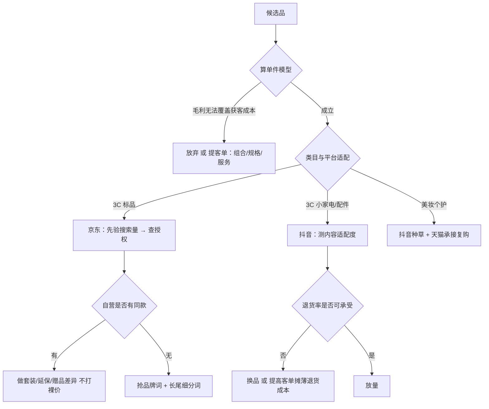

# 01 · 选品与测款

> **一句话结论**：选品不是找一个"卖得好的东西"，而是判断这个品在某个平台的流量结构下**能不能被看见、赚不赚钱、退不退货**。同一款货在四个平台的成败，往往在选品那一刻就定了。

---

## 一、选品逻辑

新手选品问"什么好卖"，操盘手选品主要聚焦于以下三个问题。这三问构成一切选品动作的底层筛子：

**1. 可被发现性**——这个品在该平台，靠什么路径被用户找到？  
京东靠搜索，抖音靠内容，淘宝靠搜索加推荐，天猫靠品牌加活动。**同一个品，可被发现性在四个平台完全不同。** 一个在淘宝靠长尾词活得很好的品，放到抖音可能一条素材都跑不出来，因为没有人会"搜"它，也没有内容切口能激发它。

**2. 经济性**——毛利能不能覆盖这个平台的获客成本？  
这是最常被跳过的一步。抖音的获客成本包含内容生产和投流两项，淘系主要是投流，京东是授权加保证金加推广。**同一个品，毛利不变，平台成本变了，成立与否就变了。**

**3. 履约性**——退货与售后会不会吃掉利润？  
抖音的冲动下单对应冲动退货，美妆类目尤其明显；3C 的售后成本在京东和淘宝是两套量级（京东服务分是硬约束，淘宝相对宽松）。**毛利算得再漂亮，退货率一高全归零。**

三问里任何一问不过，这个品在这个平台就不成立。不是"再优化一下"能救的。

## 二、阶段与立项门槛

这两件事经常被混为一谈，但它们是两个尺子。

**阶段**指的是经营动作的性质，不是销量数字：

| 阶段 | 在做什么 | 判断标准 |
|---|---|---|
| 起盘期 | 验证单件模型是否成立 | 这个品能不能赚钱 |
| 放量期 | 模型跑通后加大投入 | 放大后还赚不赚 |
| 规模化期 | 稳定盈利后争夺份额 | 能不能守住 |

**立项门槛**是另一回事：一个品类要进入公司的产品规划，得先证明它的预期体量能覆盖固定成本与最小盈利规模。**这个门槛在 3C 和美妆之间差得极远**——大家电月销数百台可能已经是重点单品，美妆月销同样数量可能连团队成本都养不住。所以门槛值要按类目和公司自身的核算标准定，不要照搬别家的数字。

**一个品能"卖"和值得"立项"是两件事。** 前者是选品逻辑能回答的，后者要用单件模型乘以预期订单量去算——也就是下一节要做的事。

## 三、先算账，再看品

在打开任何后台之前，先把这个品的单件模型算一遍。这是选品的入场券。

```
单件毛利 = 售价 − 采购成本 − 履约成本（快递/包装/仓储）
可承受获客成本 = 单件毛利 × (1 − 目标净利率) − 退货摊销
```

其中：

- **退货摊销** = 单件毛利 × 退货率 × 退货处理成本系数  
  美妆类目的退货率显著高于 3C，且退回商品常无法二次销售，摊销系数要按类目实际取，不能套用。
- **目标净利率**按自己的经营目标设，不是行业均值。做规模的和做利润的，这条线完全不同。

判断规则很简单：**实际获客成本 > 可承受获客成本，这个品在这个平台就是亏的**，无论 GMV 多好看。四个平台的可承受线各不相同，所以同一个品会出现"抖音亏、淘宝平、京东赚"的情况——这不是运营水平问题，是结构问题。

> 本篇不写死点击率、转化率的行业均值。类目差异太大，写死反而误导。**以自身历史数据做基准线**，横向比不同品，纵向比不同周期。

## 四、四平台选品逻辑对比

|        | 京东          | 淘宝        | 天猫         | 抖音          |
| ------ | ----------- | --------- | ---------- | ----------- |
| 选品在找什么 | 已有搜索需求      | 供需缺口      | 品牌产品线      | 内容表达力       |
| 需求来源   | 用户主动搜       | 用户主动搜 + 逛 | 品牌认知 + 活动  | 内容激发        |
| 决定成败的  | 品牌授权 + 参数匹配 | 竞争度 + 差异化 | 品牌定位 + 价格带 | 内容适配度       |
| 适合的品   | 标品、3C、品牌货   | 非标、长尾、细分  | 成体系的品牌线    | 可视化、低决策门槛   |
| 试错成本   | 中（授权前置）     | 低         | 高          | 中高（素材 + 投流） |
| 起量速度   | 慢，靠积累       | 中         | 慢          | 快，但波动大      |

**一句话记法**：京东选"能搜到的"，淘宝选"没人抢的"，天猫选"配得上的"，抖音选"看得懂的"。

## 五、逐平台细则

### 京东

**适用类目**：3C 标品（手机、电脑、大家电、数码配件）、需品牌背书的家电  
**适用阶段**：起盘期（拿授权）、放量期  
**最低预算**：品牌授权成本 + 保证金 + 快车推广费  
**见效周期**：3–4 周可判断  
**核心指标**：目标词搜索点击率、转化率、服务分  
**主要风险**：自营同款比价、授权被撤、账期占资金  
**停止条件**：目标词搜索体量不足以支撑成本，或自营同款价格碾压且无法做出差异化

做法要点：

1. **先验搜索量，再谈选品。** 京东用户是"搜"不是"逛"，一个词没有搜索量，品再好也无人看见。用京麦商智查词的搜索人气与在线商品数，算竞争度。**需求验证在京东是前置条件，不是事后验证。**
2. **3C 是授权制，没有授权连上架资格都没有。** 这是京东选品与其它平台最根本的差异——不是"能不能卖好"，是"能不能卖"。授权来源优先级：品牌方直授 > 一级代理 > 二级分销（溢价高、易被撤）。
3. **参数即选品。** 京东用户按参数筛，SKU 属性填错等于自绝于搜索结果。选品时要同时确认：型号是否齐全、属性是否可填全、与自营是否同型号。**同型号是死局，不同型号是机会。**
4. **与自营错位，不要硬碰价格。** 自营价格摆在那儿，POP 硬拼裸价必输（自营有采购规模优势）。可行的差异点只有三处：**套装组合、延保/安装服务、赠品结构**。
5. **蓝海在细分型号与细分场景。** 大标品被自营和头部占满，真正能做的空间在：商用型号、适老型号、租房/小户型场景、配件与耗材。这类词搜索量不大但竞争度低、转化高。

### 淘宝

**适用类目**：非标品、长尾细分需求、有设计或功能差异的品  
**适用阶段**：起盘期（快速验证）  
**最低预算**：直通车日限额百元级即可起步  
**见效周期**：1–2 周  
**核心指标**：点击率、收藏加购率  
**主要风险**：同质化比价、被跟款  
**停止条件**：点击率持续低于自身基准且换主图无效，或转化率长期不达盈亏线

做法要点：

1. **选品即找供需缺口。** 用生意参谋看"搜索人气 / 在线商品数"的比值，找需求存在但供给不足的细分。**这是淘宝相对其它三个平台最大的优势：它允许你从极小的需求切口进入。**
2. **标品在淘宝会被比价到死。** 同款同型号的标品，淘宝的竞争是纯粹的价格战，没有品牌溢价空间。**标品要么不做，要么做出无法直接比价的组合。**
3. **测款成本最低，所以要大胆测。** 直通车小额多计划并行，看点击率和收藏加购率。收藏加购率高的品，即使当下转化一般，也值得养——这是淘宝特有的"蓄水"逻辑。
4. **主图就是选品的一部分。** 淘宝的点击率高度依赖主图，同一个品换一张图可能从死到活。所以测款时**测的是"品 + 图"的组合**，不是品本身。

### 天猫

**适用类目**：有品牌基础的成体系产品线  
**适用阶段**：放量期、规模化期  
**最低预算**：高（保证金、年费、视觉、活动投入）  
**见效周期**：1–2 个月（一个完整上新周期）  
**核心指标**：首周转化率、加购率、活动期爆发倍数  
**主要风险**：品牌投入沉没、活动依赖、毛利被扣点摊薄  
**停止条件**：连续两个上新周期无起色，或活动期爆发无法覆盖日常投入

做法要点：

1. **天猫选的不是单品，是产品线结构。** 引流款（拉新、打价格锚）、利润款（承担毛利）、形象款（撑品牌调性）。**只上利润款会没有流量，只上引流款会没有利润。**
2. **价格带要先定，再选品。** 天猫的品牌定位决定了价格带，价格带决定了可选品的范围。反过来"先选品再定价"在天猫是做不成的，会跟品牌调性打架。
3. **单品试错在天猫不成立。** 天猫的流量成本高、活动有门槛，单个品试错的成本远高于淘宝和抖音。**要么成体系上，要么先在淘宝或抖音验证完再迁过来。**
4. **扣点要算进毛利。** 类目扣点直接吃毛利，选品时的成本模型必须包含这一项，否则算出来的毛利是虚的。

### 抖音

**适用类目**：美妆全品类；3C 限小家电、数码配件、可演示型产品  
**适用阶段**：起盘期（测爆品）、放量期  
**最低预算**：素材制作费 + 千川测试预算，万元级起  
**见效周期**：2–4 周  
**核心指标**：3 秒完播率、点击率、退货率（**三个必须一起看**）  
**主要风险**：退货率高、素材同质化、内容合规  
**停止条件**：跑满多轮素材仍无一条点击率达标；或退货率过高导致毛利无法覆盖获客成本

做法要点：

1. **抖音选品的第一标准是"看得懂"，不是"有需求"。** 用户没有搜索意图，是被内容激发的。所以判断一个品能不能做，先问：**它能不能在 3 秒内让人明白这是什么、解决什么、为什么现在买？** 答不上来，这个品在抖音就没有入口。
2. **爆品基因有四个特征**：视觉可演示（效果能看见）、痛点明确（一句话说清）、决策门槛低（不需要研究参数）、有价格锚（能对比出便宜感）。满足三条以上才值得投测试预算。
3. **3C 在抖音只能做"单品爆破"**，不做全店经营。适合的方向：小家电（效果可视化）、数码配件（低客单高频）、测评型产品。**需要长决策链的复杂 3C，抖音跑不动，别硬上。**
4. **美妆是抖音的天然主场，但要先算退货。** 美妆可视化效果强、决策门槛低、复购逻辑清晰，是抖音最适配的类目之一。但冲动下单对应冲动退货，**毛利必须扛得住退货摊销**，否则 GMV 越高亏越多。
5. **测款是"测素材"而不是"测品"。** 同一个品，素材角度不同结果天差地别。所以抖音的测款动作是：同品多素材并行，看哪条能跑出来；而不是一个素材测多个品。**素材是变量，品是常量。**
6. **注意货架场。** 抖音商城与搜索的占比在上升，平台在主动引导（货架场退货率低、复购好）。所以选品时要同时考虑：**这个品有没有搜索词？** 纯靠内容激发、没有任何搜索需求的品，在货架场的增量会缺失。

## 六、怎么选（决策树）



## 七、避坑

| 坑             | 表现                 | 为什么会踩           | 怎么绕开            |
| ------------- | ------------------ | --------------- | --------------- |
| 用淘系逻辑选抖音的品    | 淘宝搜索指数很好的品，抖音素材跑不动 | 把"有需求"当成"能激发"   | 抖音先测内容切口，再谈需求   |
| 京东无授权硬上       | 上架后被投诉下架，保证金被扣     | 以为 POP 门槛低就等于能卖 | 3C 先确认授权链，再谈选品  |
| 抖音只看 GMV 不看退货 | 账面漂亮，实际亏损          | 冲动下单必然伴随冲动退货    | 把退货率写进单件模型，设红线  |
| 天猫按单品思维选品     | 上了几十个品，没有一个能撑住     | 天猫要的是产品线结构      | 引流款/利润款/形象款先分工  |
| 测款预算给太少就下结论   | 样本不足，误杀好品          | 想省钱，结果反复试错更贵    | 跑够有统计意义的点击量再判断  |
| 一个品四平台同时铺     | 资源分散，哪个都测不出来       | 怕错过，想全覆盖        | 先在一个平台跑通，再复制    |
| 忽略扣点与履约       | 毛利算出来是正的，实际是负的     | 只算采购成本与售价       | 成本模型必须含扣点、履约、退货 |

## 八、两个类目的选品清单

**3C 家电**

- 京东（主场）：标品走授权，蓝海在细分型号、商用/适老/小户型场景、配件耗材
- 天猫（承接）：品牌已有基础时补齐产品线，做价格带延伸
- 抖音（爆破）：只有小家电与配件值得做，且必须可演示
- 淘宝（验证）：非标配件、长尾需求，用来低成本试水

**美妆个护**

- 抖音（拉新）：主场，但先算退货再算 GMV
- 天猫（沉淀）：复购与品牌资产的主阵地
- 淘宝（补充）：细分功效、小众品类
- 京东（机会）：礼盒、套装、送礼场景，不做主战场
