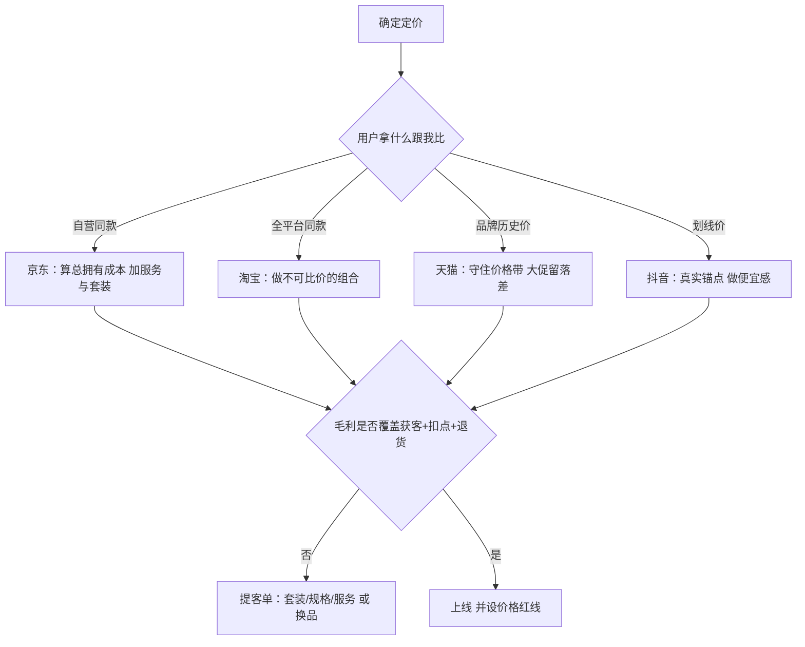

# 02 · 货品与定价

> **一句话结论**：定价不是一个数字，是一套体系——它同时在跟三个对象说话：用户的参照物、平台的考核规则、以及其他渠道上的自己。只顾其中一个，另外两个会来收账。

---

## 一、定价的底层逻辑

01 算的是"这个品成不成立"，这一篇算的是"这个品怎么卖、卖多少钱"。

定价有三层，多数人只做第一层：

| 层次   | 在回答什么         | 做错的表现          |
| ---- | ------------- | -------------- |
| 价格带  | 我在哪个区间跟谁竞争    | 定价拍脑袋，进了不该进的战场 |
| 价格锚  | 用户拿什么跟我比      | 用户拿最便宜的同款比，我必死 |
| 价格体系 | 同一款货在多渠道的价格关系 | 平台互相比价，自己被自己打  |

**成本加成定价是最典型的错误**：成本 100，想赚 40，卖 140——但你不知道隔壁自营卖 129，也不知道天猫同款在卖 158。定出来的价格既没有竞争力，也没有信息量。

操盘手定价的第一句话永远是：**"用户会拿我跟什么比？"**

## 二、价格锚

用户不跟你的成本比，跟他的参照物比。同一个品，在四个平台被比较的对象完全不同——锚定错了，价格怎么定都是错的。

|       | 京东          | 淘宝    | 天猫         | 抖音         |
| ----- | ----------- | ----- | ---------- | ---------- |
| 用户的锚  | 自营同款价       | 同款最低价 | 品牌历史价（大促价） | 划线价 / 直播间价 |
| 竞品范围  | 自营 + 头部 POP | 全平台同款 | 同品牌同层级     | 同类目爆款      |
| 价格透明度 | 极高（比价工具多）   | 极高    | 中          | 中          |
| 可用的差异 | 服务、时效、套装    | 组合、赠品 | 品牌、会员      | 场景、限时、赠品   |

**推论**：在京东，"贵"必须有可解释的理由（延保、安装、套装）；在淘宝，"贵"基本不成立，只能做不可直接比价的组合；在天猫，"贵"由品牌支撑，破价反而伤害长期；在抖音，"贵"不是问题，"看不出便宜"才是问题。

## 三、四平台定价逻辑对比

|        | 京东           | 淘宝        | 天猫         | 抖音         |
| ------ | ------------ | --------- | ---------- | ---------- |
| 定价主导因素 | 自营价 + 服务溢价   | 竞品价 + 差异度 | 品牌定位       | 转化效率 + 价格锚 |
| 价格弹性   | 低            | 高         | 中          | 高          |
| 平台价格考核 | 价格星级、比价监控    | 无强考核      | 价格力（大促校验）  | 价格竞争力      |
| 主要促销形式 | 满减、Plus 价、秒杀 | 店铺券、满减    | 跨店满减、预售、定金 | 直播间价、商城价、券 |
| 定价禁区   | 明显高于其他平台     | 高于同款且无差异  | 破品牌价格带     | 虚构划线价      |

## 四、跨平台价格冲突：这是真痛点

同一款货铺四个平台，价格必然被比价。而且不只是用户在比，**平台也在比**。

三个压力源：

1. **平台监控**：京东对 POP 价格有比价机制，长期高于其他平台会影响权重或收到提示；天猫大促会校验历史价格，"价格力"不达标拿不到资源。
2. **用户比价**：3C 尤甚，型号可精确搜索，用户几乎零成本完成跨平台比价。
3. **渠道关系**：同一款货天猫卖 199、抖音卖 159，天猫的经销体系会先崩。

**四个解法，按优先级**：

| 解法    | 做法               | 代价            | 适用     |
| ----- | ---------------- | ------------- | ------ |
| 型号差异化 | 同品不同型号/规格，规避精确比价 | 需供应链配合，可能有起订量 | 3C 首选  |
| 组合差异化 | 套装、赠品、延保，做不可比价的包 | 拉低毛利率         | 全类目    |
| 渠道专供  | 某平台独家款/独家色       | 备货压力          | 有品牌力时  |
| 承认价差  | 用服务、时效、售后补       | 需要真实优势        | 京东相对可行 |

**绝对不能做的**：同款同规格明目张胆地高价，且被用户发现。这比降价更伤——降的是利润，这个是信任。

## 五、逐平台细则

### 京东

**适用类目**：3C 标品、家电  
**适用阶段**：放量期  
**最低预算**：无额外门槛（授权与保证金见 00 总纲）  
**见效周期**：2–4 周  
**核心指标**：价格星级、转化率  
**主要风险**：比价处罚、自营价格碾压、被迫降价至毛利线以下  
**停止条件**：为保价格星级而降价，降价后毛利低于可承受线

做法要点：

1. **对标自营，但比的是"总拥有成本"不是裸价。** 自营 1299 裸机，你 1299 加延保加安装，用户感知是一样的价。**价格战打不赢自营，价值战可以。**
2. **价格星级不是越低越好。** 平台考核的是"同价位段的竞争力"，不是绝对低价。为了星级把价格打到毛利线以下，是在用利润换一个不产生利润的流量。
3. **大促价格要提前规划。** 京东会校验历史价格，先涨后降会被判违规，而且大促价一旦成为历史低价，后续日常价会被"锚"住。
4. **Plus 会员价是独立体系。** 它带来的是高价值人群，但折扣要单独测算——别把 Plus 价当成普通促销。

### 淘宝

**适用类目**：非标、长尾、细分  
**适用阶段**：起盘期 / 放量期  
**最低预算**：低  
**见效周期**：1–2 周  
**核心指标**：到手价竞争力、转化率  
**主要风险**：价格战无底线、被跟款压价  
**停止条件**：同款价格战打到毛利为零且无供应链优势

做法要点：

1. **淘宝打的是"到手价"，不是标价。** 标价可以预留空间，用店铺券、满减、赠品把到手价打下来。用户看的是结算页的数字。
2. **低价 SKU 引流是常规操作，但边界要清楚。** 用低配 SKU 做价格展示是允许的，用虚假低价（拍下不发货、强制搭售）是违规的。
3. **不做无底线价格战，除非你有供应链优势。** 淘宝的比价是全平台同款，没有成本优势的一方在价格战里必输，而且输了还留下了低价历史。
4. **组合是淘宝最好的护城河。** 两件装、加赠、搭配套餐——让用户无法直接比价，是唯一能长期抵抗跟款的方式。

### 天猫

**适用类目**：品牌成体系产品线  
**适用阶段**：放量期 / 规模化期  
**最低预算**：高  
**见效周期**：1–2 个月  
**核心指标**：价格力达标率、活动爆发倍数  
**主要风险**：破价伤品牌、活动依赖、扣点摊薄  
**停止条件**：活动期爆发无法覆盖日常投入，或价格已跌破品牌价格带

做法要点：

1. **价格带就是品牌定位。** 天猫的价格不是算出来的，是选出来的——你选择在哪个价格带，就选择了跟谁站在一起。破价一次，品牌资产掉一档，且很难补回来。
2. **大促价格要提前三个月规划。** 预售、定金、尾款、跨店满减叠加，每一层都会改变实际到手价。临时定价必然踩坑。
3. **价格力考核的本质是"日常价不能虚高"。** 日常价定得离谱，大促就没有爆发空间；日常价稳，大促才有落差感。
4. **扣点必须进成本模型。** 类目扣点直接吃毛利，定价时不算，算出来的毛利是假的。

### 抖音

**适用类目**：美妆全品类、3C 小家电与配件  
**适用阶段**：起盘期 / 放量期  
**最低预算**：素材 + 投流，万元级  
**见效周期**：2–4 周  
**核心指标**：点击转化率、退货率、实际到手价 vs 同类爆款  
**主要风险**：虚构划线价违规、价格竞争力不足被限流、退货吃掉毛利  
**停止条件**：价格已降到毛利无法覆盖获客成本 + 退货摊销

做法要点：

1. **划线价是转化核心，但必须真实。** 虚构原价是明确违规，被查到下架扣分。划线价的依据要有据可查（历史成交价、官方指导价）。
2. **抖音不卖"低价"，卖"便宜感"。** 用户不一定买最便宜的，但要"感觉占到便宜"。对比、赠品、限时、限量，都比直接降价有效，而且不伤价格体系。
3. **直播间价与商城价的价差是平台策略，要配合不要对抗。** 平台引导用户去货架场（退货率低、复购好），价差是手段之一。硬扛这个价差，损失的是货架场的增量。
4. **价格变动会直接影响流量。** 算法会监测价格竞争力，同款比同行贵，曝光就会缩。所以抖音的定价是动态的，不是定完就不动。

## 六、货品结构：不是每个平台都需要"三款齐全"

| 结构  | 职责      | 京东 | 淘宝 | 天猫 | 抖音   |
| --- | ------- | -- | -- | -- | ---- |
| 引流款 | 拉新、打价格锚 | 少  | 多  | 有  | 单点爆破 |
| 利润款 | 承担毛利    | 主力 | 主力 | 主力 | 主力   |
| 形象款 | 撑品牌、拉客单 | 少  | 少  | 必备 | 少    |
| 复购款 | 会员与复购   | 中  | 中  | 重  | 中    |

**关键差异**：京东用户是精准搜索进来的，不需要"引流款"把人拉进来，需要的是"利润款 + 参数齐全"。抖音不需要完整结构，一个爆品能撑起整店。天猫必须三款齐全，否则要么没流量要么没利润。

## 七、怎么定（决策树）

## 八、避坑

| 坑            | 表现           | 为什么会踩          | 怎么绕开          |
| ------------ | ------------ | -------------- | ------------- |
| 成本加成定价       | 价格没有竞争力也没信息量 | 只看自己成本，不看用户参照物 | 先找锚，再定价       |
| 四平台同款同价      | 高价平台被比价打死    | 图省事，怕渠道冲突      | 型号/组合差异化      |
| 虚构划线价        | 下架扣分         | 以为划线价随便填       | 锚点必须有据可查      |
| 大促前临时涨价再打折   | 被判价格欺诈       | 想做大促力度         | 提前三月规划价格体系    |
| 只算采购成本       | 毛利是假的        | 漏了扣点、履约、退货     | 成本模型四项齐全      |
| 低价 SKU 引流但缺货 | 违规且差评        | 只想拉点击          | 低价 SKU 要有真实库存 |
| 抖音为蹭流量频繁改价   | 流量波动、老客不满    | 把定价当投放工具       | 改价前先算价格体系影响   |

## 九、规则怎么核实

平台不会公开算法的全部细节，但下面这几条都能自己验证出来。**规则说明往往写得含糊，校验结果不会骗人。**

| 疑问 | 为什么重要 | 怎么自己验证 |
|---|---|---|
| 京东价格星级怎么算 | 它影响流量，但平台不公开权重 | 对同一 SKU 连续小幅调价，记录每次调价前后的星级与曝光变化。几次之后就能摸出自己类目的敏感区间 |
| 天猫价格力是否按券后价校验 | 决定大促能不能报名成功 | 只改券的面额、不动标价，再报名同一场大促，看校验结果是否变化（下面有完整例子） |
| 抖音同款比价的识别粒度 | 决定你被拿去跟谁比 | 在抖音商城搜自己的品，看"同款推荐"里出现的是同型号还是同品类不同款。前者说明按型号识别，后者说明按标题/类目匹配 |
| 各平台实际扣点 | 直接影响毛利测算 | 从后台结算单反查。结算单里的技术服务费与佣金就是实际值，不要用第三方汇总的行业数字 |

**完整例子：天猫价格力到底看哪个价**

假设某商品标价 199 元，日常放 20 元券，到手 179 元。

1. 保持标价 199 元不变，把券从 20 元调到 40 元，到手变成 159 元。
2. 用这两种状态分别尝试报名同一场大促。
3. 看结果：
   - 如果"券 40 元"那版被判价格力不足、而"券 20 元"能过 → 平台校验的是**券后到手价**
   - 如果两版结果一致 → 平台只校验**标价**

这个结论会直接改变玩法：按到手价校验，"高标价 + 大额券"就不成立，必须真降；只按标价校验，券才是纯粹的价格工具，可以放心用。

同一套思路可以套用到所有平台的模糊规则上：**改一个变量，看校验结果变不变。** 一次只改一个，才分得清是哪个因素起的作用。

