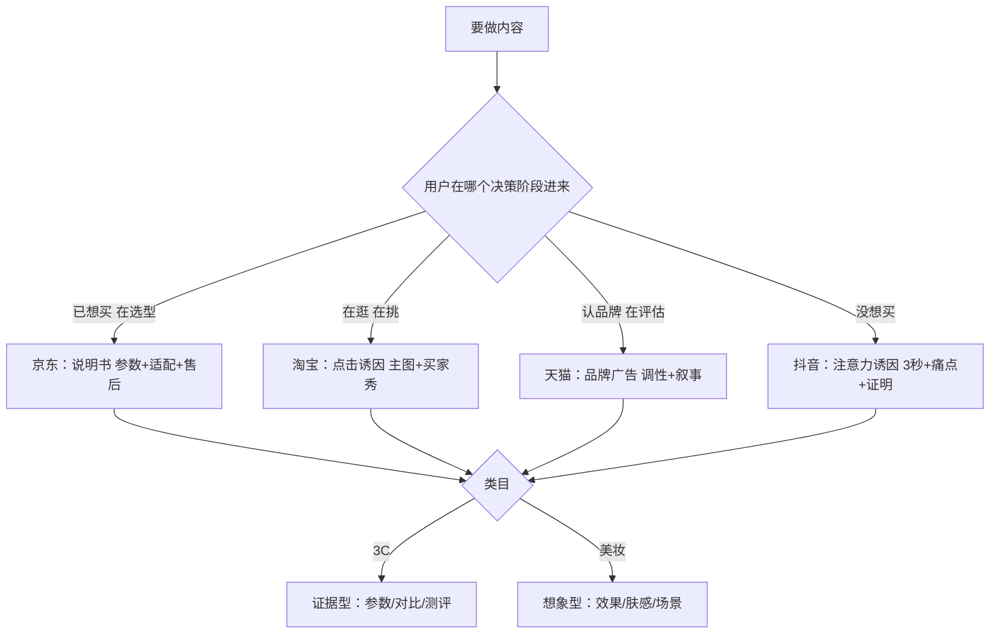

# 03 · 内容与素材

[← 返回目录](../README.md)

> **一句话结论**：内容不是"做好看"，是"降低决策成本"。四个平台的内容任务根本不同——京东消除疑虑、淘宝争取点击、天猫建立认同、抖音制造冲动。所以一套素材不可能四平台通用。

---

## 一、内容逻辑

内容在四个平台承担的责任，是完全不同的四件事：

| | 用户此刻的状态 | 内容要解决什么 | 内容像什么 |
|---|---|---|---|
| 京东 | 已经想买，在选具体哪个 | 确认：型号对不对、适配不对、售后靠不靠 | **说明书** |
| 淘宝 | 还在挑，可能只是随便逛逛 | 被点开：凭什么点你而不是别人 | **点击诱因** |
| 天猫 | 认这个品牌，在评估值不值 | 认同：为什么值这个价 | **品牌广告** |
| 抖音 | 根本没想买 | 激发：3 秒内让他停下来 | **注意力诱因** |

**这个表决定了所有内容决策。**

把抖音的注意力诱因搬到京东主图，会被判违规（促销水印、夸张表述）；把京东的参数详情页搬到抖音，用户划走；把天猫的品牌调性搬到淘宝，点击率会死。**内容的形态由用户的决策状态决定，不由你的审美决定。**

## 二、四平台内容形态对比

| | 京东 | 淘宝 | 天猫 | 抖音 |
|---|---|---|---|---|
| 第一触点 | 搜索列表主图 | 搜索列表主图 | 品牌页/活动页 | 视频前 3 秒 |
| 核心载体 | 主图、五点、详情、视频 | 主图、详情、买家秀 | 详情、品牌页、KV | 短视频、直播 |
| 内容核心 | 参数准确 | 点击诱因 | 品牌调性 | 情绪与场景 |
| 成功指标 | 点击率 + 转化率 | 点击率 | 停留 + 转化 | 完播 + 点击 + 转化 |
| 复用性 | 低 | 低 | 低 | **极低**（素材消耗快） |

## 三、逐平台细则

### 京东

**适用类目**：3C 标品、家电
**适用阶段**：全阶段
**最低预算**：一次性制作，长期复用
**见效周期**：详情与主图优化后 2–3 周可见
**核心指标**：主图点击率、详情页转化率
**主要风险**：主图违规（促销信息、水印）、属性填写不全影响搜索
**停止条件**：主图与详情反复优化后点击率仍低于类目基准

做法要点：

1. **五点描述是搜索词的载体。** 京东的搜索匹配大量依赖标题与属性，五点里埋入长尾词能带来额外的搜索曝光。**这不是文案，是流量位。**
2. **主图第一张必须合规。** 白底、产品全貌、无促销文字水印——京东对这个的审核比想象中严格，不合规直接下架。
3. **详情页要回答"和我原来那台有什么区别"。** 京东用户带参数来，最关心型号差异、适配场景、安装条件。**写清"不适合谁"比写"适合谁"更有效。**
4. **属性填全是内容的一部分。** 型号、规格、能效、接口——漏填一个，就丢掉一批筛选流量。
5. **视频在京东的权重在上升**，优先做安装演示、使用场景，不需要情绪，需要"看完就确定"。

### 淘宝

**适用类目**：非标、长尾、细分
**适用阶段**：起盘期 / 放量期
**最低预算**：低（主图可反复低成本迭代）
**见效周期**：换图后 3–7 天可见
**核心指标**：主图点击率、前 3 屏停留
**主要风险**：主图同质化、详情页自嗨
**停止条件**：连续多版主图测试点击率无提升，问题在品不在图

做法要点：

1. **淘宝的生死在第一张图。** 同一个品，换一张主图能从死到活。所以测款时测的是"品 + 图"的组合，图的分量不比品轻。
2. **详情页前 3 屏决定转化。** 用户不会看完，前 3 屏必须解决：这是什么、凭什么信你、买了有什么保障。
3. **买家秀比详情页有效。** 淘宝用户会专门去看评价和问大家，UGC 的可信度远高于自述。**运营买家秀的投入产出比，通常高于重做详情页。**
4. **短视频在淘宝的权重在升。** 逛逛与详情页视频都吃流量，但要求与抖音不同——淘宝的视频不需要前 3 秒强吸引，需要"补充信息"。

### 天猫

**适用类目**：品牌成体系产品线
**适用阶段**：放量期 / 规模化期
**最低预算**：高（视觉、KV、活动页）
**见效周期**：长期，单次优化难见即时效果
**核心指标**：页面停留、加购率、活动期转化
**主要风险**：调性不统一伤品牌、活动视觉跟不上节奏
**停止条件**：不适用"停止"逻辑，属长期资产

做法要点：

1. **天猫的详情页不是说明书，是广告。** 它要建立的是"这个品牌值得这个价"的认知，参数是辅助不是主角。
2. **视觉一致性比单页转化更重要。** VI、色彩、字体、摄影风格统一，是品牌资产的一部分。单页为了转化破一次调性，长期是亏的。
3. **大促视觉要提前做。** 主 KV、活动页、氛围图需要成套，临时拼凑出来的页面在大促流量下转化明显偏低。
4. **内容投入是沉没成本，但决定品牌天花板。** 这部分不能按 ROI 算，要按品牌资产算——这是天猫和另外三个平台最大的区别。

### 抖音

**适用类目**：美妆全品类、3C 小家电与配件
**适用阶段**：全阶段
**最低预算**：持续投入（素材是消耗品）
**见效周期**：单条素材 3–7 天见分晓
**核心指标**：3 秒完播率、点击率、转化率（**三个必须一起看**）
**主要风险**：内容合规（功效宣称、极限词）、素材同质化、消耗速度快
**停止条件**：多轮素材均无一条 3 秒完播达标，问题在品或切口不在执行

做法要点：

1. **前 3 秒决定 80% 的结果。** 素材结构：开场吸引（3 秒）→ 痛点（5 秒）→ 产品（10 秒）→ 证明（10 秒）→ 转化（5 秒）。**先把开场这 3 秒写完，再想别的。**
2. **素材是消耗品，不是作品。** 要批量生产多个角度，而不是精雕一条。一条素材的生命周期很短，靠"一条爆款吃一年"的思路做抖音必死。
3. **测的是素材，不是品。** 同品多角度并行，看哪个切口能跑出来。素材是变量，品是常量（与 01 篇的结论一致）。
4. **直播是另一套内容逻辑。** 话术、节奏、憋单、过款——直播的"内容"是脚本化的，不是即兴的。要有逐字稿，不是"主播自由发挥"。
5. **内容合规在抖音最严。** 美妆不能说医疗功效，3C 不能虚标参数，极限词会被系统识别。**合规成本要计进内容生产，不是发出去再说。**

## 四、内容的成本结构：这是抖音与其他三个平台的分水岭

| | 京东/淘宝/天猫 | 抖音 |
|---|---|---|
| 投入方式 | 一次性制作 | 持续生产 |
| 资产属性 | **固定资产**（详情页做一次用一年） | **运营成本**（素材是消耗品） |
| 边际成本 | 递减 | 不递减，甚至递增（同质化后效果衰减） |
| 团队配置 | 设计 1 人可支撑 | 需要持续的拍摄与剪辑产能 |

**这个差异是很多人低估的。** 做淘系出身的人转抖音，最容易犯的错是按"做一套好素材"的思路去准备，结果第一周素材就跑完了。**抖音的内容不是项目，是产线。**

## 五、3C 与美妆的内容差异

| | 3C 家电 | 美妆个护 |
|---|---|---|
| 用户状态 | 理性，看参数与对比 | 感性，看效果与代入 |
| 内容重点 | 参数、型号对比、场景演示、测评 | 使用效果、肤感、身份认同 |
| 在京东 | **好做**：参数即内容 | 难做：无法试用，靠图文表达效果 |
| 在抖音 | **难做**：需要长解释 | **好做**：效果可视化，天然适配 |
| 在淘宝 | 中：靠对比与价格 | 中：靠买家秀 |
| 在天猫 | 中：靠品牌与服务 | 好做：品牌叙事空间大 |

**一句话**：3C 的内容是"证据"，美妆的内容是"想象"。用做证据的方式做美妆（堆参数）会没人看，用做想象的方式做 3C（讲情怀）会没人信。

## 六、内容怎么定

## 七、避坑

| 坑 | 表现 | 为什么会踩 | 怎么绕开 |
|---|---|---|---|
| 一套素材四平台复用 | 每个平台效果都平庸 | 想省成本 | 按决策状态重新生产 |
| 主图堆卖点文字 | 京东违规下架、淘宝点击率反降 | 以为信息越多越好 | 主图只解决"点不点" |
| 抖音素材追求精美 | 完播率低，跑不动 | 用广告思维做内容 | 先写好前 3 秒 |
| 详情页自嗨 | 停留短、转化低 | 讲自己想讲的，不讲用户关心的 | 每屏回答一个具体疑虑 |
| 忽视买家秀 | 转化上不去 | 只优化自有内容 | UGC 投入产出通常更高 |
| 抖音素材合规踩线 | 下架、限流 | 功效宣称与极限词随手写 | 发布前过一遍合规清单 |
| 把内容当项目做 | 素材断供，流量断崖 | 低估消耗速度 | 按产线配置产能 |

## 八、规则怎么核实

根据贴主的实际操作体验：内容的规则里，最容易卡人的几条都没有权威文档，只能自己测。

| 疑问 | 为什么重要 | 怎么自己验证 |
|---|---|---|
| 京东主图的促销文字红线在哪 | 违规直接下架 | 上传一张带促销文字的图，看审核结果与驳回理由。**平台的驳回理由通常比规则文档具体得多**，几次就能摸出边界 |
| 淘宝短视频到底有没有权重 | 决定要不要配视频产能 | 同一批商品，一半加视频一半不加，跑四周看流量差。**不要跨类目比**，类目之间基准差太大 |
| 抖音美妆的功效表述能写多狠 | 决定文案与口播的尺度 | 用不挂商品的短视频测同类表述，看是否被限。被拒时会指出具体违规词，按词修改比整段重写高效 |
| 3C 与美妆的完播率差多少 | 决定 3C 在抖音能不能做 | 比自己的两个品类在同账号下的 3 秒完播率差值。**跨账号比没有任何意义**，粉丝基数会完全干扰结果 |

**验证的通用做法**：一次只改一个变量。主图、标题、视频、价格同时改，结果出来了也不知道是哪个起的作用。
