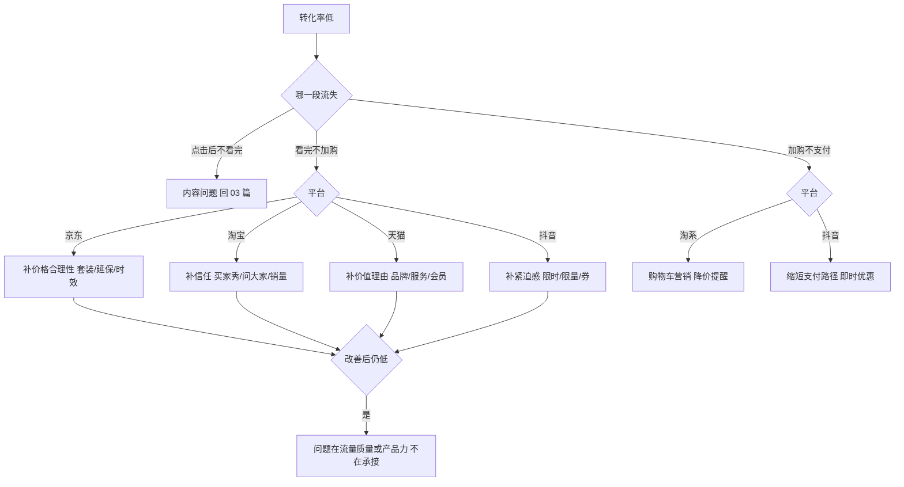

# 05 · 转化承接

[← 返回目录](../README.md)

> **一句话结论**：转化率不是"优化"出来的，是"消除疑虑"的结果。四个平台的用户带着完全不同的疑虑进来——京东怕买贵，淘宝怕买假，天猫怕不值，抖音怕后悔。答错疑虑，页面做得再漂亮也没用。

---

## 一、转化逻辑

每个商品从上架、曝光到点击，再到实际的转化，就如同一个漏斗模型，每一层流失的原因都不一样：

```
曝光 → 点击 → 详情/直播间 → 加购 → 下单 → 支付
```

- 曝光到点击：流失在"凭什么点你"（03 篇解决）
- 点击到加购：流失在"我还有什么不放心"
- 加购到支付：流失在"要不要现在买"

**本篇处理的是后两段——所有转化动作的本质，都是回答"我还有什么不放心"。**

而"不放心"的内容，四个平台完全不同：

| | 京东 | 淘宝 | 天猫 | 抖音 |
|---|---|---|---|---|
| 核心疑虑 | 会不会买贵？多久到？ | 是不是正品？ | 值不值这个价？ | 冲动过后会不会后悔？ |
| 疑虑来源 | 自营在旁边摆着 | 同款太多，真假难辨 | 品牌溢价需要支撑 | 没有充分比较就下单了 |
| 解法方向 | 价格优势 + 时效承诺 | 销量 + 评价 + DSR | 品牌背书 + 权益 | 紧迫感 + 低风险 |

## 二、四平台转化要素对比

| | 京东 | 淘宝 | 天猫 | 抖音 |
|---|---|---|---|---|
| 信任基础 | 平台心智（快、真） | 需自建（销量/评价） | 品牌自带 | 主播/内容自带 |
| 决策时长 | 短（目标明确） | 中 | 长 | **极短** |
| 询单率 | 高 | 中 | 中 | 低 |
| 核心工具 | 211 标、Plus 价、延保 | 买家秀、问大家 | 会员、赠品、服务承诺 | 直播间逼单、优惠券 |
| 最大流失点 | 比价 | 信任不足 | 价格犹豫 | 支付前冷静 |

## 三、逐平台细则

### 京东

**适用类目**：3C 标品、家电
**适用阶段**：全阶段
**最低预算**：低（主要是页面与客服投入）
**见效周期**：2–4 周
**核心指标**：详情页转化率、询单转化率
**主要风险**：与自营比价流失、客服响应慢
**停止条件**：页面与客服都优化后转化率仍低于自营同款的一半，说明价格或产品力有硬伤

做法要点：

1. **信任已由平台建立，你只需要解决"贵不贵"。** 京东用户不会怀疑假货，只会怀疑买贵了。所以页面要给的是**价格合理性**——套装价值、延保权益、赠品清单。
2. **时效是转化利器。** 211 时效标、次日达，在 3C 品类的转化贡献被严重低估。**能承诺就一定要露出，不能承诺就别标。**
3. **询单转化率是京东的隐藏金矿。** 京东用户问得多（"能不能装""适配吗"），客服响应速度和专业度直接决定成交。**3C 类目的客服要能做技术判断，不能只会说"亲，可以的"。**
4. **评价数量比评分数更重要。** 京东用户用"评价数"判断这个链接可不可靠。新品期要合规地积累评价——不是刷，是通过售后跟进、晒单激励（合规方式）。

### 淘宝

**适用类目**：非标、长尾、细分
**适用阶段**：起盘期 / 放量期
**最低预算**：低
**见效周期**：1–2 周
**核心指标**：加购率、支付转化率、DSR
**主要风险**：信任不足导致流失、评价差
**停止条件**：转化率长期低于类目基准且评价内容无改善空间

做法要点：

1. **淘宝的转化障碍是"信任"，所以证据比文案重要。** 买家秀、问大家、追评——这些是真实用户的证词，可信度远高于你写的详情页。
2. **问大家是被严重低估的位置。** 用户在这里问的是最真实的疑虑（"会不会掉色""是不是正品"），这些问答直接影响决策。**主动运营问大家，比改详情页划算。**
3. **销量是硬门槛。** 淘宝用户看销量判断可靠性，冷启动期销量低是最大障碍。这个只能靠时间和合规运营解决，没有捷径（刷单是死路）。
4. **客服响应速度影响转化。** 淘宝的询单转化率与响应时长强相关，尤其是美妆类目（用户会问肤质适配）。
5. **加购是"待转化"信号，要主动跟。** 购物车营销、降价提醒、优惠券触达——加购未支付的人群是最值得运营的池子。

### 天猫

**适用类目**：品牌成体系产品线
**适用阶段**：放量期 / 规模化期
**最低预算**：高（会员权益、赠品、服务）
**见效周期**：一个完整大促周期
**核心指标**：加购率、会员转化率、客单价
**主要风险**：价格犹豫、品牌支撑不足
**停止条件**：不适用"停止"，属长期经营

做法要点：

1. **天猫的障碍是"值不值"，解法是"给足理由"。** 品牌故事、成分/工艺说明、服务承诺（七天无理由、运费险、上门安装）——**每一项都在为溢价提供依据**。
2. **会员是复购的核心，也是转化的加速器。** 入会礼、会员价、积分——会员体系的转化贡献不在首单，在第二单。**天猫的真实价值在 LTV，不在单次转化。**
3. **大促期间的紧迫感要设计。** 限时、限量、前 N 名赠品——不是为了制造焦虑，是为了给"再等等"的用户一个现在下单的理由。
4. **服务承诺要显眼。** 天猫用户对服务的敏感度高于淘宝，退换政策、安装服务、正品保障要放在决策路径上，不要藏在详情页底部。

### 抖音

**适用类目**：美妆全品类、3C 小家电与配件
**适用阶段**：全阶段
**最低预算**：中（直播间与优惠券成本）
**见效周期**：单场直播可见，优化需 2–3 周
**核心指标**：直播间转化率、支付率、退货率
**主要风险**：冲动后退货、支付前流失
**停止条件**：转化率改善但退货率同步上升，说明是靠过度承诺换的成交

做法要点：

1. **抖音的障碍是"后悔"，所以要降低决策风险。** 退货政策要显眼、运费险要有、优惠券要即时可用——**不是在鼓励退货，是在降低下单门槛**。
2. **直播间逼单是结构化的，不是吼。** 限时、限量、倒计时、库存释放——这些是节奏设计，需要脚本，不是主播临场发挥。
3. **抖音的详情页要"短平快"。** 用户不会细看，前 3 屏必须解决：是什么、多少钱、有什么保障。**把京东那套长详情搬过来是浪费。**
4. **支付率是抖音特有的关键指标。** 下单到支付之间流失很高（冲动过后冷静了）。缩短支付路径、即时优惠，是提升支付率的主要手段。
5. **评价要主动运营，但方法要合规。** 抖音的评价数量少，几条差评就能显著影响转化。合规的售后跟进（不是好评返现）是必要的。

## 四、评价与 UGC：承接的核心资产

四个平台对评价的依赖程度不同，但都在上升：

| | 京东 | 淘宝 | 天猫 | 抖音 |
|---|---|---|---|---|
| 评价权重 | 高（判断可靠性） | **极高**（判断真假） | 中（品牌背书强） | 高（新品尤其） |
| 特殊位置 | 追评 | 问大家、买家秀 | 买家秀 | 直播间评论 |
| 运营重点 | 数量积累 | 优质买家秀置顶 | 品牌调性一致 | 差评处理速度 |

**合规边界（四个平台一致）**：
- 不能刷单、不能虚构交易
- 不能好评返现、不能诱导好评
- 不能删除真实差评（只能回复）
- 不能用他人图片冒充买家秀

**这些不是"注意一下"的程度，是会被处罚的。** 详见 08 篇。

## 五、直播间承接（抖音专有）

直播是抖音转化的主战场，承接逻辑与货架完全不同：

**话术结构四段**：

| 阶段 | 目的 | 关键动作 |
|---|---|---|
| 留人 | 让划到的人停下来 | 利益点前置（"今天这个价只有这场"） |
| 讲品 | 建立价值 | 场景 + 痛点 + 演示，不讲参数 |
| 逼单 | 促成决策 | 限时、限量、库存倒数 |
| 过款 | 承接流量 | 快速切下一个品，避免掉人 |

**节奏控制**：憋单（攒人气再放价）与放单（集中成交）的切换频率，决定了整场的流量效率。这个节奏要靠场控实时看数据调整，不能按固定脚本走完全程。

**场控的三件事**：评论引导（把用户问题顶上来）、库存释放（配合逼单节奏）、异常处理（差评、质疑即时响应）。

## 六、怎么选（决策树）



## 七、避坑

| 坑 | 表现 | 为什么会踩 | 怎么绕开 |
|---|---|---|---|
| 一套详情页四平台通用 | 转化率都平庸 | 想省成本 | 按疑虑类型重写 |
| 只优化详情不看流量质量 | 转化率怎么改都不动 | 流量本身不精准 | 先看流量来源与人群标签 |
| 刷单冲销量 | 处罚、降权、清退 | 想快速过冷启动 | 用合规方式积累（售后、内容） |
| 好评返现 | 违规扣分 | 以为是行业惯例 | 改为服务体验提升 |
| 抖音详情页做得像京东一样长 | 用户不看，转化低 | 惯性思维 | 前 3 屏解决核心问题 |
| 忽视客服响应时长 | 询单流失 | 只看页面不看人 | 配足客服，尤其 3C |
| 靠过度承诺换转化 | 转化高但退货率更高 | 只看前端不看后端 | 承诺要能兑现（联动 06 篇） |

## 八、规则怎么核实

转化的很多"标准值"并不存在权威版本，但你的店铺本身就是最好的实验场。

| 疑问 | 为什么重要 | 怎么自己验证 |
|---|---|---|
| 京东询单转化率多少算正常 | 判断客服是助力还是拖累 | 用自己的历史数据做基线，横向比不同客服、不同班次，纵向比优化前后。**行业基准没有权威公开值，别信网传数字** |
| 淘宝问大家哪些操作算干预 | 越界就是违规 | 对照平台"评价管理"规则里对"诱导"的定义，判定核心是**是否由商家发起**。模糊地带一律按商家发起处理 |
| 抖音下单到支付的流失有多大 | 决定要不要优化支付路径 | 罗盘里比"下单人数"与"支付人数"，差值就是流失。直播间与商品卡分开看，两者流失原因不同 |
| 评价对权重的实际影响 | 决定要不要重投评价运营 | 同款两个规格分别上架（避免被判重复铺货），一个重点运营评价、一个不做，跑一个月看流量差 |

**一个提醒**：转化率的对比必须在同一种流量来源下做。搜索流量与推荐流量的转化率天生不同，混在一起看会得出相反结论。
