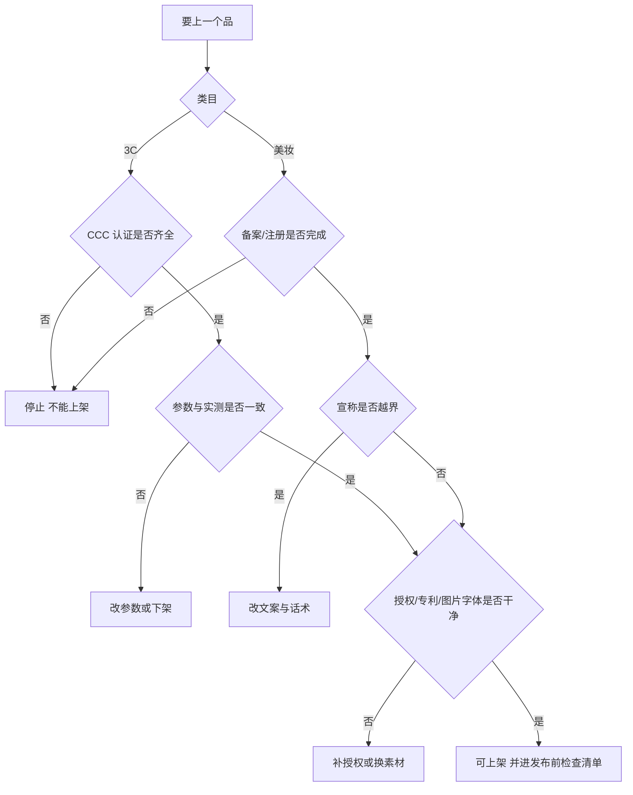

# 08 · 合规与风控

[← 返回目录](../README.md)

> **一句话结论**：合规不是底线，是成本项——它必须在选品阶段就计进去，而不是出事之后再补。**3C 的认证和美妆的备案是上架资格问题，不是运营优化问题。**

---

## 一、风险逻辑

四类风险，风险性质完全不同：

| 类型 | 例子 | 性质 | 后果 |
|---|---|---|---|
| 商品合规 | 3C 认证、化妆品备案 | **准入** | 无证不能卖，卖了就是违法 |
| 宣传合规 | 极限词、功效宣称 | **表述** | 下架、罚款、职业打假 |
| 交易合规 | 刷单、价格欺诈 | **行为** | 扣分、降权、清退 |
| 知识产权 | 授权、专利、图片版权 | **权属** | 投诉下架、赔偿 |

**关键认知**：第一类是"能不能做"，后三类是"怎么做"。**很多人在第二三类上花大量精力，却在第一类上翻车——因为第一类在选品时就该筛掉。**

## 二、准入红线（按类目）

### 3C 家电

| 项 | 要求 | 谁最容易漏 |
|---|---|---|
| 3C 认证（CCC） | 强制性产品认证，无证不得销售 | 新品类、进口小厂货 |
| 能效标识 | 适用品类的强制标识 | 家电类目 |
| 参数标注 | 与实测一致，虚标属虚假宣传 | 电池容量、功率、续航 |
| 电池运输 | 锂电池有运输合规要求 | 移动电源、小家电 |
| 型号一致性 | 上架型号与实际销售型号一致 | 多平台铺货时 |

**3C 的合规是硬门槛**：没有 CCC 认证，不是"风险高"，是"不能卖"。这一点决定了 01 篇选品时就要先验证认证。

### 美妆个护

| 项 | 要求 | 谁最容易漏 |
|---|---|---|
| 化妆品备案/注册 | 普通化妆品备案，特殊化妆品（防晒、染发、祛斑等）需注册 | 新品牌、代工品 |
| 功效宣称 | 不能宣称医疗效果（"治疗""修复受损"边界模糊） | 文案与直播话术 |
| 成分标注 | 全成分标注，与备案一致 | 进口品中文标签 |
| 进口品 | 需有中文标签与合法进口备案 | 代购转正规渠道 |
| 生产许可 | 委托生产需有受托方资质 | OEM 白牌 |

**美妆的合规风险集中在"说"上**：产品可能没问题，但宣称越界了。**直播间口播是最容易出事的地方**，因为主播不会背法规。

## 三、宣传合规（最高频踩坑区）

| 类型 | 红线 | 常见踩法 |
|---|---|---|
| 极限词 | "最""第一""顶级""国家级""绝无仅有" | 主图、标题、详情、直播口播 |
| 功效宣称 | 美妆不能宣称医疗作用；3C 不能虚标性能 | "祛痘印""修复屏障"等表述 |
| 对比宣传 | 不能贬低竞品 | "比某品牌更好" |
| 数据引用 | 必须有出处 | "销量第一""98% 好评"（无依据） |
| 虚构原价 | 划线价必须有真实成交依据 | 随便填个高原价 |
| 承诺性用语 | 不能承诺效果 | "七天见效""永不脱妆" |

**实操建议**：把极限词表做成发布前的检查清单，主图文案、详情页、直播脚本各过一遍。**这不是运营的额外工作，是发布流程的一环。**

## 四、交易合规

| 行为 | 定性 | 后果 |
|---|---|---|
| 刷单/虚假交易 | 严重违规，且可能涉法律责任 | 扣分、降权、清退、罚款 |
| 好评返现 | 违规 | 扣分，评价不计入 |
| 诱导好评 | 违规 | 同上 |
| 先涨后降 | 价格欺诈 | 处罚、投诉 |
| 恶意竞争（差评竞品） | 违规 | 处罚 |

**刷单这件事要有清醒认知**：它不只是"平台处罚"的问题，虚假交易在情节严重时涉及法律风险。**短期看是捷径，长期看是把店铺和个人的风险敞口打开。**

## 五、知识产权

| 类型 | 风险点 | 高发场景 |
|---|---|---|
| 品牌授权 | 授权链不完整、超范围使用 | 京东 3C 尤其严格 |
| 外观专利 | 仿款被投诉 | 美妆包装、小家电外观 |
| 实用新型/发明 | 功能侵权 | 3C 配件 |
| 图片版权 | 盗图投诉 | 主图、详情、买家秀素材 |
| 字体版权 | 商用字体未授权 | 主图文字、包装设计 |

**图片与字体是最容易被忽略的两项**——它们不在"产品"上，而在"素材"上，所以经常被漏掉。

## 六、四平台处罚梯度

| | 京东 | 淘宝/天猫 | 抖音 |
|---|---|---|---|
| 轻微 | 警告、下架商品 | 降权、删除商品 | 警告、下架 |
| 中度 | 扣分、限制活动 | 扣分、屏蔽搜索 | 限流、扣保证金 |
| 严重 | 清退、扣保证金 | 关店 | 封禁、清退 |

**抖音的特点是"快"**：内容侧的违规判定是系统自动的，触发即限流，申诉周期长。所以抖音的合规要**前置到发布前**，而不是事后申诉。

规则本身的变动不记在本篇，统一记在 `09-规则变动日志.md`。

## 七、怎么判断（决策树）

## 八、避坑

| 坑 | 表现 | 为什么会踩 | 怎么绕开 |
|---|---|---|---|
| 选品时不看认证 | 上架后被下架，货压手上 | 以为合规是运营阶段的事 | 认证作为选品前置条件 |
| 直播口播越界 | 功效宣称违规 | 主播不背法规 | 给主播话术红线表 |
| 主图用商用字体 | 字体公司索赔 | 不知道字体有版权 | 只用开源字体或已授权字体 |
| 盗用竞品图 | 投诉下架 | 图省事 | 自拍或购买授权 |
| 虚构划线价 | 价格欺诈 | 以为划线价随便填 | 保留真实成交依据 |
| 刷单冲量 | 扣分清退 | 想快速冷启动 | 用合规方式积累 |
| 规则变了不知道 | 突然被限流 | 没有跟踪机制 | 维护 `09-规则变动日志` |

## 九、规则怎么核实

合规和前面几篇不一样——**它有权威源，不需要自己试**。要找的是"目录"和"分类"，不是经验值。

| 疑问 | 为什么重要 | 去哪查 / 怎么验证 |
|---|---|---|
| CCC 认证覆盖哪些小家电 | 无证不能上架，不是风险高低问题 | 查认监委的强制性产品认证目录，按**产品类别**对照，不要按商品标题猜。目录更新会发公告 |
| 美妆功效宣称的边界在哪 | 决定文案与口播尺度 | 查《化妆品功效宣称评价规范》的功效分类，"舒缓""修护"归哪一类有明确界定。**按类别对，不按感觉对** |
| 抖音的合规识别规则是什么 | 决定发内容的风险 | 规则不公开，但违规通知里会写明条款。把每次违规类型与申诉结果记下来，三个月就能整理出自己类目的踩线清单 |
| 京东授权链要几级 | 决定能不能入驻 | 招商页面会列授权书层级要求，实际以审核反馈为准。**驳回理由比招商页面具体得多** |

**一个提醒**：合规问题别问同行"你们怎么做的"。别人没被查到，不等于合规，只等于还没被查到。
