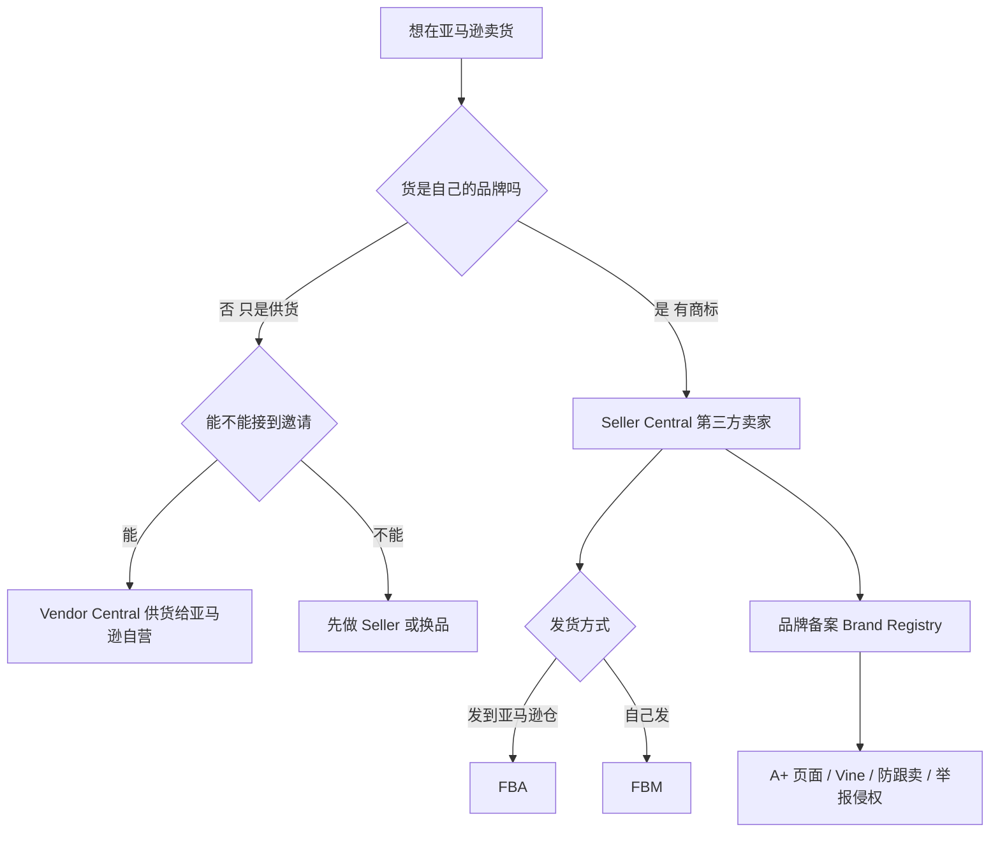

# 10 · 亚马逊（延伸对照）

[← 返回目录](../README.md)

> **一句话结论**：亚马逊和国内四家不是同一个物种——它没有店铺运营，只有商品运营；没有询单客服，只有页面和评论。**国内那套"运营一个店"的思路平移过去，第一步就会走错。**

---

## 零、先说清这篇的性质

这篇和前面九篇不一样。

前面九篇是我按自己的操作经验写的，有具体的判断依据。亚马逊这篇**没有实操样本**，只有规则框架、术语体系和别人的公开案例。

所以阅读方式要改：

- **可以信的**：机制层面的东西（平台怎么赚钱、流量怎么分、钱花在哪、什么动作会封号）。这些是全球统一规则，读文档就能确认。
- **不能全信的**：具体数值（费率、佣金、广告成本）、具体操作节奏、类目竞争度。这些会随时间和类目剧烈变化，本篇只给判断方法，数值以卖家后台为准。

**这篇的定位是"进得去、看得懂、不犯致命错误"，不是"照着做就能起量"。**

## 一、先建坐标系：它和国内四家差在哪

如果只记一句话：**国内是"经营店铺"，亚马逊是"经营单个商品"。**

| 维度 | 抖音 / 淘宝 / 天猫 / 京东 | 亚马逊 |
|---|---|---|
| 经营单元 | 店铺（有权重、有粉丝、有层级） | **ASIN**（单个商品，彼此独立） |
| 流量来源 | 店铺权重 + 内容 + 付费 | 搜索 + 广告 + 关联流量（几乎没有店铺概念） |
| 用户资产 | 会员、粉丝、私域可沉淀 | **不存在**。买家不属于你，邮件营销受限 |
| 售前沟通 | 旺旺/客服/直播答疑，影响转化 | **几乎没有**。买家不咨询，直接看页面和评论 |
| 转化决定因素 | 客服 + 页面 + 评价 + 价格 | **页面 + 评论 + 价格 + 配送时效** |
| 大促逻辑 | 平台造节，商家报名争坑位 | 有 Deal 与 Prime Day，但**日常销售占比更高** |
| 规则执行 | 违规先警告、扣分，有申诉缓冲 | **系统判定，事后封号，资金可冻结** |
| 失败代价 | 降权、扣分、关店 | **账号封停 + 库存与资金一起锁死** |

最后一行是本质区别：国内的处罚是"梯度式"的，亚马逊是"断崖式"的。所以亚马逊的运营重心，**风险控制的权重要比国内高得多**。

### 三个不可能平移的机制

**① 购物车（Buy Box）**

亚马逊同一件商品可能有很多卖家在卖，但**只有一个卖家能拿到"加入购物车"按钮**，这个位置叫 Buy Box。拿不到 Buy Box，页面照样展示，但几乎没人能下单。

这一条在国内没有对应物。它意味着：在亚马逊，**你的竞争对手可能是卖同一个 ASIN 的其他人**，而不只是同类目的其他商品。价格、配送时效、账号健康度都会影响谁能拿到这个位置。

**② 跟卖**

同一个 ASIN 下，别的卖家可以直接挂上来卖（叫跟卖）。如果你没有品牌备案，别人跟卖你的链接，你只能靠降价抢购物车。

国内的"链接是你的"，在亚马逊不成立——**链接属于 ASIN，不完全属于你**。这也是为什么品牌备案在亚马逊是门槛级的动作，而不是可选项。

**③ 评论的获取被严格限制**

国内可以用各种方式运营评价（合规边界内）。亚马逊明确禁止：刷单、返现换评、亲友评论、包装内放索评卡片（含礼品卡）。

官方给的渠道只有两个：**Vine 计划**（付费，最多 30 条，由平台招募测评人）和后台的**索评按钮**（对已成交订单发一次标准化邀请）。

所以亚马逊新品的评论积累很慢，而评论又直接影响转化——**这是新品期最难受的地方，也是"三个月见分晓"这个说法的来源。**

## 二、术语对照表（先过一遍词，再看后面）

国内的说法搬到亚马逊，一大半找不到对应词。这张表是全文的地基。

| 国内说法 | 亚马逊对应 | 关键差异 |
|---|---|---|
| 店铺 | Storefront（店面页） | 只是个展示页，不带权重，不影响流量分配 |
| SKU | ASIN（商品）+ FNSKU（FBA 标签） | ASIN 是竞争单元，也是评论的载体 |
| 主图 | 主图（首图需纯白底） | 首图审核比国内严，带文字/水印易被拒 |
| 五点描述 | Bullet Points | 位置比国内重要，是搜索与转化的双重入口 |
| 详情页 | 详情页 + A+ Content | A+ 需品牌备案，相当于国内的品牌详情页 |
| 买家秀 / 评价 | Reviews（星级 + 文字）+ Ratings | 只有星级也算，权重与文字评论不同 |
| DSR | Feedback（店铺反馈）+ 账号绩效指标 | 前者是买家对卖家的评价，后者才是真正卡流量的 |
| 直通车 / 快车 | Sponsored Products（SP，商品推广） | 逻辑最接近，按点击付费 |
| 品牌专区 / 品牌广告 | Sponsored Brands（SB）+ Brand Store | 需品牌备案 |
| 人群 / 再营销 | Sponsored Display（SD，展示型推广） | 可投竞品 ASIN 与兴趣人群 |
| 京东仓 / 菜鸟仓 | FBA（亚马逊物流） | 不只是一段物流，直接影响购物车与 Prime 标 |
| 自发货 | FBM / MFN（卖家自发货） | 时效不达标会失去购物车 |
| 大促坑位 | Deal（LD / BD）、Prime Day | 报名制，有历史价格与库存门槛 |
| 销量榜 | BSR（Best Sellers Rank） | 类目排名，是选品与竞品分析的主入口 |
| 平台采销 / 小二 | Vendor Manager（仅 Vendor 账号有） | 第三方卖家（Seller）没有对接人，全靠系统和开 case |
| 达人带货 | 站外 Influencer / 联盟（Associates） | 站外流量对排名有影响，但不可直接挂链成交 |
| 私域 / 粉丝群 | 无 | 买家联系方式不给卖家，邮件营销受限 |

## 三、角色与账号：先确定你是哪一种卖家

这是最容易搞错的一步，和国内"开个店"完全不同。



**Seller Central（第三方卖家）**——绝大多数人走这条路。自己定价、自己投广告、自己承担库存风险。对应国内的"POP 店"。

**Vendor Central（供应商）**——把货卖给亚马逊，由亚马逊自营销售。对应国内的"京东自营供应商"。多为邀请制，主动权在平台，卖家看不到终端数据，也控制不了定价。

**必须先做的一件事：品牌备案（Brand Registry）**

需要注册商标（受理中的 TM 也可申请，具体以后台要求为准）。备案之后才解锁：A+ 页面、Vine、Brand Store、防跟卖与侵权举报、Transparency 溯源。

**没有品牌备案做亚马逊，等于把最关键的几件武器全交出去了。**

### 账号层面的三条红线

1. **资料真实且唯一。** 营业执照、法人信息、地址、电话、收款账户，一套资料只能对应一个账号。
2. **网络与设备不能混用。** 同一台电脑、同一条网络登过两个账号，会被判关联。这是国内卖家最常见的死法。
3. **审核是常态。** 注册后可能触发地址验证（寄明信片）、视频验证、账单审核。资料对不上就卡在这里。

> 国内的经验在这里几乎帮不上忙：亚马逊的账号安全是**前置工程**，不是出事后再补的。

## 四、选品：亚马逊的品，和国内的品不是一个选法

国内的选品逻辑是"这个品有没有内容爆点、有没有价格带空间"。亚马逊的选品逻辑更接近**工程计算**：这个品的物理属性和价格带，能不能扛住 FBA 费用和广告成本。

### 四个硬约束（选品前先过一遍）

| 约束 | 为什么卡人 | 判断方式 |
|---|---|---|
| **重量与体积** | FBA 配送费按尺寸分段，越重越大越吃毛利 | 先查配送费再谈利润，不要反过来 |
| **客单价** | 太低，配送费与广告费占比吃掉全部毛利；太高，决策周期长、评论积累慢 | 用单件毛利倒推可承受广告成本（同 01 篇公式） |
| **是否易碎/带液/带电池** | 触发额外合规与物流限制，退货率也高 | 带电池需 MSDS 等资料，液体与易碎品破损率高 |
| **专利与认证** | 侵权投诉直接下架，申诉周期长 | 上架前查外观专利与商标，认证按目标国要求（CE/FCC/FDA 等） |

### 亚马逊选品与国内的三处根本差异

**① 需求必须"能被搜索到"**

亚马逊没有内容推荐场，流量几乎全部来自搜索与广告。所以判断标准是：**这个需求有没有明确的搜索词。** 国内靠"发现式消费"能卖的东西（新奇、需要演示、靠视频讲清），在亚马逊很难起量，因为没人搜它。

**② 竞争度看评论数和 BSR，不看店铺**

国内看竞店、看店铺层级。亚马逊看单个 ASIN：头部竞品的评论数量、BSR 排名、上架时间。**评论数是护城河的直接度量**——一个积累了上万条评论的 ASIN，你很难靠广告打赢。

**③ 变体是策略，不是配置**

同一个产品做多个颜色/尺寸，合成一个父子体（变体），评论可以共享。这一点和国内的多 SKU 逻辑类似，但亚马逊上"多变体合并"对转化的影响更大——**新品可以借老变体的评论起跑**。前提是合规：变体必须是真的同类商品差异，不是硬拼。

### 类目差异（3C vs 美妆）

| | 3C 配件 | 美妆个护 |
|---|---|---|
| 在亚马逊的难易 | **较易**：参数导向，页面能讲清，退货率可控 | 较难：液体、保质期、成分合规、退货不可二次销售 |
| 主要门槛 | 认证（FCC/CE）、专利、兼容性描述 | FDA 相关备案、成分标注、运输限制 |
| 竞争形态 | 品牌集中度高，白牌靠价格带切入 | 评论门槛极高，新品冷启动慢 |
| 建议 | 从配件、耗材、周边切入，避开整机 | 除非有品牌与合规能力，否则不建议作为首个类目 |

## 五、Listing：页面就是唯一的销售员

国内有客服、有直播、有详情页互动。亚马逊没有——买家看完页面直接下单或离开。所以 Listing 的每一块都是转化率的组成部分，而且**转化率直接影响排名**。

### 五个组成部分

| 部分 | 作用 | 要点 |
|---|---|---|
| **标题** | 搜索匹配 + 点击 | 品牌 + 核心词 + 关键属性 + 规格。不写促销语、不写"最好""第一"这类主观表述 |
| **主图** | 点击率 | 首图纯白底、商品占画面主体。带文字、水印、道具容易被拒 |
| **五点（Bullet Points）** | 转化 | 每点解决一个具体疑虑：适配什么、解决什么、参数、差异、保障 |
| **图片组** | 转化 | 场景图、尺寸对比图、细节图、使用步骤。图片承担的说明责任比国内更重 |
| **A+ 内容** | 转化 + 品牌 | 需品牌备案。相当于国内的品牌详情页，能显著拉转化 |

### 后台还有一块容易被忽略的：Search Terms

后台有一个关键词字段（有字数/字节上限），用来补充标题里放不下、但买家会搜的词。

规则有三条：**不要重复标题已有的词、不要堆同义词、不要写竞品品牌名**（侵权风险）。

### 页面的判断标准

不看"做得好不好看"，只看一个数：**转化率**。

转化率低，先怀疑三件事，按顺序排查：**主图有没有点击欲望 → 五点有没有回答疑虑 → 价格与评论数是否落后于竞品**。这三件都不是"优化文案"能解决的。

## 六、广告：三种类型，两本账

### 三种广告

| 类型 | 打哪里 | 适合阶段 | 门槛 |
|---|---|---|---|
| **SP（商品推广）** | 搜索结果页、商品详情页 | 全阶段，主力 | 无 |
| **SB（品牌推广）** | 搜索结果顶部，可带视频与品牌 logo | 有品牌、要打认知 | 需品牌备案 |
| **SD（展示型推广）** | 站内商品页 / 站外 | 再营销、抢竞品流量 | 无（部分功能需备案） |

**投放顺序**：先用 SP 跑通转化，再考虑 SB/SD。顺序反了，就是在没有转化能力的情况下买曝光。

### SP 的两种定向

- **自动广告**：系统按商品信息匹配流量。作用是**跑词**——找出你没想到但能出单的搜索词。
- **手动广告**：自己指定关键词（广泛 / 词组 / 精确三种匹配）。作用是**承接**——把自动跑出来的好词收进来，控制出价。

标准打法是循环：**自动跑词 → 下载搜索词报告 → 好词转手动 → 差词加否定 → 继续跑**。

这个循环不做，广告费会一直漏在无关词上。

### 两本账：ACOS 与 TACOS

```
ACOS = 广告花费 ÷ 广告带来的销售额
TACOS = 广告花费 ÷ 店铺总销售额
```

**只看 ACOS 会做错决策。** ACOS 高不一定是坏事——如果广告把自然排名带起来了，总销售额涨得比广告费快，TACOS 是下降的。

所以要两个一起看：

| 现象 | 含义 | 该做什么 |
|---|---|---|
| ACOS 高 + TACOS 降 | 广告在带动自然流量 | **继续投**，别停 |
| ACOS 低 + TACOS 升 | 广告只吃到本来就有的转化 | 检查是不是在抢自然单 |
| 两个都高 | 页面或价格有问题 | 先修 Listing，别加预算 |

**新品期 ACOS 高是正常的**，因为评论少、转化低、竞价贵。判断标准不是 ACOS，是**自然位有没有往上走**。

### 归因窗口

广告成交的统计有归因窗口：SP 通常是点击后 7 天，SB/SD 更长（14 天左右）。也就是说，**今天的广告报告反映的不是今天的投放效果**。看短期波动容易误判，具体窗口以后台设置为准。

## 七、履约：FBA 不只是物流

国内把仓储物流当成本项。亚马逊的 FBA 是**流量资格**——带 Prime 标、优先拿购物车、退货由平台处理。

### FBA 的费用不止"配送费"

| 费用 | 什么时候收 | 容易踩的坑 |
|---|---|---|
| 配送费 | 每件发货 | 按尺寸重量分段，包装尺寸改一点可能跨段 |
| 月度仓储费 | 按月按体积 | 淡旺季费率不同，旺季明显更高 |
| 长期仓储费 | 存放超期 | 滞销库存会持续吞利润，越拖越贵 |
| 入库配置费 | 入仓时 | 分仓方式不同费用不同，容易被忽略 |
| 低量库存费 | 库存长期偏低 | 断货风险的另一面，是平台在惩罚"备货不足" |
| 退货处理费 | 退货时 | 部分类目退货率高，这笔钱要预先算进成本 |

**选品阶段就要把这六项算进单件成本**，不是发货了才发现。这跟 01 篇的单件经济模型是同一本账。

### FBA / FBM / SFP 怎么选

| | FBA | FBM（自发货） | SFP（卖家自配送 Prime） |
|---|---|---|---|
| 谁发货 | 亚马逊 | 你自己 | 你自己，但要达到 Prime 时效 |
| 购物车优势 | **最高** | 低 | 中高 |
| 适合 | 稳定出单、标准化商品 | 大件、定制、测款初期 | 有海外仓且时效稳定 |
| 风险 | 库存与仓储费 | 时效不达标丢购物车 | 时效考核严格，掉标即失去资格 |

**起盘阶段常见做法**：小批量走 FBA 验证转化，同时用 FBM 兜住断货风险。纯 FBM 起量很难，因为拿不到购物车。

### 库存的两难

- 备少了 → 断货 → 排名掉 → 重新推的成本比第一次更高
- 备多了 → 仓储费 + 清库存折价 → 利润被吃掉

亚马逊没有"临时补货"这个选项（海运周期长），所以**补货节奏是亚马逊运营最硬的一项能力**，比广告优化更影响结果。

## 八、评论与合规：封号高发区

### 评论的合规边界

| 不能做 | 后果 |
|---|---|
| 刷单、虚假交易 | 账号停用，资金冻结 |
| 返现/礼品换评论 | 同上，且评论会被批量删除 |
| 亲友、员工留评 | 判定为操纵评论 |
| 包装内放索评卡（含礼品卡） | 高风险，属于诱导评论 |
| 只给好评才提供服务 | 属于评论操纵 |

**能做的只有两件**：Vine 计划（付费、平台招募测评人）、后台索评按钮（标准化邀请，不能自定义内容）。

这条和国内的差距最大。国内很多"运营技巧"在亚马逊是**直接封号**的动作，不是扣分。

### 账号绩效的三个关键指标

| 指标 | 含义 | 为什么重要 |
|---|---|---|
| **ODR（订单缺陷率）** | 差评 + 索赔 + 信用卡拒付的比例 | 超标可能被停售 |
| **迟发率 / 取消率** | 自发货时效 | FBM 卖家的主要死因 |
| **有效追踪率** | 是否提供可追踪物流 | 不达标限制自发货权限 |

阈值以后台为准，但方向明确：**这些都和"履约稳定"挂钩**，和 06 篇的结论一致——履约是资格，不是加分项。

### 侵权是另一个雷区

专利（外观/发明）、商标、版权（图片、文案）三类投诉，**投诉方发起后平台通常先下架再说**。申诉要举证，周期以周计。

所以选品阶段就必须查：目标国有无同类外观专利、商标是否被注册、图片是否自己拍的。

## 九、数据：看哪几个数

| 指标 | 看什么 | 在哪看 |
|---|---|---|
| **转化率** | 页面能力 | 后台业务报告（按 ASIN） |
| **BSR** | 类目位置与竞品强弱 | 商品页 + 第三方工具 |
| **ACOS / TACOS** | 广告效率与整体健康 | 广告报告 |
| **购物车赢得率** | 价格与账号健康度 | 后台报告 |
| **IPI** | 库存健康度，影响仓储容量 | 库存绩效页 |
| **退货率** | 产品与描述是否匹配 | 后台退货报告 |

两个提醒：

1. **亚马逊不给完整的搜索词流量数据**（不像国内的生意参谋能看到大量关键词）。这就是第三方工具（卖家精灵、Helium 10、Jungle Scout 等）存在的原因。工具数据是**估算**，不能当官方口径用。
2. **BSR 是类目排名，不是销量**。跨类目比 BSR 没有意义，同一类目内才有可比性。

## 十、90 天起盘节奏（框架，不是承诺）

| 阶段 | 主要动作 | 判断标准 |
|---|---|---|
| **0–30 天** | 账号与品牌备案、选品核算、Listing 上线、Vine 启动 | Listing 是否完整合规、首批评论是否开始积累 |
| **31–60 天** | 自动广告跑词、否定词沉淀、主图迭代、小批量补货 | 转化率是否达到类目基准、ACOS 是否在收敛 |
| **61–90 天** | 好词转手动、SB/SD 加投、报 Deal、确定补货节奏 | TACOS 是否下降、自然位是否上升 |

**90 天不达标该怎么办**：如果转化率始终低于类目基准，问题在品或页面，不在广告。这时候加预算是加速亏损。这和 04 篇"先跑通自然流量，再放付费"是同一个判断。

## 十一、避坑

| 坑 | 表现 | 为什么会踩 | 怎么绕开 |
|---|---|---|---|
| 账号关联 | 莫名被封 | 用同一网络/设备登过多个账号 | 独立网络与设备，资料唯一 |
| 把国内刷单思路带过去 | 账号停用、资金冻结 | 以为只是"运营手段" | 评论只走 Vine 与索评按钮 |
| 没查专利就上架 | 上架后被投诉下架 | 只看能不能卖，不看能不能合法卖 | 选品阶段查专利与商标 |
| 忽略入库配置费/低量库存费 | 利润与预估差一大截 | 只算了配送费 | 用后台费用测算工具先算全 |
| 断货 | 排名掉，重推成本翻倍 | 低估海运周期 | 按补货周期倒排，留安全库存 |
| 只盯 ACOS | 停了还在带自然单的广告 | 不知道要看 TACOS | 两本账一起看 |
| 盲目铺货 | 一堆 ASIN 都不出单 | 用国内"多上款"思路 | 少量精品，把钱压在验证过的品上 |
| 变体乱合并 | 评论被拆分、Listing 被合并处罚 | 以为能借评论 | 只合并真实同类差异 |
| 主图带文字 | 审核被拒、反复改 | 用国内主图习惯 | 首图纯白底，信息放副图 |
| 忽视退货成本 | 毛利被吃光 | 只看售价与采购价 | 退货处理费计入单件成本 |

## 十二、规则怎么核实

亚马逊的规则文档比国内平台更完整、也更集中——**大部分问题能在卖家后台的帮助页和政策页找到原文**，不需要像国内那样靠试。

| 疑问 | 为什么重要 | 去哪查 |
|---|---|---|
| 当前佣金与 FBA 费用 | 决定单件利润能不能成立 | 后台"费用一览"与费用测算工具，按自己的尺寸重量算，不要用别人的截图 |
| 某类目的准入要求 | 能不能卖的问题 | 后台"品类申请"页面列明所需资料，驳回理由比说明更具体 |
| 评论政策的具体边界 | 封号风险 | 后台"客户评论政策"原文，重点看"禁止的评论方式"一节 |
| 广告归因窗口 | 判断投放效果的时间尺度 | 广告后台的报告设置里能看到归因天数 |
| 账号绩效的阈值 | 会不会被停售 | 后台"账户状况"页会直接标出各项指标的红线位置 |
| 目标国合规要求（CE/FCC/FDA 等） | 能不能清关、能不能上架 | 按目标国监管机构官网查，不看服务商口头承诺 |

**一个提醒**：亚马逊的信息差比国内小，但**误传比国内多**——因为跨境圈子里的"经验帖"大量过时。判断一条经验是否可信，看它有没有给出可核实的出处（后台截图的具体页面、政策原文的条款），而不是看说的人做了多久。
