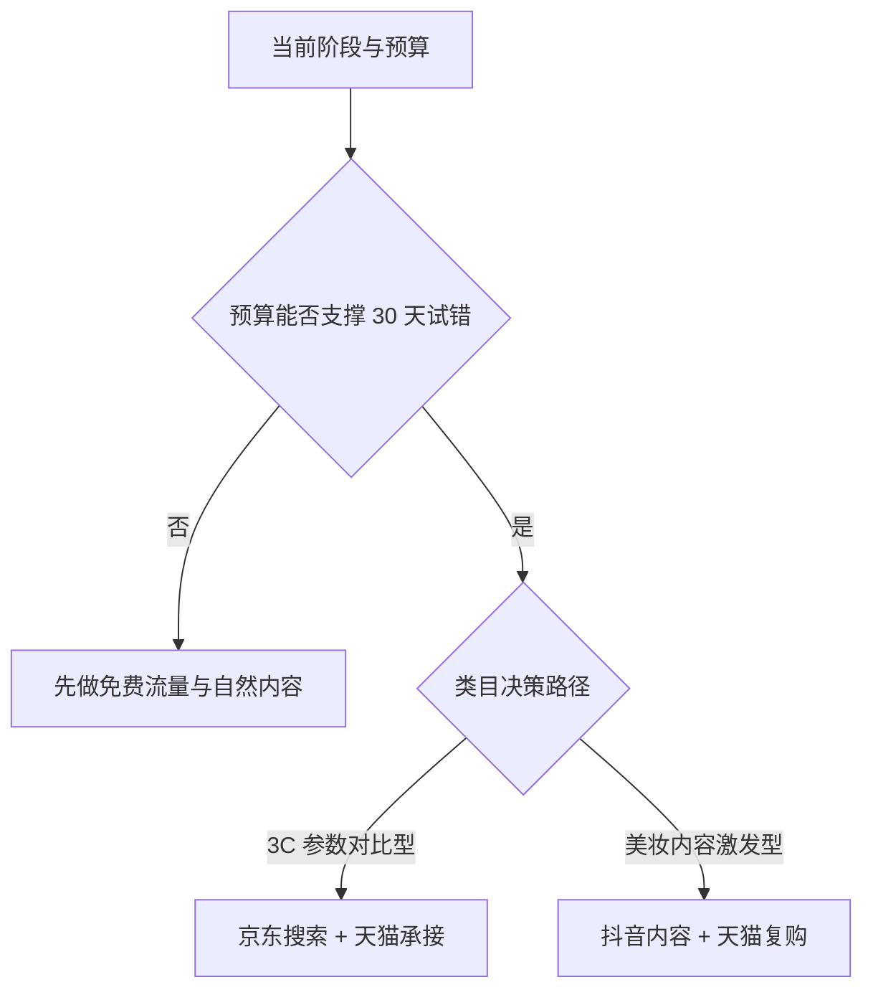

# 04 · 流量获取

> **一句话结论**：（这一栏写全篇最反直觉的那句判断。写不出来，说明这篇还没想清楚。）

## 一、XX 逻辑

（标题写具体名字：选品逻辑、定价逻辑、流量逻辑、转化逻辑、履约逻辑、数据逻辑、风险逻辑。）

不看操作，先看机制。这个模块在各平台分别由什么东西驱动？为什么同样的动作在不同平台收益差十倍？

（三到五行，讲清底层逻辑，不写操作步骤。）

## 二、四平台对比

| | 京东 | 淘宝 | 天猫 | 抖音 |
|---|---|---|---|---|
| 主要入口 | | | | |
| 驱动机制 | | | | |
| 可控程度 | | | | |
| 成本结构 | | | | |

## 三、逐平台细则

### 京东

**适用类目**：
**适用阶段**：
**最低预算**：
**见效周期**：
**核心指标**：
**主要风险**：
**停止条件**：

做法要点：

1.
2.

### 淘宝

（同上七字段）

### 天猫

（同上七字段）

### 抖音

（同上七字段）

## 四、怎么选（决策树）

## 五、避坑

| 坑 | 表现 | 为什么会踩 | 怎么绕开 |
|---|---|---|---|
| | | | |

## 六、规则怎么核实

平台不会公开全部细节，但每条模糊规则都能用对照实验验出来。

| 疑问 | 为什么重要 | 怎么自己验证 |
|---|---|---|
| | | |
| | | |

**验证的通用做法**：一次只改一个变量。同时改多个，结果出来了也分不清是哪个起的作用。
